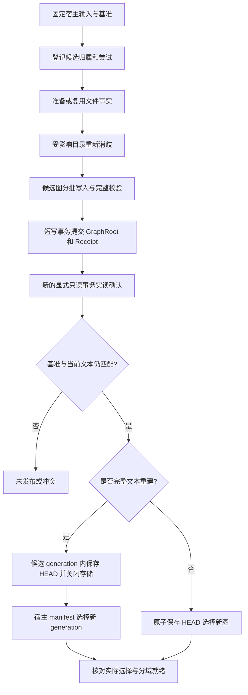

# G2 实施计划：graphdb 接入、图构建与联合发布

历史运行记录已迁入[归档索引](archive/pre-g4-validation/README.md)；文中的旧 reports 路径指归档内位置，机器记录链接的标题保留原始路径。

日期：2026-10-23；进度更新：2026-10-28。**G2 已带遗留项收尾**，当前结论见 [G2 总验收](G2_ACCEPTANCE_REPORT.md)。固定身份 Resume、保留清理和 L1 成本测量已交付；原生故障窗口、候选重建成本及代码域覆盖限制仍需跟踪。尚无公开图查询；原生验证使用 [ANN 修复制品](ANN_READONLY_DIGEST_DRIFT.md)。

后续按 [G3 计划 2.4—2.5](G3_IMPLEMENTATION_PLAN.md#24-交接改动) 交接业务模型、TextMap、覆盖和按需读取。本轮先细化契约、修正覆盖判定并分析构建耗时，不做性能重构。2026-10-27 的[模块收敛报告](MODULE_CONSOLIDATION_REPORT.md)保留当时问题，后续修复以总验收及交接记录为准。

本计划承接 [G0–G4 查询增强说明](QUERY_ENHANCEMENT.md) 和 [G0/G1 验收记录](QUERY_ENHANCEMENT_REPORT.md)。G2 为 zg 建立真实图存储、构建、维护与发布闭环；代码和文档分别推进。独立 KnowledgeBase SDK 的完整迁移仍然后置。

## 1. 实施结论与范围

首版采用 **文件事实增量维护，重新解析受影响目录的引用，构建独立图候选，确认后切换选择指针**。正文和向量继续使用宿主现有存储，不增加 KG collection，不重复 Embedding，不额外保存整份历史源文件。

每次图更新先重建一份图数据库候选，不直接修改当前已发布图。这样可以把 DDL、部分写入和图规则变更隔离在候选中，也便于保留旧读者和核对失败结果。代价是重复写入图元数据、构建期间同时占用新旧图空间。G2 必须测量此代价；图内原地增量修改不是本阶段的完成条件。

| 纳入 G2 | 不做或后置 |
| --- | --- |
| 上游 binding 实际接入和原生共存验证 | 本仓库自建 FFI、替代生产数据库、Python 子进程 |
| 索引流水线同次提取事实，绑定实际 EntityId | 第二次独立扫描后按实体序号猜测绑定 |
| 图独立格式、候选、事务回执、选择指针 | 通用来源/声明/更正服务及 Python 全量迁移矩阵 |
| 全量构建、文件更新/删除/排除、graph-only 重建 | 图原地补丁、Arrow/bulk 性能优化 |
| 失效栅栏、租约、取消、重开核对、只读检查 | 公开 relations、搜索扩展、CLI/MCP，留 G3 |
| 内部构建选项、覆盖与就绪诊断、可运行示例 | G4 查询增益结论、LLM 抽取、代码文档关联 |

图默认关闭。Rust/Python 和 Markdown 沿用 G1 的支持边界；其他语言、动态调用、不完整解析、歧义和不支持目标继续可诊断，不生成猜测的唯一关系。不增加 Windows 支持工作。

## 2. 当前基线与尚未通过的检查

下表保留计划制定时的接入基线，并标明本轮 G2.0 更新；不能解释为整个 G2 已完成。

| 项目 | 已确认状态 | 对实施的影响 |
| --- | --- | --- |
| 上游依赖 | `rust/thirdparty/graphdb` gitlink 为 `3bf0d532ce928c02782c76d42cc289b1e49e8df4` | 以此提交的 API 为准，不混用独立 graphdb 工作区的新版本 |
| 构建接线 | workspace 已登记 path dependency；`zg-knowledge/graphdb` 为可选 feature | 该相对路径由仓库 gitlink 固定，不以开发者机器的绝对路径为发布前提 |
| 库编译 | `cargo check -p zg-knowledge --features graphdb` 已通过 | 只证明库编译，不证明测试编译、发布或恢复 |
| 上游实际测试 | 所选提交的 query、persistence、ownership 共 28 项通过 | 不替代宿主 zvec 共存、图业务和故障测试 |
| 宿主接入测试 | 原 6 项存在 8 处编译错误；G2.0 已修复并扩为 13 项，另有 5 项 Schema 探针，全部实际通过 | 基础接入与真实共存已验证；生产适配、发布与恢复不计为完成 |
| 具体 API 差异 | `execute` 返回 `ExecutionSummary`；该版本没有 `Database::close()` | 测试需消费 summary；连接关闭并释放所有数据库拥有者后再验证重开 |
| 本地原生依赖 | 原工作区绝对软链保留；G2.0 用官方工具导出无软链、逐文件摘要核验的独立源码包并重新构建，宿主再次通过 | 源码包路线已验证；尚未执行全新递归 Git 检出，不把缓存构建等同干净检出 |
| 宿主发布 | 完整重建通过 manifest 切换 generation；普通更新原地修改当前文本存储 | 同一 generation 不能证明文本和图同步，必须增加写前失效与来源复核 |
| G1 入口 | `inspect_sources` 保留 G1 默认分段检查；G2.1 另有同次绑定检查与内部 indexing 接线 | G2.1 已增加实际流水线内部暂存位，复用本次字节、配置及实际 EntityId；公开图选项与构建编排留 G2.2 |

计划制定时的“共存”只打开 graphdb；G2.0 已补齐双库真实写入、向量/全文查询、图引用回取及关闭重开。隔离源码包上游 28 项、宿主 graphdb feature 全 targets 50 项、默认 feature 32 项通过，Clippy/格式检查通过。持久化日志、原生身份和文件摘要已写入 [验收记录](G2_0_ACCEPTANCE_REPORT.md)；G2.0 当时未覆盖真实未知提交、运行中取消/宿主期限桥接、进程终止与 SDK 回执核对；后续覆盖进度与仍未验证窗口见第 7 节和各份 G2.2 验收，不以既有纯规则测试替代。

## 3. 职责、feature 与内部接口

| 模块 | G2 职责 |
| --- | --- |
| `zg-engine` | 输入读取/解码、同次宿主解析、Entity/Fragment、Embedding、文本写入、文件目录、manifest、工作区锁、任务与查询编排；非可选的图策略、栅栏、选择指针与候选诊断协议 |
| `zg-knowledge::relations` | 自有事实、身份和解析规则、状态及依赖；不接收 AST，不持有宿主 zvec 写连接 |
| `zg-knowledge` 的 graphdb 适配 | 具体数据库会话、参数化 DDL/查询、事实与结果转换、图候选、事务回执及错误映射 |
| `zg-storage` | 已有哈希、原子文件保存等基础工具；不成为第二套工作区管理器 |
| 上游 graphdb | 原生构建/链接、句柄、参数与结果、读写事务、原生错误 |

保留 `zg-engine/knowledge-graph` 作为不依赖图数据库的候选检查能力；新增默认关闭的 `knowledge-graph-graphdb`，启用前者及 `zg-knowledge/graphdb`。默认 zg 构建不加载 graphdb，不增加其原生构建要求。`STATE`、`POLICY`、`HEAD` 的轻量读写、目录归属和候选诊断由 engine 非可选模块维护，仅使用已有 `zg-storage` 文件持久化工具；不借此把 `zg-knowledge` 改为默认依赖。关闭图 feature 的二进制仍能撤销旧图资格，处理显式 Off，并保护待核对候选。

适配优先使用具体 `GraphDbStore` 与独占连接会话，提供内部 `with_read` / `with_write` 操作边界。现有未使用的通用 `GraphStore` 端口应调整或移除，避免另建通用 Value/Rows 编解码和 GAT 后端框架。对外仍传递项目自有事实和结果；原生句柄不泄漏至公共 API。

事务在同一个有界 blocking 任务内创建、使用、提交/回滚和释放。上游事务独占借用可变连接且非 Send，不跨 await，不添加未经验证的 Send/Sync。数据库实例由路径所有者统一管理，连接按操作独占；同路径不为每次读请求另行 `Database::open`。

### 3.1 最小构建接口

G2 允许 in-process 构建入口接收 `off | code | documents | both`、源码根映射及图规则配置，用于接通真正的 indexing 和测试。内部增加独立 `graph_only` 构建操作；不要求用户重建文本索引才能首次启用图。

这是将构建参数提前接入 G2，G3 才稳定其公共 API、CLI/MCP 和查询选项。显式请求真实图但未编译相应 feature 时返回不支持，不静默降为候选检查成功。

首版图为可选增强：图失败可以保留已经成功的文本更新，但返回图未就绪及原因。取消不能被“可选”策略吞掉：选择前取消返回 cancelled，选择后按实际发布结果返回并附取消到达较晚的诊断，不能报告为未生效。`text_published`、`graph_candidate_committed`、`graph_selected`、分域 `graph_ready` 分别表达，不把普通搜索的可用状态当作图可用状态，也不承诺 G2 已提供公开关系查询。

#### 3.1.1 候选生命周期状态机

第 6 节流程图隐含的状态机显式化如下。八个推进态对应流程图的八个处理节点；注意第 6 节的文字步骤 6（发布锁复核）与步骤 7（保存 HEAD/manifest）合并为同一个 `Selected` 态，步骤 8（报告）不是状态而是对外映射：

| 状态 | 进入条件 | 对应失败态 |
| --- | --- | --- |
| `Registered` | `build.json` 已落盘，输入与基准已固定 | — |
| `FactsReady` | 同次提取的事实已准备或从已选图复用 | `Failed(facts)` |
| `Disambiguated` | 受影响目录已重新消歧，目录修订已定 | `Failed(resolve)` |
| `Imported` | 全部参数化批次写入成功 | `Failed(batch)` |
| `Validated` | 来源资格、实体映射、位置、解析状态、目录成员与版本全部校验通过 | `Failed(validate)` |
| `RootCommitted` | 短 Update 事务内提交 GraphRoot 与成功 Receipt | `Failed(commit)` 或 **`Unknown`** |
| `Confirmed` | 新连接会话的显式 READ ONLY 事务实读确认根、回执、计数与摘要 | `Failed(confirm)` 或 **`Unknown`** |
| `Selected` | 发布锁下基准复核通过，HEAD 或 manifest 已指向该候选 | 已确认未选中时为 `Failed(select)`；选择结果不能判定时为 **`Unknown(select)`** |

`Selected` 表示已确认选择，`Failed(stage)` 表示已知阶段失败，`Cancelled` 表示已确认未选中且停止推进，`Discarded` 仅表示安全条件满足后已实际完成清理。`Unknown(stage)` 是受保护的待核对状态，不是取消或可清理的终止态；适用阶段包括 commit、confirm 和 select。

推进阶段与效果判定分别记录：阶段失败或取消不能抹掉已经确认的提交效果。错误结果保留候选提交与宿主选择各自的 `committed | not_applied | unknown`、`selected | not_selected | unknown` 判定，以及 `cancellation_requested`。未能判定时不能用 bool=false 代替 unknown。阶段和错误码进入宿主尝试诊断，不改写图内成功回执（见 4.1.1、4.3.1）。

对外报告字段的精确语义（下表为 **Rust 侧结构体字段**，用 snake_case；它们与 4.1.1 的 JSON 文件字段分属两层，后者沿用宿主 manifest 的 camelCase 惯例，两者不得混用）：

| 字段 | 类型 | 为真/取值条件 |
| --- | --- | --- |
| `text_published` | bool | 宿主 manifest（全量）或文本存储 + manifest（增量）已发布；**与三个图字段完全正交** |
| `graph_candidate_committed` | bool | 已确认匹配的 GraphRoot 与成功 Receipt 存在；后续确认失败或取消不撤销此事实，**不代表已被宿主选中**；未知结果走错误判定，不伪装为 false |
| `graph_selected` | bool | 已确认 HEAD/manifest 实际指向该候选；选择结果未知时返回待核对错误，不伪装为 false |
| `graph_ready`（分域） | enum | `ready` \| `not_ready(reason)` \| `unsupported` \| `stale`；仅当 `Selected` 且该域校验通过且来源仍匹配 |

三条必须测试的不变量：

1. `graph_candidate_committed=true && graph_selected=false` 是**合法状态**，对应 7.3 表格第二行（候选已提交、未发布）。
2. `graph_selected=true && graph_ready=stale` 也合法：HEAD 绑定的 `textRevision` 已落后于 `STATE.textRevision`。
3. 蕴涵链 `graph_ready=ready ⇒ graph_selected ⇒ graph_candidate_committed` 单向成立，逆向均不成立。

取消与错误码映射（沿用现有 `EngineError` 构造器，不新增错误类）：

| 场景 | 错误码 / 报告方式 |
| --- | --- |
| 已确认未选中、无未知效果时取消 | `cancelled`，停止推进并转 `Cancelled`；已提交候选保留成功回执，清理满足 7.4 后才转 `Discarded` |
| 提交/确认/选择正在执行或结果未知时收到取消 | 请求原生取消并等待实际结果；仍不能判定则保持 `Unknown(stage)` 与 recovery_required，禁止转 `Discarded` |
| `Selected` 之后取消到达 | **不报错**，按实际发布结果返回 `graph_selected=true` 并附“取消到达较晚”诊断 |
| 显式启用真实图但后端 feature 未编译 | `unsupported`；显式 Off 只需轻量策略能力 |
| 图写入/校验失败（降级发布） | 文本实际已成功发布时可不报错，返回 `text_published=true` 与图诊断；graph-only 失败不伪造文本发布，仍可保留经核验有效的旧图 |
| `Unknown` 提交结果 | `storage_failure`，带 recovery_required 标记，隔离候选实例 |
| 期限/预算耗尽 | `deadline_exceeded` / `invalid_argument`，沿用 `graph_facts::map_error` 已有映射 |
| 基准竞争冲突 | `resource_busy`；**绝不按完成先后覆盖** |

#### 3.1.2 graph_only 触发矩阵

保留 `index(IndexOptions)` 一个公开构建入口，在其内部增加模型无关的计划阶段；不以执行完正常索引后“没有 Embedding 调用”冒充 graph-only。

当前 `WorkspaceIndexService::index` 在扫描前执行 `acquire_index_models`，其中还会检查远程模型授权。因此正式接入必须按以下顺序重构，不能仅在现有流水线末尾判断 `textRevision`：

1. 持有既有工作区写入准入，读取 manifest/已保存索引描述，解析 3.1.3 的有效图策略，检查 feature 与参数。预检查不获取模型运行时、不检查远程模型授权、不下载模型。
2. 使用已有扫描/选择机制核对实际文件目录、pending 状态和文本相关配置。内容比较使用受现有预算控制的不可变输入；来源摘要和实体映射按 5.2 核验，不能仅凭 changes、mtime 或“尚未推进修订”认定无变化。需要正常索引时把可复用输入交给原流水线，来源变化重新核对，避免第二次读取后混用版本。
3. 仅使用已保存索引描述确定是否存在文本格式、分段、模型描述或选择规则变化。描述缺失或不能证明兼容时，不能进入 graph-only，也不能静默加载模型来完成所谓零模型路径；返回明确的需正常索引/重建状态。
4. 生成内部执行模式，再分别进入文本路径或 graph-only/reuse 路径。只有文本路径才获取模型、执行其授权并调用 Embedding；graph-only 只打开现有文本存储的只读会话，不修改文本存储或文本 manifest。

下表中的 scope 指按 3.1.3 解析后的有效策略，不把请求 `None` 当作显式 Off：

| 文本条件 | 有效图策略/现有图 | 行为 |
| --- | --- | --- |
| 首次文本建库、显式 rebuild，或需正常索引/重建的文本配置变化 | Off | 原有文本路径；不建图 |
| 首次文本建库、显式 rebuild，或需正常索引/重建的文本配置变化 | Code/Documents/Both | 正常文本路径；全量时在同一候选 generation 内联合构建，增量时更新文本后构建图候选 |
| 已有文本索引，实际文件有变化/删除/失败重试 | Off | 纯文本增量，按 5.1 失效旧图 |
| 已有文本索引，实际文件有变化/删除/失败重试 | Code/Documents/Both | 文本增量后图候选重建与 HEAD 切换 |
| 已证明文本及文本相关配置无变化 | 开启，且图、规则、配置、绑定与来源全部有效一致 | `unchanged`；不加载模型、不重写文本、不新建图候选 |
| 已证明文本及文本相关配置无变化 | 开启，但首次启用、图缺失/失效或图规则/Schema/模块根改变 | graph-only；不加载模型、不 Embedding、不动文本存储，只构建并选择图 |
| 已证明文本及文本相关配置无变化 | Off | 不构建图；普通文本索引仍遵循既有模型/授权语义，显式 Off 额外保存关闭策略并撤销图选择 |

零模型分流只用于已证明的 graph-only 或有效图复用，不改变图关闭时普通 `index` 的既有模型与授权行为。若有效策略开启但当前二进制没有图后端，显式启用按能力检查拒绝；None 继承时只执行原有文本路径及轻量栅栏，并报告图不可用。

这保留“首次启用图不要求重建文本索引”，也明确了纯图重建失败或来源无法复取时的未就绪结果；不会为了完成图任务绕过文本模型的既有授权。

#### 3.1.3 图策略、daemon 合并与协议

图策略属于工作区的持久化意图，由 engine 的 `POLICY.json` 保存，和 HEAD 选择的已构建效果分开。只有 POLICY 是后续任务的有效配置来源；build.json 与 GraphRoot 保存不可变的构建输入副本，用来判断该产物是否仍匹配策略，不是另一份可独立更新的策略。

| 请求值 | 语义 |
| --- | --- |
| `graph=None` | 沿用工作区已保存策略；没有策略时为 Off，不清除排队任务的显式设置 |
| `Some(scope=Off)` | 先保存关闭策略使旧图失去资格，再持久化撤销当前 HEAD；旧图仅在选择已撤销且租约释放后清理，结果未知时保留待核对 |
| `Some(Code/Documents/Both, ...)` | 校验后完整替换期望策略；省略字段不做隐含合并 |

策略在任务真正执行、获得写入准入并完成参数/能力校验后持久化；排队未执行和准入前取消不改策略。图构建失败不撤销已保存意图，以便后续 watch/重试仍可维护图；旧图是否可用独立核验当前策略指纹。POLICY 写入结果不确定时先实读核对，不继续按猜测策略写文本或选择图。首次文本建库的策略按工作区逻辑归属保存，位置见 4.1；不随失败候选清理丢失。

`IndexOptions.graph` 使用可序列化、无原生依赖的 engine 配置类型，并带 `#[serde(default, skip_serializing_if = "Option::is_none")]`。None 不增加传输字段，保持不设置图选项的旧请求形状；它不保证旧 daemon 能识别 Some。显式设置先检查 daemon 协议与轻量策略能力，启用 Code/Documents/Both 另检查真实 graphdb feature；Off 不要求原生图后端。旧 daemon 无对应能力时返回不支持，不通过删字段伪装成功。未编译图 feature 的新版 engine 对显式启用返回不支持；对 None 继承已有开启策略时仍允许普通文本更新并执行栅栏，返回图能力不可用诊断，不加载可选组件。

必须调整并测试以下宿主路径，而非只改 `complete_job`：

- `job_scheduler::merge_options`：None 保留已有显式图设置；相同显式策略可合并；不同显式策略（含 Off）排为后续串行任务，不静默覆盖任一请求。合并后的配置与实际返回任务必须对应。
- `WorkspaceRuntime::index_template` 与 watcher：模板使用 None，在任务执行时读取最新 POLICY；不反复重放旧显式策略。daemon 重启同样从 POLICY 恢复意图，不以纯内存模板为唯一来源。
- 协议能力/版本检查：区分轻量图策略支持和真实图后端支持；更新序列化往返和新旧端组合测试。取消、进度和 `Proof { revision, full_epoch }` 继续使用现有通道和 fencing。

### 3.2 模块映射

首版要求显式配置源码根、语言、namespace 和模块前缀，并记录指纹。Rust 的 lib/bin/不同 crate 使用不同 namespace；按配置根映射普通文件、`mod.rs` 及入口文件。Python 按配置包根处理普通模块、`__init__.py` 和 `src` 布局。重叠根必须有唯一选择，否则诊断并拒绝生成该文件的唯一解析关系。

不在本阶段自动推导全部 Cargo/Python 工程布局。Rust `#[path]`、宏/cfg、复杂重导出及不支持的布局保留诊断。测试固定配置根，不能把单个工作区目录默认当成所有模块的统一 namespace。

#### 3.2.1 配置格式与校验规则

G2 构建配置类型归 engine，不依赖 `zg-knowledge` 或 graphdb；需要被 in-process 调用方构造并被 daemon 序列化。G3 再稳定其公共兼容承诺，G2 先随传输协议版本管理，挂在 `IndexOptions.graph` 下：

```rust
pub enum GraphScope { Off, Code, Documents, Both }

pub enum PackageLayout { Flat, Src, ModRs }

pub enum GraphLanguage { Rust, Python } // engine 自有传输类型

pub struct GraphModuleRoot {
    pub root: PathBuf,               // 相对工作区根，规范化正斜线
    pub language: GraphLanguage,     // Rust | Python（Markdown 无模块）
    pub namespace: String,           // 全局唯一、非空
    pub module_prefix: Vec<String>,  // 模块路径前缀，可为空
    pub layout: PackageLayout,       // Rust: Flat|ModRs；Python: Flat|Src
}

pub struct GraphOptions {
    pub scope: GraphScope,
    pub module_roots: Vec<GraphModuleRoot>,
    pub rules: Option<GraphRules>,   // 解析规则版本与开关
}
```

校验规则（一律拒绝而非猜测）：

| 规则 | 违反时行为 |
| --- | --- |
| `namespace` 全局唯一且非空 | `invalid_argument`，不开始构建 |
| `root` 在工作区内、规范化后不含 `..` | `invalid_argument` |
| 重叠根必须唯一选择 | 取最长前缀匹配。等长并列在结构上不可达：`new()` 拒绝重复 root，而两个不同的等长 root 不可能同时是同一规范化路径的组件级前缀（首个相异组件即分叉），故最长匹配恒唯一，不需要运行时 `ambiguous_module_root` 分支；嵌套 root 由最长前缀消解 |
| `language` 与文件实际语言不符 | 保留宿主实际语言与普通检索，诊断 `module_language_mismatch`，该文件不生成唯一代码关系；不能用配置重新解释语法树 |
| Markdown 配了 module root | `invalid_argument`（`graph_facts` 已有 “Markdown has no code module” 检查，保持一致） |
| `scope` 为 `Code`/`Both` 但 `module_roots` 为空 | 代码域返回 `not_ready(no_module_roots)`，文档域仍可正常构建 |

配置、语言和规则传输类型均由 engine 定义；只有启用图后端的桥接代码才转换为 `zg-knowledge::relations` 类型，默认构建可完成配置反序列化和栅栏处理。

指纹：`moduleRootsFingerprint = sha256(canonical_json(sorted(module_roots)))`，排序键为 `(root, language, namespace)`。canonical JSON 必须固定字段顺序与数组顺序，否则指纹不稳定会使 graph-only 重建误判为配置变化。期望配置由 POLICY 管理，build.json 保存其不可变输入副本；HEAD 只引用指纹。

### 3.3 主要代码改动入口

| 现有位置 | 计划调整 |
| --- | --- |
| [extraction/code.rs](../rust/crates/zg-engine/src/extraction/code.rs)、[extraction/mod.rs](../rust/crates/zg-engine/src/extraction/mod.rs) | 给实际提取路径增加可选事实收集，传递真实分段设置；复用 AST 和缓冲 |
| [graph_facts/mod.rs](../rust/crates/zg-engine/src/graph_facts/mod.rs) | 保留 G1 检查入口，增加正式绑定桥接和模块映射 |
| [indexing/pipeline.rs](../rust/crates/zg-engine/src/pipelines/indexing/pipeline.rs) | PreparedFile、成功文件事实、真实变更/删除/失败结果及栅栏写入时序 |
| [indexing/service.rs](../rust/crates/zg-engine/src/pipelines/indexing/service.rs) | 模型获取前的计划分流、构建编排、关闭/退还写句柄后发布、取消效果核对 |
| [workspace/build.rs](../rust/crates/zg-engine/src/workspace/build.rs)、[manifest.rs](../rust/crates/zg-engine/src/workspace/manifest.rs) | 保持宿主选择点；接入图候选归属、租约及恢复清理，兼容两种 storage_home |
| [storage/store/mod.rs](../rust/crates/zg-engine/src/storage/store/mod.rs)、[read_session.rs](../rust/crates/zg-engine/src/storage/read_session.rs) | 文件状态/实体摘要核验、读会话租约和原生句柄所有权 |
| [zg-knowledge/src/graph/](../rust/crates/zg-knowledge/src/graph/)、[relations](../rust/crates/zg-knowledge/src/relations/) | 具体图适配及版本化事实持久化；保留领域解析规则和诊断。G2.1 已将旧 `graph.rs` 拆为适配、Schema、编码与测试模块，移除通用端口；具体 `GraphDbStore` 使用内部 `with_read` / `with_write` 边界 |

新增 engine 非可选的 `storage/graph_state.rs` 管理 STATE、HEAD 轻量格式和候选诊断，`workspace/graph_policy.rs` 管理工作区策略；graphdb 会话、图内回执和候选导入仍位于可选的 `zg-knowledge::graph`。新文件按现有模块拆分存放；不另建独立图守护进程或重复工作区管理层。原生依赖与探针只修改宿主接入，不在本阶段修改上游 binding。

## 4. 格式、身份与事实持久化

### 4.1 宿主存储内的独立图产物

在实际 `storage_home()` 内保存图侧文件。正式服务沿用当前 `generations/<id>` 布局；当前格式的已发布 enabled manifest 必须有 `storageGeneration`。缺失该字段的旧布局按既有 `rebuild_required` 拒绝，不在模型前预检查中迁移，不放宽 `validate_published`。存储工具或未发布草稿可使用根路径，不等于正式服务接受旧 manifest。

```text
<workspace_home>/graph/POLICY.json  # engine 拥有的期望策略，跨 generation
<storage_home>/
  storage/                       # 现有文本与向量，不改变其归属
  graph/
    STATE.json                   # 宿主维护的文本修改栅栏
    HEAD.json                    # 当前图选择；不是业务提交回执
    builds/<graph_build_id>/
      build.json                 # 创建前落盘的归属、固定输入与尝试描述
      attempt.json               # 宿主尝试诊断/待核对标记，不是成功回执
      db/                        # graphdb TP 数据库
```

POLICY 保存期望策略；图配置随 build.json 及数据库根记录保存不可变的规范化输入和指纹，HEAD 只引用版本与摘要。已保存策略和已生效产物可以暂时不同，差异使图失效或等待构建，不自动宣称发布成功。尝试诊断沿用宿主任务/候选归属，不建立平行的全局任务中心或第二份成功账本。

图格式自行版本化；本次不通过给 `deny_unknown_fields` 的宿主 manifest 随意加字段实现可选能力，也不因增加图旁路文件直接提升全局文本格式版本。未来真正修改宿主格式时仍遵循既有 `rebuild_required`，不在打开时隐式升级。未知图格式只使图不可用，不破坏可读的文本索引。

必须分别表达：文本物理 generation、文本修改修订、图构建 ID、图发布 ID、operation/attempt ID、来源原始/解码摘要、图 Schema/抽取/解析/配置指纹。文本修改修订每次实际变更推进，A→B→A 也不是同一次状态；不可用 mtime 代替来源版本。

`build.json` 在创建数据库和候选文件前持久化，用于归属和恢复定位，不证明提交成功。成功回执只存于图数据库；HEAD 是被选中产物的指针。

#### 4.1.1 旁路文件与候选诊断字段

轻量文件均由 engine 使用 `zg-storage` 的原子写入（临时文件 + rename + 目录 fsync），各自带独立 `formatVersion`，读取时先比版本再解码。未知格式使图不可用；若不能可靠保存写前栅栏则停止对应文本修改，不能强行覆盖未知格式。外层元数据使用 camelCase；`configuration` 内采用 engine 自有 `GraphOptions` 的传输字段（如 `module_roots`、`module_prefix`），按规范 JSON 计算指纹。HEAD 分域 `ready` 使用带 `state`/`reason` 的枚举，`coverage` 是完成事实绑定的文件数，不是百分比。

`<workspace_home>/graph/POLICY.json` 保存 `formatVersion`、规范化 `configuration`、`policyFingerprint` 和诊断时间。它属于工作区逻辑配置，不放进候选 generation；默认构建可读取与保存 Off，不需要打开图库。未知策略格式不猜测继承或写入。

`STATE.json`（宿主维护，不受 graphdb feature 控制）：

| 字段 | 类型 | 语义 |
| --- | --- | --- |
| `formatVersion` | u32 | 栅栏文件格式，首版 1 |
| `state` | `"stable"` \| `"mutating"` | `mutating` 期间该 storage_home 的图增强不可用 |
| `textRevision` | u64 | 持久化文本修改修订，见 4.1.2 |
| `operationId` | UUID | 推进本次修订的操作；`stable` 时保留最近一次 |
| `attempt` | u64 | 该 operation 内的尝试代次，用于 fencing |
| `catalogDigest` | sha256 | 规范化目录摘要，见 5.2 |
| `updatedEpochMs` | u64 | 本次栅栏写入时间，仅诊断用，不参与有效性判定 |

`HEAD.json`（图选择指针，宿主写入）：

| 字段 | 类型 | 语义 |
| --- | --- | --- |
| `formatVersion` | u32 | 选择指针格式，首版 1 |
| `graphBuildId` | UUID | 被选中的候选，对应 `builds/<id>/` |
| `textRevision` | u64 | 选择时绑定的文本修订；不等于 `STATE.textRevision` 即自动失效 |
| `catalogDigest` | sha256 | 选择时的目录摘要，与 `textRevision` 共同构成基准 |
| `contractVersion` | string | `zg-relations-v1` |
| `schemaFingerprint` | sha256 | 图 Schema 与 DDL 指纹 |
| `policyFingerprint` | sha256 | 本产物使用的期望策略；与当前 POLICY 不一致即图失效 |
| `domains` | map | 分域就绪：`code` / `documents` 各含 `ready`、`reason`、`nodeCount`、`referenceCount`、`coverage` |

`builds/<graph_build_id>/build.json`（候选归属，创建 db 之前落盘）：

| 字段 | 类型 | 语义 |
| --- | --- | --- |
| `formatVersion` | u32 | 归属记录格式，首版 1 |
| `graphBuildId` | UUID | 与目录名一致 |
| `operationId` / `attempt` | UUID / u64 | 固定输入的一部分；相同 operation 换输入即冲突 |
| `baseTextRevision` | u64 | 构建基准修订 |
| `baseCatalogDigest` | sha256 | 构建基准目录摘要 |
| `baseHead` | UUID \| null | 构建时的旧选择，用于确认与竞争检测 |
| `scope` | `"off"` \| `"code"` \| `"documents"` \| `"both"` | 本次构建域 |
| `configuration` / `policyFingerprint` | object / sha256 | 本次构建的完整规范化配置及其指纹，不只保存哈希 |
| `moduleRootsFingerprint` | sha256 | 模块映射配置指纹，见 3.2 |
| `rulesFingerprint` | sha256 | 抽取与解析规则指纹 |
| `schemaFingerprint` | sha256 | 与 HEAD 同名字段同源 |
| `createdEpochMs` | u64 | 仅诊断用 |

`builds/<graph_build_id>/attempt.json` 是宿主诊断记录，保存 operation/attempt、最后阶段、结构化错误码、取消请求及已观察的提交/选择判定。它可记录 `failed`、`unknown`、`commit_pending`、`select_pending`，但不能作为成功或未生效的权威证据。DDL 失败即使没有 Receipt 表也能报告，不向损坏或隔离中的图库追加诊断。

在进入可能产生未知结果的提交和选择之前，先持久化相应 pending 标记；失败则不进入该动作。崩溃后标记仍 pending 时必须核对，不能按普通失败删除候选。动作完成后可刷新观察结果，但成功与否最终以图内不可变成功回执、实际 HEAD/manifest 和来源核验为准；诊断写入失败不能逆转已知效果。

写入顺序分两条路径，不得混淆：

- **文本更新路径**（5.1 栅栏）：`STATE=mutating` → 文本写入与 checkpoint → `STATE=stable`（同时写入新 `textRevision` 与实际 `catalogDigest`）。
- **图构建路径**（第 6 节）：`build.json` → 创建 `db/` 并写图 → 图内提交 GraphRoot 与 Receipt → 只读确认 → 发布锁下复核 `STATE` 仍为 `stable` 且基准匹配 → `HEAD.json`。

关键：`STATE=stable` 是图构建的**前置条件而非最后一步**。第 6 节步骤 6 明确要求“在发布锁下复核当前文本 stable”，因此图候选开始时栅栏必须已经回到 `stable`；图构建期间文本不在变，栅栏保持不变。任一步失败即停在该步，不回写后续文件；`STATE.json` 的 `mutating` 只能在文本写入准入下推进，且必须先于任何改变文本存储的动作落盘。

#### 4.1.2 文本修改修订的定义

`textRevision` 是 **u64 单调递增计数器，持久化在 `STATE.json`**，由 zg-engine 存储层独立维护。

明确**不复用** `zg-daemon/src/workspace_runtime/freshness.rs` 的 `dirty_revision` / `indexed_revision` / `required_epoch` / `reconciled_epoch`，两条理由：

1. 它们是纯内存态（`AtomicU64` 与 `lock()` 保护的 `Freshness` struct），进程退出即丢失，无法承担跨重启的栅栏职责。
2. crate 依赖方向是 `zg-daemon` → `zg-engine`，而栅栏属 engine 存储层；反向依赖会形成循环。

两者语义正交、各自保留：daemon 的 revision/epoch 表达运行时调度新鲜度（watcher 观察到多少变更、已索引到多少、是否做过全量核对），engine 的 `textRevision` 表达存储层持久化栅栏（文本实际被改过多少次）。daemon 侧无需感知 `textRevision`，engine 侧不读 daemon 状态。

推进规则：仅在一次索引任务**实际改变**文本存储时 +1；无实际变化不推进，此时旧 HEAD 若基准仍匹配可继续有效。A→B→A 也推进（比较修订号而非内容），因此不能用 mtime、内容摘要或 generation 代替修订号做等价判断。首次建立基线：从未创建图元数据且无进行中图构建的索引可以不写 `STATE.json`；首次图构建必须在写入准入下建立 `state=stable` 基线并记录当时的 `catalogDigest`。

### 4.2 从同次宿主提取绑定事实

正式路径扩展现有 `PreparedFile`：读取一次来源、使用同一解码缓冲、实际 `ChunkOptions`、同次代码 AST 与实体列表，附带自有候选事实。Markdown 关系解析复用该缓冲，宿主检索分段保持不变。

G1 的 `entity_indices` 保持为检查用类型；在 engine 内生成 `BoundFacts`，把序号映射到该次 `bind_entities` 产生的实际 EntityId，必要时引用其 Fragment。不得把序号直接持久化，也不得第二次调用 `inspect_sources` 后依赖相同序号偶然成立。

只有宿主成功保存为 Indexed 的文件才进入有效事实目录。Embedding、准备或文本写入失败的文件不能保留可扩展的旧图关系；失败和不支持文件仍进入状态目录供诊断。待索引、删除中等中间状态禁止作为有效关系两端。

保存原始和 decoded UTF-8 摘要，位置统一为 decoded `[start,end)`，保留 BOM/CRLF/其他宿主解码的对应语义。证据优先引用 Entity/Fragment；未覆盖范围只在原始与解码摘要都一致后复取原文件。读取失败、缺失或摘要不同即证据不可用，不偷偷绑定新文件内容。

graph-only 重建复用已持久化且指纹一致的事实。解析规则变化需要重新读取时，必须核对它仍对应已索引修订；不一致时要求正常文本更新或报告未就绪，不能把新事实附到旧向量上。此路径不加载模型、不生成 Embedding。

### 4.3 逻辑 Schema 与物理探针

G2.1 通过所选提交上的最小 DDL/访问探针后，提交精确 Schema 说明和建库代码。不得从其他 Kuzu 版本推断图数据库当前支持哪些类型、索引或 DDL。

| 逻辑对象 | 必须保存的内容 |
| --- | --- |
| FileSnapshot | 文件逻辑身份/路径、宿主 FileId、来源版本、资格状态、语言、模块映射、事实完整性和规则指纹 |
| FileFacts 元数据 | 重新消歧必需的 scopes、bindings、imports、diagnostics 等；不保存正文/向量 |
| Node / Reference | 稳定节点 ID、版本关联、类型/限定名/位置/实体映射；引用状态、原因及候选目标 |
| Anchor | 独立锚点 ID、文件、slug 和声明区分信息；重复 slug 可共存并产生歧义 |
| CatalogRevision | domain、language、namespace、目录修订及规范成员摘要，包含配置和选择规则 |
| 关系与依赖 | 包含、目标/候选关联、期望目录修订、目标来源版本；只连接同类图 |
| GraphRoot / Receipt | 构建、输入、基准、Schema/规则/目录指纹、operation/attempt 及已提交结果 |

高频身份/过滤/遍历属性使用 typed 列；结构化低频内容使用有版本的 canonical JSON。列表仅在实际验证支持后使用原生 LIST，否则使用 JSON，禁止分隔符拼接。所有业务值参数化，列/表名来自固定 Schema。

逻辑节点 ID 不包含内容或行号；构建和来源版本关联单独保存。`(file_path, slug)` 不是唯一锚点键。仅关联到可变文件身份不能证明依赖版本正确，必须保存期望版本或不可变目录修订。

沿用 G1 保守消歧：代码按 language + namespace，文档按 Markdown 目录重新计算受影响引用。目录修订检测新增、删除和排除变化，也覆盖此前未找到目标的负解析。用引用到目录修订的关联和目录成员清单表达保守依赖，避免为每个引用复制一整套文件关系造成 R×F 膨胀；精确目标仍带来源版本。

文档目标分类使用完整宿主文件目录，包括已索引但不支持图的语言。Markdown 指向已索引代码文件是 `unsupported_graph_target`，不能因为图目录没有该文件就误报断链。

候选数据库从空库初始化，在空闲连接上完成 DDL，再写业务；不依赖 ALTER/MERGE。图 Schema 变化创建新候选，不重建正文/向量。节点/关系表、主键与访问路径以探针结果定稿，不提前创建通用 Entity/Assertion/Correction 全套表。

#### 4.3.1 候选事实 Schema（G2.1 已细化）

八张事实表的精确类型、可空列、ordinal 与 DDL 已落到 [G2.1 事实格式](G2_1_FACT_SCHEMA.md) 和 [Schema 代码](../rust/crates/zg-knowledge/src/graph/schema.rs)，可复现的 DDL 见 [schema.cypher](archive/pre-g4-validation/README.md#g2-1 "包内：knowledge/reports/g2.1/schema.cypher")。以这三者为事实格式 v1 的依据，不继续维护一份遗漏顺序字段的草案。

G2.0 已验证 UINT64，本轮长度、修订和范围等无符号值据此保存，平台转换显式检查。节点、引用、锚点补充 ordinal；KgFile 支持没有图事实的完整宿主目录成员，并保留实体数/集合摘要。结构化列使用统一版本化 canonical JSON。

额外的 KgFactMetadata 只记录候选事实格式、Schema/配置/选择指纹和完整候选摘要，随全部事实原子写入。它不是第九张事实表，也不替代后文的 GraphRoot、Receipt 或宿主选择；后者仍属于 G2.2。

`KgFile` 的宿主字段映射 `FileRecord`（`id` / `relative_path` / `snapshot.{size_bytes, content_hash}` / `index_status`）与 `SourceVersion`（`raw_digest` / `decoded_digest`）。`index_status` 取 `FileIndexStatus` 的判别名（`not_indexed` / `indexed` / `deleting` / `failed`），只有 `indexed` 的文件才能作为有效关系两端。`KgAnchor` 用独立 `id` 而非 `(file_path, slug)`，`discriminator` 让重复 slug 共存并保留歧义。

完整 scopes、bindings、diagnostics 按本轮新增的三张 typed 表及作用域关系保存；不再用另一份 facts payload 重复保存它们。`KgReference.scope_ordinal` 保存原始词法作用域索引，Scope/Binding/Diagnostic 的 ordinal 用于准确还原数组顺序。模块、节点、引用、锚点由各自 typed 表与版本化 JSON 列共同还原。`facts_format_version` 与规则指纹守护结构契约；G2.1 候选记录配置指纹，G2.2 补齐完整构建配置与 GraphRoot。基础事实类型可接受调用方显式提供的 legacy generation 标识；正式宿主发布只绑定实际已选 generation，不以该标识绕过 manifest 校验。

**Scope / Binding / Diagnostic 的图内 ID 是合成的**。与 `FactNode.id`、`Reference.id` 不同（前者按路径/限定名等逻辑身份生成且不包含正文或行号，后者绑定来源版本与引用范围），`Scope` / `Binding` / `FactDiagnostic` 在 G1 契约里**没有 id 字段**，它们靠数组下标互相引用（`Scope.parent: Option<usize>`、`Binding.scope: usize`、`Reference.scope: usize`）。因此入图时必须合成：

```text
KgScope.id      = stable_digest(FACT_CONTRACT_VERSION, file_path, "scope", ordinal)
KgBinding.id    = stable_digest(FACT_CONTRACT_VERSION, file_path, "binding", ordinal)
KgDiagnostic.id = stable_digest(FACT_CONTRACT_VERSION, file_path, "diagnostic", ordinal)
```

这使图内 ID 依赖数组顺序的稳定性，而顺序由 `rules_fingerprint` 守护：它已包含 `host-tree-sitter-rules-v1` 与解析器版本（见 [代码规则指纹](../rust/crates/zg-engine/src/graph_facts/code.rs)），因此解析规则或解析器版本一变即触发重新抽取，不会拿旧 ordinal 对新结构。同时保留 `ordinal` / `scope_ordinal` 列，使重建时能校验拓扑约束（`validate_structure` 要求 `Scope.parent < i`）；只承诺同一规则和输入下可还原，不把 ordinal 当作跨修订稳定业务身份。根 Scope 无 parent 边，每个非根 Scope 恰有一条同文件父边；包括根在内的所有 Scope 都保存 owner 关联。Diagnostic 的可选 span 用成对 null 表示缺失，与 `[0,0)` 区分。

`KgBinding` 的三列共同表达 `BindingTarget` 这个 tagged enum：`target_kind` 取 `node` / `import` / `dynamic`；`target_node_id` 仅 `node` 时有值（并额外建 `KgBindNode` 边）；`target_import_path` 仅 `import` 时有值，存模块路径的 canonical JSON（导入目标可能在候选目录之外，不一定是图内节点，故不建边）。`visible_from` 与词法作用域、语言规则和动态绑定一起决定遮蔽行为，必须完整保留。

**三表天然稀疏，且稀疏度与语言强相关**：`collect` 的语言分派（见 [collect](../rust/crates/zg-engine/src/graph_facts/code.rs)）只认 Rust 与 Python，`Language` 枚举也只有 Rust / Python / Markdown 三个变体。因此：Markdown 文件在 `KgScope` 里只有 1 行根 Module scope、在 `KgBinding` 里**零行**；C / C++ / Go / Java / JS / TS 六种语言虽被宿主 `grammar()` 支持用于检索实体提取，但**不产生任何图事实**。`ScopeKind::Block` 仅 Rust 产生，`ScopeKind::Class` 的跳过规则仅对 Python 生效（见 [resolve_name](../rust/crates/zg-knowledge/src/relations/code.rs)），因此任何涉及 `KgScope.kind` 的查询必须带 `language` 过滤，不得跨语言混用，这与 [候选事实契约](QUERY_ENHANCEMENT.md#候选事实契约)“代码与文档分别解析，不跨域匹配同名节点”及本文 G2-A06 属同类约束。

持久化不保存 AST、正文、向量或临时 `entity_indices`。索引内的范围、scope 索引和节点 ID 引用在写入与读回时校验。`entity_ids_digest` 是该文件本次实际索引的全部 EntityId 规范排序后的摘要，供 5.2.1 对引用文件核验；节点/引用的 entity_ids 只保存各自实际绑定集合。

验收必须跨关闭重开还原结构、scope、bindings、lookup、诊断与绑定；再改变另一个文件的目标定义并重新消歧，结果与对同一事实输入完整计算一致。未知 facts 格式不丢字段凑出成功，也不静默退回独立解析来掩盖往返不完整。

边表（遵循 4.3 的 R×F 膨胀约束，依赖经由目录修订中转）：

```cypher
CREATE REL TABLE KgContains(FROM KgFile TO KgNode)
CREATE REL TABLE KgParent(FROM KgNode TO KgNode)
CREATE REL TABLE KgScopeParent(FROM KgScope TO KgScope)
CREATE REL TABLE KgScopeOf(FROM KgScope TO KgNode)
CREATE REL TABLE KgInScope(FROM KgBinding TO KgScope)
CREATE REL TABLE KgBindNode(FROM KgBinding TO KgNode)
CREATE REL TABLE KgRefInScope(FROM KgReference TO KgScope)
CREATE REL TABLE KgDiagOf(FROM KgDiagnostic TO KgFile)
CREATE REL TABLE KgResolved(
  FROM KgReference TO KgNode, expected_target_version STRING)
CREATE REL TABLE KgCandidate(
  FROM KgReference TO KgNode, expected_target_version STRING)
CREATE REL TABLE KgAnchorOf(FROM KgAnchor TO KgNode)
CREATE REL TABLE KgMemberOf(FROM KgFile TO KgCatalogRevision)
CREATE REL TABLE KgExpectRevision(FROM KgReference TO KgCatalogRevision)
```

所有边端点都是节点表，不把关系表作为另一条边的端点。`expected_target_version` 为 canonical JSON，绑定目标路径、宿主 generation、原始/解码摘要、文本修订及实体映射摘要；resolved 和 ambiguous 两类目标都必须保存并核对。若探针确认边属性不可用，改由 `KgReference.target_versions` 的版本化 JSON 映射保存同一信息，Schema 指纹区分该变体；不同时维护两份可变版本真相。

`KgResolved` 仅用于 `status=resolved` 的唯一目标；`KgCandidate` 承载 `ambiguous` 的全部候选，不任取一个。`unresolved` / `external` / `unsupported` / `outside_workspace` 不产生边，其 `reason` 留在 `KgReference` 上。`KgExpectRevision` + `KgMemberOf` 共同表达保守读集（含负解析），避开为每个引用复制整套文件关系。

新增的六条边把原本靠数组下标表达的引用关系转为可遍历的图边，这是“仅消歧规则改变可复用结构并重新解析引用”（5.3）的物理基础：`resolve_name` 的六步算法（定位起始作用域 → 沿 parent 上溯 → 按语言规则决定是否跳过某级 → 筛选 `visible_from <= 引用位置` 的同名绑定 → 按 `BindingTarget` 分派 → 任一环节不确定即降级）可通过完整读回 FileFacts 并调用现有领域 resolver 重跑，无需重读源文件；不在 G2 另写一套 Cypher 名称解析规则。具体对应：`KgRefInScope` 是算法的起点，`KgScopeParent` 是上溯路径，`KgScopeOf` 提供 `Scope.owner`（Rust 的 `self`/`super` 解析需要它取模块 `qualified_name` 作基路径），`KgInScope` + `KgBindNode` 提供名字到目标的映射，`KgDiagOf` 保留“为何无关系”的诚实证据。

注意边数增量：每个 `KgBinding` 至少带来一条 `KgInScope`，`target_kind=node` 的再带一条 `KgBindNode`；每个非根 `KgScope` 带一条 `KgScopeParent`，每个 Scope（包括根）带一条 `KgScopeOf`。边总量由事实分布决定，2–3 倍仅作待测估计，不能作为已验证结论；复杂作用域与绑定主要集中在 Rust/Python 文件上。G2.1 已用 L1 语料实测该增量，记录见 [验收报告](G2_1_ACCEPTANCE_REPORT.md)，不得把单次计时推广为吞吐保证（见 4.3.2 第 10 项）。

图内根与回执（G2.2 图侧子集已实现；第 6 节提交与确认的核心，与 HEAD 分工：回执存图内、HEAD 只存指针）：

```cypher
CREATE NODE TABLE GraphRoot(
  graph_build_id STRING PRIMARY KEY, operation_id STRING, attempt UINT64,
  base_text_revision UINT64, base_catalog_digest STRING, base_head STRING,
  scope STRING, contract_version STRING, schema_fingerprint STRING,
  rules_fingerprint STRING, module_roots_fingerprint STRING,
  configuration STRING, policy_fingerprint STRING, catalog_revisions STRING, facts_digest STRING,
  file_count UINT64, node_count UINT64, reference_count UINT64,
  committed_epoch_ms UINT64)

CREATE NODE TABLE Receipt(
  receipt_id STRING PRIMARY KEY, graph_build_id STRING,
  operation_id STRING, attempt UINT64, outcome STRING,
  stage STRING, detail_code STRING, epoch_ms UINT64)
```

2026-10-26 已实现该图侧提交子集：新候选显式创建这两张表，不升级既有事实候选；无符号字段使用 G2.0 已验证的 UINT64。额外的 `facts_digest` 绑定 KgFactMetadata 中已确认的完整事实摘要，避免只凭计数认定同一份候选。整体 G2.2 尚未完成。

`GraphRoot` 与成功 `Receipt` 在同一个短 Update 事务内提交，绑定 operation/attempt、期望基准与全部输入指纹。`configuration` 是规范化构建配置，`catalog_revisions` 按 domain/language/namespace 的完整目录键保存修订清单，不以单一 domain 覆盖多个代码 namespace。

图内 Receipt **只记录已提交成功事实且不可变**：`outcome=committed`、`stage=commit`，detail_code 为空或固定成功码。DDL/批次/校验失败、确认失败、取消和 unknown 只进入宿主尝试诊断，不要求失败时一定存在 Receipt 表，不向隔离实例补写，也不把已提交成功回执改成 failed/unknown。确认失败后仍保留已知 candidate_committed；健康重开后以匹配的根和成功回执核对。HEAD 不保存回执数组，回执随所属候选生命周期保留。

#### 4.3.2 探针必须回答的问题

每条探针需有明确通过判据，结果写入仓库内验收报告：

1. `STRING PRIMARY KEY` 是否支持；复合主键语法为何；`KgAnchor` 能否用 `(file_path, slug, discriminator)` 做主键。
2. `CREATE REL TABLE` 的完整语法；边端点必须是节点表；探针覆盖 resolved 与 candidate 的目标版本属性、同一对节点的多条同类边，以及无边属性时的版本化 JSON 映射方案。
3. 列声明能否直接写 `STRING[]` 或 STRUCT；若可，参数化能否绑定 LIST/STRUCT 值。不可则定下 canonical JSON 的版本与转义规则。
4. 除主键外是否支持二级索引；不支持时 `file_path` 过滤的访问路径与代价。
5. `MERGE` / `CREATE OR REPLACE` / `ALTER` / `DROP` 实际可用性。计划不依赖它们，但增量路径需确认“先 DELETE 再 CREATE”是否原子可行。
6. **无符号溢出风险**：宿主的 `textRevision` / `size_bytes` / `entity_count` 是 u64，`span_start` / `span_end` 是 usize，`file_id` 是 u32，而 graphdb 只有有符号 `Int64` 与 `UInt64` 两类。探针需确认 `UINT64` 列能否声明与参数化绑定；不可则统一存 `INT64` 并在写入前断言不超 `i64::MAX`，超限归为不可表示错误而非静默截断。
7. 空库完成 DDL 后能否立即写入；DDL 是否确实不遗留事务（`in_transaction()` 为 false）。
8. `import_batches` 与参数化 `CREATE` 的吞吐差异及失败语义（部分写入是否可见），决定全量构建是否改用批量导入。
9. 同进程内 graphdb 与宿主 zvec 真实写读共存；并验证 `Database` 为 `Arc` 共享实例、无 `close()` 方法，关闭等于释放全部 `Database` 克隆与 `Connection`，目录锁才放手。
10. **三表入图的体量实测**（对应 4.3 表格、5.3 结构复用与 G2-A07 的要求）：用 L1 语料按固定筛选捕获的 `.rs` 文件实测（早期 222 为估数，本轮实际数量及逐文件摘要以验收 manifest 为准） `KgScope` / `KgBinding` / `KgDiagnostic` 的行数、新增六条边的边数、图磁盘增量与写入耗时增量，并与其余五表的体量对比。同时验证合成 ID 的稳定性：同一输入连续抽取两次，ordinal 与合成 ID 必须逐字节相同；改变 `ChunkOptions` 不得影响它们（分段属宿主检索侧，不属图结构）。

## 5. 文本更新与图有效性

### 5.1 写前失效栅栏

必须在任何可能改变当前文本存储的动作之前维护 STATE，包括删除、排除、失败替换和最终文件写入。此代码属于宿主轻量协议，不受 graphdb feature 控制。从未创建图元数据且没有进行中图构建的索引可以不创建 STATE；首次图构建须在写入准入下建立稳定基线。只要存在图选择、栅栏或进行中图任务，文本写入就必须执行该协议。

1. 持有现有工作区写入准入，确定本次实际写集合；changes 参数只是提示，使用真实扫描/diff、重试和最终结果。
2. 首次写前原子保存并持久化 `STATE=mutating`，附 operation 和新文本修改修订。不能可靠撤销旧图资格时停止本次文本修改，不能声称普通搜索降级就足够安全。
3. 执行现有文本索引操作；在 mutating 期间，该 storage_home 的图增强不可用。首版采用这一保守行为，不宣称并发原地更新仍有完整旧文本快照。
4. 文本保存和必要 checkpoint 成功、文件中间状态核对完成后，保存 `STATE=stable`、新修订和实际目录摘要。旧 HEAD 绑定旧修订，自动失效。
5. 后续图候选成功并选中后，新图恢复资格。失败、取消或崩溃导致部分文本变更时保留 dirty/mutating；不得恢复旧 HEAD 为 ready。

增量路径在关闭文本写句柄后，先保存 manifest 的本次选择规则/索引描述，再构建和选择图 HEAD；元数据保存失败不能提前选新图。完整重建的 HEAD 仍先准备在未选 generation 内，最终由 manifest 一次选择文本与图。两条路径的实际顺序和故障验收见 [G2.2 宿主记录](G2_2_HOST_PUBLICATION_REPORT.md)。

关闭图功能的新版二进制同样执行栅栏，允许失效旧图而不加载图数据库。没有实际文本变化可以不推进修订；此时可保留仍有效旧图或单独重建图。

STATE 不是文本数据库事务回执，也不能掩盖宿主已有中间状态。可写重开先按宿主规则核对 pending/失败文件，再决定是否建立 stable 基线；只读打开不修复。完成核对不等于图恢复，图仍需重新验证或重建。

### 5.2 不认识栅栏的旧二进制

由于未升级全局文本格式，旧二进制可能修改同一 generation 却不写 STATE。因此 `STATE + HEAD + 图内记录` 相互吻合仍不充分。

图重开/准入时，从实际宿主存储计算规范化目录摘要：包括文件集合、资格状态、来源摘要，以及所引用实体身份/映射的必要摘要；不能只使用缓存文件、mtime 或 generation。将其与 HEAD 和图内根记录核对。G2 的内部读取验证入口还需在返回证据前检查相关来源、目标和目录读集。

依赖宿主已有锁和读会话保障核对窗口；遇到活动写入或无法证明稳定时返回图未就绪。G3 接入公开查询时必须使用此入口，不能绕过它直接读 graphdb。旧二进制修改、部分替换、A→B→A 和同内容不同实体映射都纳入测试。这里核对当前内容一致性，不承诺追溯旧二进制的中间更新历史；实际目录与实体完全等价时允许按当前状态核验，但不把它认作同一次发布操作。

#### 5.2.1 规范化目录摘要的算法与成本

**数据来源必须用 `IndexStore::list_files()`**（返回完整 `FileRecord`）。不能用轻量的 `list_file_attributes()`：`StoredFileAttributes` 的定义注释写明“without content hashes or index status”，只有 `id` / `relative_path` / `modified_epoch_ms`，缺资格状态与来源摘要两项必需输入。`list_file_paths()` 同样不够。

算法固定为单一函数，`STATE.json` 的 `catalogDigest` 写入与本节的不信任重算必须共用它，否则比对无意义：

1. `list_files()` 取全部 `FileRecord`。
2. 按规范路径编码的字节序排序，不依赖目录遍历顺序；同平台编码规则固定版本。
3. 逐项流式喂入 sha256：`path`、`file_id`、`index_status` 判别名、`content_hash`、`size_bytes`。编码固定版本，变长字段带字节长度，数字使用固定编码，Option 使用存在性标签区分 None 与空值，禁止无边界拼接；非 UTF-8 路径使用带类型标签的宿主原生字节编码，保持目录摘要完整，同时对不支持的图路径逐文件诊断。
4. 不构造中间大字符串，避免峰值内存翻倍；输出 64 位十六进制。

成本为排序 O(F log F)、摘要扫描 O(F) 时间及 O(F) 记录内存（F = 文件数）。只在图准入与重开核对时完整计算；缓存只在可证明宿主租约/写者驱逐协议连续有效且 POLICY、STATE、HEAD 与相应来源未变时复用，不能在无法证明写入历史时无限复用缓存。G2.4 测量 1k / 10k / 100k 文件规模下的耗时与峰值 RSS。

完整目录与所引用文件的实体映射核验是图获得资格的正确性门，不因性能阈值超限改成抽样、仅校验旧成员或只相信增量账本。请求期限内不能完成时返回 `not_ready(validation_pending)` 或期限诊断，保留普通搜索；后续有界核验完成且来源仍稳定后才恢复图资格。未来采用新格式/写者协议来可靠检测全部写入需单独论证，不能把未升级的旧二进制视为已遵守。

**实体映射摘要的缺口**：`EntityId = 8hex(file_id) + 24hex(sha256(content, source_range))`，其中 `source_range` 不在 `FileRecord` 内。因此文件内容未变但分段配置（`ChunkOptions`）改变时，`content_hash` 不变而 EntityId 变，上述目录摘要检测不到，而这正是 4.2 要求“长文分段改变不误绑定”的场景。

补法：图内 `KgFile.entity_ids_digest` 保存绑定时该文件全部实际 EntityId 的规范摘要；重开核对时**只对图引用到的文件**从宿主存储读取实际 EntityId 比对，不全工作区枚举，把 O(E) 缩小到 O(E_referenced)。两类摘要分开报告，任一失配即图未就绪，不尝试部分修复。

### 5.3 图增量处理

| 输入变化 | G2 行为 |
| --- | --- |
| 来源、事实和配置均未变化且图资格有效 | 复用当前图；返回 unchanged |
| 文件正文改变 | 同次索引产生新事实，旧版本立即失效；重算受影响目录引用，构建新图 |
| 文件删除/排除/准备或索引失败 | 从有效目录移除，保存诊断，重算依赖；不可继续扩展旧关系 |
| 目标新增/删除、模块或锚点改变 | 推进目录修订，包含负解析在内重新消歧 |
| 仅解析/图 Schema/模块根配置改变 | graph-only 重建；必要时核对来源后重新解析，不重新 Embedding |
| 图关闭期间文本发生更新 | 旧图失效；再次启用时从当前有效文本建立图，不能直接恢复旧 HEAD |
| 仅 Embedding 配置改变 | 以宿主产生的实际文本/实体版本为准复核映射，不因向量空间本身重新做知识抽取 |

未变文件从已选图读取可复用事实元数据，不重复保存在额外事实缓存中。复用结构须核对来源、抽取和模块配置指纹；来源版本、generation 和实体映射始终绑定当前宿主结果，不能沿用旧实体序号或旧 generation 的绑定。对于未变内容，结构抽取指纹改变时重新抽取；仅消歧规则改变可复用结构并重新解析引用。没有旧图时首次构建会核对并读取已有索引对应来源。图文件更新的“增量”指复用和重算范围；物理上仍完整生成新图数据库。

## 6. 候选构建、确认与选择



1. 复用宿主写任务、工作区锁与有界执行资源。固定来源目录、文本修改修订、旧 HEAD、规则/Schema/配置和 operation 输入；保存 build.json 后才创建候选。
2. 候选准备和数据批次不占用最终发布事务。按参数化批次写图，核对执行结果及必要计数/成员清单；部分成功只能修复当前候选，不能污染已选图。

   已实现：新候选显式增加独立版本的 `KgImportProgress` 单行进度表，不在打开时向旧候选加表。批次按事实行数和序列化参数字节双重切分，默认 256 行 / 256 KiB，另有固定的一次进度更新；单行超限在任何事实写入前拒绝。计划摘要绑定事实摘要、预算、顺序和批次边界。每个批次在同一事务中写事实与累计进度，新 READ ONLY 事务确认进度；全部事实完整读回后，才原子保存正常事实元数据与 finalized，随后执行原有短根/回执事务。完整目录仍受总输入/输出预算、graphdb 结果/中间行及协作取消/期限约束；不把参数字节预算当成内核总内存或事务执行时长保证。
3. 完整校验来源资格、实体映射、位置、解析状态、目录成员和版本。不完整文件不生成 resolved 边；代码/文档分域记录覆盖与诊断。
4. 宿主先持久化 commit_pending；在短 Update 事务内提交 GraphRoot 和不可变成功 Receipt，绑定 operation/attempt、期望基准与全部输入指纹。数据已准备并校验，事务不承担整个图导入。
5. 使用新的连接会话和显式 READ ONLY 事务，实读根、回执和实际产物，核对完整计数/规范摘要及关联约束，不以 commit 返回、checkpoint 或随机抽样代替确认。连接共享同一受管数据库实例，不另开同目录独立数据库。
6. 在发布锁下复核当前文本 stable、实际目录、POLICY 指纹和期望旧 HEAD、attempt 代次均匹配；旧尝试不能发布。事务和连接退出后才能关闭候选实例并切换。
7. 宿主先持久化 select_pending。完整文本重建：HEAD 先保存在尚未被选中的新 generation，文本与图句柄退出后，沿用宿主 manifest 作为最终选择点。增量/graph-only：原子替换并持久化当前 storage_home 的 HEAD。替换或持久化结果不确定时进入 Unknown(select)，不直接转 Failed 或清理候选。
8. 实读实际选择结果后报告 `graph_selected`；只有来源仍匹配且分域产物校验通过才报告相应 `graph_ready`。图内回执存在仅表示候选已提交，不代表已被宿主选中。

完整重建可选图失败时，新文本 generation 可发布，但其中不得携带伪造 ready 的 HEAD。增量文本已改变时，图失败返回文本效果和图降级；graph-only 重建失败且文本未变化时，可保留通过有效性核验的旧图。

取消在已确认未选中时阻止继续发布；正在执行或结果未知的提交/选择必须先核对，不能把取消等同安全丢弃。选择后根据实际选择返回已发生效果，不能由统一“返回前检查取消”把成功发布覆盖成未生效。HEAD/manifest 写入后回包失败同样先核对真实指针，结果未知时保留候选、成功回执和恢复诊断。G2 不提供跨 zvec、graphdb 和文件系统的分布式原子事务承诺。

## 7. 尝试、错误与恢复核对

### 7.1 固定输入与 fencing

operation 首次绑定输入、基准和配置；相同 ID 更换这些内容返回冲突。重试使用新 attempt，串行写入协调下确认有效代次。部分导入是否复用必须依据该候选的已核验进度，不能只因目录存在就跳过。

源输入或基准变化产生新的 operation，不重写已绑定含义。并发请求发布前复核基准；相同已完成效果可复用实际回执和选择，不同目标返回冲突，不按完成先后覆盖。HEAD 不保存无限增长的回执数组。

### 7.2 原生错误与取消

保留上游结构化 kind、执行 outcome、阶段、原因及清理结果；不压成丢失信息的单一字符串。`execution_outcome=Unknown` 即按结果未知处理，即使外层 kind 不是 CommitOutcomeUnknown。已确认提交后的结果转换错误不能被当成可安全重发的业务失败。

`NotActive` 不等于实例已经关闭；由适配器生命周期状态判断 closed。`Unusable` 等错误隔离实例；非穷举枚举保留兜底分类。只读、冲突、资源、取消、超时和存储失败分别表达，诊断不输出原文和凭据。

所选 binding 的事务超时是准入/重试期限，不能当作查询执行时限。已将宿主取消和期限通过每个已准入阻塞操作持有的 watcher 桥接到上游 CancelToken，全部图查询与 DDL 使用同一操作的 QueryOptions；结果/中间行限制仍保留。首个观察到的停止原因保留，期限触发的原生 Cancelled 映射为 Deadline，同时保留原生种类、outcome 与原因。调用方退出不撤销 worker 的桥接或写锁；正常 worker 完成会停止 watcher，不追加取消。

当前 binding 的打开、连接、begin/commit/rollback 与 checkpoint 不接受 CancelToken，文件系统持久化也不在此机制内；这些步骤必须等待真实结果并保留准入。宿主沿用 120 秒图操作期限，不是整个请求的硬墙钟上限，前置来源扫描也不因本轮桥接自动获得该上限。结果当前完整物化，分页读取不等于内核内存有界。真实活跃 native import 取消/回滚、宿主转发、适配层 Unknown 隔离及已确认提交后进程退出见 [原生取消与期限验收](G2_2_NATIVE_CONTROL_REPORT.md)；原生提交中途响应丢失或强杀仍未覆盖。

### 7.3 未知结果

提交或确认结果未知时隔离对应候选图实例，禁止继续业务写入或选中；HEAD/manifest 选择结果未知时也保留候选并进入 Unknown(select)。取消不能解除隔离或降低保护等级。释放活动调用/连接和拥有者后重新可写打开核对。其他有效图与文本按各自状态服务；不能无理由隔离整个 zg。

| 重开核对结果 | 对外状态与允许动作 |
| --- | --- |
| 回执与根存在，HEAD/manifest 已选择且当前来源一致 | 确认为已选中；再完成分域有效性核验 |
| 回执与根存在，但没有被选择 | 候选已提交、未发布；显式继续时重新校验基准后选择，或丢弃已确认候选 |
| 健康可读数据库中无对应成功回执 | 没有已确认发布效果；核对当前指针后允许新 attempt，不能仅看目录重发 |
| 指针、根、回执或来源互相矛盾 | 不就绪，报告需核对/重建；不按时间戳挑选一个真相 |
| 无法重开、损坏或仍不能判定 | recovery_required；保留证据，禁止盲目重试和自动删除 |

只读打开只检查和报告，不修复栅栏、补写回执或完成选择；任何打开模式都不能将成功回执改写为失败/未知记录。不建设通用任务自动恢复服务。

已实现实验性 in-process `ZvecGrep::recover_graph(GraphRecoveryOptions)` 与 [运行示例](../rust/crates/zg-engine/examples/graph_recovery.rs)，G3 再决定 CLI/MCP 命令形态：

| 显式动作 | 已实现行为 |
| --- | --- |
| Inspect | 在宿主写入准入下只读重开，核验批次前缀的实际事实与进度、完整事实、根/回执及真实 HEAD/manifest；不改图/文本文件或诊断 |
| Reconcile | 要求 Inspect 返回的 operation/attempt；重新可写打开并核验，checkpoint 后只写宿主尝试诊断；不会修复 STATE 或改写图内成功回执 |
| Select | 要求匹配的已提交根/回执、当前已选文本 generation、stable STATE、真实来源/实体/目录与策略及期望旧 HEAD；关闭图拥有者后按原协议选择 HEAD |
| Discard | 要求 operation/attempt 匹配。可能进入根提交的候选先重新可写核对；明确停在根提交前的失败允许按持久化协议证据清理不完整 Schema。无 HEAD 引用且读租约释放后，以独立清理记录、原子移出和物理删除推进，可显式续作；Unknown 不能仅凭诊断清理 |

不完整导入不能据进度推断成功：核对真实前缀且根/回执均不存在后，可记为已知未提交；后续宿主索引使用新 build/operation。图适配器支持固定输入与固定计划的显式断点续写，逐批核对进度，不是宿主自动重放。事实完整而根/回执不存在仍未提交，不能选择。已提交但属于未选中文本 generation 的候选，只核对效果、解除已知结果的清理保护；不凭图回执补造文本 manifest，后续由既有构建恢复清理或重新构建。输入/回执矛盾、损坏或无法核验仍保留 recovery_required。

`recover_graph` 不修复 mutating STATE，不恢复模型/正文处理，不自动重放原 operation。新增独立的 `ZvecGrep::recover_text_state`：默认仅检查当前已选 generation；修复须带检查返回的 operation、attempt 与 textRevision，且实际索引文件全部完成、目录成员和原始字节摘要与当前来源一致。修复先撤销 HEAD，再以递增的 textRevision 和新操作身份保存 stable STATE，并实读确认；不重新写入 zvec，不复活旧图。随后正常 index 可以走 graph-only 重建。写入或实读结果不确定时返回 recovery_required，不把后到取消当作已确认修复失败。未完成、失败或来源不匹配的文本仍须正常索引/重建；只读打开不隐式修复。当前该入口要求真实图 feature，默认构建拒绝且不创建目录。

详细边界及真实测试见 [批次与恢复验收](G2_2_BATCH_RECOVERY_REPORT.md) 和 [G2.3 恢复与租约验收](G2_3_RECOVERY_LEASES_REPORT.md)。

### 7.4 读者与清理

图读会话获取宿主 storage_home 及选定 graph_build 的联合租约；同路径的原生句柄由同一所有者管理。切换 HEAD 后旧读者可以持有旧图，但不得假设 zvec 已提供旧正文快照：证据在当前宿主存储中失配时必须诊断或拒绝，不能混合旧边与新正文。

GC 复用宿主生命周期与清理入口，不能单独扫描图目录随意删除。没有活动租约、所有原生拥有者已经释放、未被当前 manifest/HEAD 选中且不处于未知核对时，才可删除旧图。清理失败不把已发布结果改成失败。

宿主完整重建的 recover/discard 当前会删除未选中 generation，接入时必须先处理其图句柄、归属和未知结果。已隔离且结果未明的候选不得被通用清理盲删；达到保留/磁盘预算时拒绝新构建并报告，不以删除恢复证据换取空间。已知未发布、无租约候选可按策略清理。

#### 候选限额与清理记录

当前内部默认限额为：工作区合计 8 份图候选（包含已选、旧 generation 和待核对/移出待删产物），图数据及清理元数据逻辑长度合计 1 GiB，单候选 256 MiB，最低剩余空间 256 MiB，开始新候选额外检查 64 MiB 余量，目录遍历最多 100,000 个条目。这些是待规模测量调优的实现默认值，不是 Schema 或对外性能承诺。达到限额时拒绝新候选，不删除未知结果腾空间；有效图复用不创建候选，可以继续执行。普通文本更新已经成功时仍按可选图策略报告降级。

创建前、每批 native 导入事务前、完整事实就绪前、根提交前、checkpoint 确认后和 HEAD/manifest 选择前检查资源。磁盘探针匹配实际文件系统设备，兼容 macOS Data volume 的 firmlink。检查在图写事务之外执行。它不是磁盘配额或跨工作区原子预留：单批、DDL、checkpoint 及其他进程仍可能在两次检查间消耗空间，原生错误继续按真实 outcome 处理。

清理先保存 `graph/discards/<buildId>.json`，再把已核验、未选中的候选从 builds 原子移到同 generation 的 trash，保存 detached 状态后物理删除，最后保存 removed。独立记录保留操作身份和历史根提交事实，删除到一半失败也能按相同身份继续；只读 Inspect 不推进。未解决记录或残留 trash 阻止当前默认构建的 generation 清理。完成记录继续保留，计入字节/条目上限；没有后台自动删除任务。

只有明确的 registered/validated/failed + not_applied + not_selected 才能作为“尚未进入根提交”的协议证据；进入 commit_pending 之前的状态必须先持久化，这是该判断的前提。已提交/未知候选仍走真实重开与根/回执核验，无法核验时继续保留。不能原生打开的已知提交前候选，Inspect 仅报告协议身份和 native_candidate_not_inspected，不宣称事实就绪。证据与限制见 [本轮验收](G2_3_RETENTION_REPORT.md)。

#### 7.4.1 图读会话接入 read_session 的方式

采用**在现有 `ReadSession` 内增加图字段**的方案，而不是平行的图缓存：

```rust
struct ReadSession {
    // Native handles must close before releasing the residency lock.
    storage: IndexStore,
    graph: Option<GraphReadSession>,   // 必须在 _residency 之前
    storage_home: PathBuf,
    graph_key: Option<String>,         // HEAD、文本状态与扫描规则的选择指纹
    _residency: Option<FileLock>,
}
```

必须遵守的既有不变量（均已由 `storage/read_session.rs` 现有实现钉住）：

| 不变量 | 对图会话的要求 |
| --- | --- |
| 字段声明顺序即析构契约 | `graph` 与 `storage` 都必须在 `_residency` 之前，保证先关原生句柄、再释放跨进程 residency 共享读锁；重排即破坏语义 |
| 两级锁分离 | 图的原生 open/close 只能发生在 `SessionSlot.entry` 锁内，绝不能进 `CacheInner.state` 锁，否则一个工作区的图冷启动阻塞所有工作区的缓存命中 |
| `Arc::strong_count` 当租约账本 | `reap` 用 `strong_count(&cached.session) > 1` 判定活跃租约；图会话挂在同一个 `ReadSession` 上，自动共享该账本，**不新增计数器** |
| 后台线程必须是 OS 线程 | 图回收复用已有的 `index-read-cache` 线程与 `REAP_INTERVAL`，不新增线程，也不改用 `tokio::spawn`（单线程 executor 上同步等待其他进程释放会死锁） |
| 写者协议四步 | `release_for_write(home)` 驱逐整个 `ReadSession`，图句柄随之关闭，天然满足 5.1 写前失效栅栏对图的要求，无需新增驱逐入口 |
| `Drop` 的 `Arc::ptr_eq` 校验 | 图租约复用同一个 `ReadSessionLease`，不新增 Drop 逻辑；刷新 `last_used` 前仍须校验仍是自己借出的 session |

**本轮实现**：原 `acquire_with` 只比较 `storage_home`；现在统一在 `acquire_session` 比较目录及联合选择指纹：

```rust
if entry.as_ref().is_some_and(|e| {
    e.session.storage_home != storage_home
        || e.session.graph_key.as_deref() != graph_key
}) {
    entry.take();
}
```

HEAD 切换 `graphBuildId` 时 `storage_home` 不变，联合指纹仍会变化，因此后续借用不会静默复用旧图。图准入同时核验当前 POLICY 指纹与 STATE 资格，不能因构建 ID 未变而沿用旧状态。正文 `acquire_with` 保留 `FnOnce() -> EngineResult<IndexStore>` 签名，新增的 `acquire_session` 接收构造整个 `ReadSession` 的闭包，统一借出正文或联合图会话。

旧读者语义与此不冲突：已借出的 `ReadSessionLease` 持有自己的 `Arc<ReadSession>`，驱逐只影响后续 acquire，因此“切换 HEAD 后旧读者可以持有旧图”仍成立；但旧读者返回证据前必须校验来源版本与当前宿主存储一致，失配即诊断或拒绝。`home_allows_cached_reads(&home)` 探测失败即释放的保守策略（“宁可多开一次句柄也绝不服务旧数据”）对图会话同样适用。

不采用平行图缓存的理由：需重复实现两级锁、reap 线程、`release_for_write` 遍历与 residency 锁，且必须保证两套缓存的驱逐顺序一致，否则写者可能驱逐了 zvec 而图句柄仍持有 residency 锁。

内部图租约入口 `ReadSessionCache::acquire_graph` 已实现，正文检索继续使用原 acquire，不因编译图 feature 自动打开图库。图租约核验当前 manifest、POLICY、stable STATE、HEAD 和已确认选择的 attempt；缓存键包含选择、文本状态、扫描规则及不可变构建输入摘要，同 generation 内换 HEAD 也会重新借出会话。读取前后重核资格，批量核验实际目录、EntityId 摘要及 generation；这只建立已保存索引的图视图，不替代 G3 返回证据前的原始文件/范围复核。

原生 GraphDbStore 通过只读 read_session 共享上游 Database 拥有者，每次操作使用独立连接、事务和取消控制，隔离状态共享。多个 engine 缓存使用弱拥有者登记避免同路径重复打开原生实例；该登记没有 TTL、工作线程或独立租约，生命周期仍由原 ReadSessionCache 管理。源码和非空双底座验证见 [G2.3 记录](G2_3_RECOVERY_LEASES_REPORT.md)。

#### 7.4.2 句柄归属与 daemon 侧生命周期

**图读句柄归属 engine 的 `ReadSessionCache`（idle 60 秒），不归属 daemon 的 `WorkspaceRuntime`（`DEFAULT_IDLE_TTL` 4 小时、`MAINTENANCE_INTERVAL` 1 分钟）。** 理由：`WorkspaceRuntime` 本身不持有 `IndexStore`，读句柄一律由 engine 缓存管理；且 4 小时粒度与“图是可丢弃增强项”的定位相冲突，会使图句柄长期驻留。

daemon 侧按 3.1.3 补齐能力检查、任务合并与策略继承，不新增图句柄缓存；以下既有约束保持不变：

1. `retire_idle` 的锁纪律不变：`retired = true` 与 `scheduler.forget_root(root)` 必须在同一把 runtimes map 锁内完成，`close_watcher()` 作为异步操作放到释放 map 锁之后。图句柄不在这条路径上，**不得插入其中**。
2. `RuntimeActivity::begin()` 对 retired runtime 返回 `None` 拒绝准入，图构建任务自动受同一保护，无需额外检查；`Deref<Target = Arc<WorkspaceRuntime>>` 的“守卫即句柄”语义不变。
3. 图构建走 engine 的有界 blocking 执行资源；daemon 除 `submit_tracked` / `complete_job` fencing 外，还必须处理图请求能力检查、排队合并和 watcher 模板。`Proof { revision, full_epoch }` 语义不变；None 在任务执行时按 POLICY 继承，不把过期模板反写为新配置。
4. **`complete_job` 的推进条件必须明确**：现为 `job.state == Succeeded && result.files_failed == 0` 才推进 `indexed_revision` / `reconciled_epoch`。图降级发布（zvec 成功、图失败）时，**图失败不计入 `files_failed`**，任务仍为 Succeeded，daemon 照常推进代次；图的未就绪由 `HEAD.json` 与分域 `graph_ready` 表达，不进 daemon 的新鲜度判定。否则图故障会错误地把整个工作区标为 `possibly_stale`。

direct 模式（无 daemon）：图句柄走 `ReadSessionLease::open(storage_home)` 的非缓存分支（`_residency: None`、`cached: false`），其 `close(self)` 只对非缓存分支显式关闭存储；图会话必须在同一分支被显式关闭，否则进程退出前 graphdb 目录锁不释放，下次打开会被拒。

## 8. 执行阶段与交付顺序

| 阶段 | 实施内容 | 通过门 |
| --- | --- | --- |
| G2.0 接入门 | 修复现有测试；嵌套依赖复现；实际 graphdb/zvec 共存；参数/类型/事务/生命周期/错误探针 | 本轮 13 项接入＋5 项 Schema 通过，独立源码包上游 28 项通过；未覆盖的故障/期限窗口见验收记录，不计为通过 |
| G2.1 事实接线与 Schema | 已交付实际流水线内部同次绑定、模块根/目录、八表与结构边、真实关闭重开及三表体量/ID 验证 | [G2.1 验收](G2_1_ACCEPTANCE_REPORT.md) 保留阶段快照；后续接线单列记录 |
| G2.2 构建与选择 | 图内根/回执、STATE/POLICY/HEAD、模型前分流及联合/graph-only、分批导入、显式核对/选择和原生查询取消桥接已接通；宿主重放仍待完善 | [宿主验收](G2_2_HOST_PUBLICATION_REPORT.md)、[批次/恢复验收](G2_2_BATCH_RECOVERY_REPORT.md) 和 [原生控制验收](G2_2_NATIVE_CONTROL_REPORT.md) 分别保留固定快照；没有重复 Embedding |
| G2.3 增量与恢复 | 已补 dirty STATE 修复、联合读租约、逐读取消、候选限额/分批准入与可恢复 Discard；其余原生故障窗口继续收尾 | [恢复与租约记录](G2_3_RECOVERY_LEASES_REPORT.md)；内部读能力尚未接公开查询，不据此宣布 G2 完成 |
| G2.4 收尾 | in-process 示例、状态/诊断、资源测量、回归与文档 | 分域报告、可复现命令、证据和未完成项齐备 |

G2.0 失败时不依赖失败契约推进发布；可继续独立事实类型和夹具整理。每阶段小步合并本地实现，保存并核对其他会话修改；本计划不授权提交或推送。

### 8.1 G2.0 必做探针

- 按实际 API 修复 schema helper：消费 `ExecutionSummary` 后返回 `Ok(())`。使用连接关闭与数据库所有者释放验证重开，不添加宿主 unsafe close。
- 同进程真正创建、写入、读取、关闭重开 zvec 和 graphdb；只读取 BuildInfo 或只打开图库不算原生共存通过。记录加载来源、原生 ABI/工具链和固定提交。
- 显式 TP 打开；参数与所用结果类型往返；DDL 在空闲连接执行；失败回滚；显式 READ ONLY 旧视图、新读事务确认。不得将 AP 默认模式或默认写 begin 当成所需语义。
- 区分连接关闭、不可用和事务状态；取消桥接、准入期限与运行时取消；结构化 outcome 映射。提交响应丢失和进程终止分别说明注入点及实际覆盖窗口。
- 在无本机绝对符号链接依赖的干净检出/CI 上复现，递归初始化固定嵌套子模块并记录版本。开发机缓存可复用，但不成为正确性或发布门的唯一证据。

### 8.2 阶段产出物清单

每阶段的具体文件与可演示中间状态，避免“完成”只有口头定义：

| 阶段 | 新增文件 | 修改文件 | 测试产出 | 可演示的中间状态 |
| --- | --- | --- | --- | --- |
| G2.0 | `zg-knowledge/tests/graphdb_schema.rs`、`knowledge/G2_0_ACCEPTANCE_REPORT.md` 与验证记录 | `tests/graphdb_binding.rs`（修 8 处编译错误并扩为 13 项）；无 Cargo 依赖变更 | 13 项接入＋5 项 Schema；独立源码包复现；第 10 项三表体量实测仍顺延 G2.1，未覆盖窗口单列 | 双库真实写读重开已复现；探针留在测试目录，不建立生产 Schema 或运行时适配 |
| G2.1 | `zg-knowledge/src/graph/{mod,graphdb,schema,codec,tests}.rs`（由现有 `graph.rs` 拆分为目录，并移除其中未使用的通用 `GraphStore` / `Value` / `Rows` 端口）、`zg-engine/src/graph_facts/binding.rs`、`zg-engine/src/graph_facts/module_roots.rs`、`zg-knowledge/src/relations/bound.rs`、`zg-engine/tests/graph_binding.rs`、`zg-engine/examples/graph_fact_capture.rs`、`zg-knowledge/examples/fact_roundtrip.rs` | `extraction/code.rs`、`extraction/mod.rs`、`graph_facts/mod.rs`、`relations/*`（保持 G1 类型，由图适配器生成 Scope/Binding/Diagnostic 的持久化 ID）、`zg-engine/Cargo.toml`（新 feature）、3.3 表格的路径引用 | relations 扩展、八张事实表往返（KgFile/KgNode/KgScope/KgBinding/KgReference/KgAnchor/KgDiagnostic/KgCatalogRevision，含 scopes/bindings/diagnostics，对应 G2-A07；GraphRoot/Receipt 两张元数据表归 G2.2）、模块映射校验、合成 ID 稳定性 | 同次提取绑定真实 EntityId；八张事实表可写入图并完整读回；仅改消歧规则时能仅凭图内数据重跑 `resolve_name` |
| G2.2 | `zg-knowledge/src/graph/{build,import,import_tests,control,control_tests}.rs`、engine `indexing/graph/{recovery,control,control_tests}.rs` 与 `examples/graph_recovery.rs`；engine 非可选的 `storage/graph_state.rs`、`workspace/graph_policy.rs`；engine 可选图编排模块 | `indexing/pipeline.rs`、`indexing/service.rs`（模型前分流）、`workspace/build.rs`、`api/index.rs`（无原生依赖的 graph 配置） | `graph_publication`（两个 crate 各一份）、零模型预检查与 unchanged、默认 feature 栅栏检查 | 全量重建联合发布；graph-only 无模型获取/授权/Embedding；默认构建能失效旧图 |
| G2.3 | 扩展现有 engine `indexing/graph/recovery.rs`，不新建平行恢复服务 | `storage/read_session.rs`（`graph_build_id` 比对与 `open` 闭包签名）、`workspace/build.rs`（图句柄先关）、daemon `job_scheduler`/`index_template`/`complete_job`、协议能力检查 | 合并/继承/重启及新旧端测试；故障注入矩阵（第 9 节末尾列举的九类窗口，其中候选 DDL/分批导入与根回执事务/提交响应各含两个子窗口） | 增量失效、旧二进制检测、未知提交恢复均可重现 |
| G2.4 | `zg-knowledge/examples/graph_build.rs`、`knowledge/G2_ACCEPTANCE_REPORT.md` | `knowledge/README.md`、`QUERY_ENHANCEMENT.md` 状态、`zg-knowledge/README.md` | 全量回归 + 资源测量数据 | 可复现命令、分域报告、遗留风险清单齐备 |

依赖关系：G2.0 是硬前置（探针未过不得定 Schema）；G2.1 与 G2.2 可部分并行（Schema 定稿后图候选和 engine 轻量协议可开工）；G2.3 依赖 G2.2 的 HEAD/STATE 已存在；G2.4 依赖全部。G2.0 失败时不依赖失败契约推进发布，可继续独立事实类型和夹具整理（第 8 节已有约定）。

## 9. 验收矩阵

下面的“通过”均指实施后的目标，不是当前结果。代码和文档分别报告覆盖，不用一种图的成功掩盖另一种失败。

| 编号 | 必验行为 | 主要阶段 |
| --- | --- | --- |
| G2-A01 | 现有 6 项宿主测试编译并运行；真实双原生写读重开；干净依赖复现 | 0 |
| G2-A02 | 参数/结果、失败回滚、旧读事务与新事务可见性、只读拒绝写 | 0/2 |
| G2-A03 | 同次实际 ChunkOptions/AST/字节绑定 EntityId；长文分段改变不误绑定；不二次 Embedding | 1 |
| G2-A04 | 中文、BOM、CRLF、非 UTF-8 解码、范围与未覆盖证据；非 UTF-8 文件名逐文件诊断 | 1 |
| G2-A05 | 准备/Embedding/文本写失败不保留有效旧边；来源在准备期间变化不混用版本 | 1/3 |
| G2-A06 | namespace/包根隔离；不支持布局诊断；代码文档不跨域；代码链接不误报断链 | 1 |
| G2-A07 | 关闭重开往返保留 scopes/bindings/Reference.scope/诊断/实体摘要；复用后对变化目标重新消歧与完整计算一致；重复标题仍歧义 | 1 |
| G2-A08 | 新增目标改变负解析；删除/同名新增改变歧义；同稳定节点 ID 的新修订更新依赖 | 1/3 |
| G2-A09 | 初建、重开、A→B→A；无变化返回 unchanged、不新建图；失败 attempt 不复用为成功；过期尝试拒绝 | 2/3 |
| G2-A10 | graph-only/首次启用在模型获取前分流；远程未授权及本地模型不可用时仍不获取/授权/Embedding；文本变化或配置不兼容进入正常路径或明确拒绝 | 2 |
| G2-A11 | DDL 全部边端点为节点；resolved/candidate 都核对目标版本；候选失败不选中；图根与不可变成功回执同事务，新只读确认 | 1/2 |
| G2-A12 | 完整重建 manifest 联合选择；增量图单独选择；基准竞争冲突不覆盖 | 2/3 |
| G2-A13 | active 文本写前持久化栅栏；默认 feature、不编译 zg-knowledge/graphdb 的二进制仍能失效旧图，处理 Off 和待核对候选 | 2/3 |
| G2-A14 | 模拟旧二进制修改未抽样文件、新增负解析目标、同 generation 半替换；完整目录/实体核验拒绝旧图；故意降低校验预算只返回未就绪 | 3 |
| G2-A15 | 取消与提交/选择竞争；Unknown 收到取消仍隔离且不删候选；HEAD/manifest 响应未知先核对；已成功选择不改成未生效 | 2/3 |
| G2-A16 | DDL 未建表也能记宿主诊断；unknown 不追加图库；确认失败不改成功回执；pending 崩溃后重开核对，只读不修复、不盲重试/删除 | 2/3 |
| G2-A17 | 旧图读者与新构建共存；正文版本复核；句柄未释放不能删目录；清理失败不撤销成功 | 3 |
| G2-A18 | 图未配置、可选构建失败、不同图格式、缺来源/证据各有明确分域状态 | 2/4 |
| G2-A19 | 队列、批次、中间行/物化结果、磁盘候选、新旧图和隔离保留均受资源限制 | 0–4 |
| G2-A20 | None 保留排队显式设置、不同策略串行、Off 撤销选择、失败后 watch 重试/重启继承 POLICY；新旧端能力检查；普通索引/搜索、授权和默认构建回归 | 2–4 |

故障注入覆盖：栅栏前后、zvec 文件替换中、文本 checkpoint 与 stable 之间、候选 DDL/分批导入、根与回执事务中/提交响应、只读确认、HEAD 文件/目录持久化、宿主 manifest 切换后响应以及清理阶段。各窗口核对磁盘实态和重开结果，不能只检查返回错误。

报告分别标记真实底座故障、适配层注入和未覆盖窗口。若无法制造原生未知提交，说明已验证映射/核对、尚未验证的实际中断窗口；不能将替身通过计为该原生恢复门通过，也不能据此宣布完整 G2 故障验收完成。

## 10. 回归、资源与交付

### 10.1 测试入口

以下命令在 `rust/` 执行。新 feature、`graph_publication` 测试和示例名称是本计划的交付目标，当前尚不存在，实施后补齐再执行。

```bash
# G2.0 已修复并实跑的宿主接入与 Schema 探针；独立源码包复现见验收记录
cargo test --locked -p zg-knowledge --features graphdb --test graphdb_binding --test graphdb_schema -j 14

# 既有 G1 回归
cargo test --locked -p zg-engine --features knowledge-graph --test graph_facts -j 14
cargo test --locked -p zg-knowledge --test relations -j 14

# 待新增的实际存储与宿主联合发布测试
cargo test --locked -p zg-knowledge --features graphdb --test graph_publication -j 14
cargo test --locked -p zg-engine --features knowledge-graph-graphdb --test graph_publication -j 14

# 默认构建与图 feature 分别检查；按既有脚本完成工作区回归
cargo check --locked -p zg --all-targets -j 14
cargo clippy --locked --workspace --all-targets --features zg-engine/knowledge-graph-graphdb -j 14 -- -D warnings
cargo fmt --all -- --check
git diff --check
```

编译并发使用已确认的 14，不等于将原生持久化测试并发提高到 14。按既有用例隔离目录；出现 socket/沙箱/instance.lock 环境差异时单独重跑并同时记录两次结果，不删断言、不新增 ignore 掩盖失败。`--offline` 仅在依赖已缓存时使用，不是干净检出前提。

新增独立图 feature CI，递归获取固定原生依赖；默认 CI 不强制构建图依赖。原生功能验收先使用当前可用环境；不把未运行平台标成通过。

### 10.2 测量与边界

复用已固定的 `benchmarks/zg-graph` 语料检查关系和版本；另测普通构建、单文件更新、目标新增/删除和 graph-only 的时间、峰值 RSS、磁盘增量及新旧图同时保留的峰值。记录硬件、数据量、配置和测量方式；不沿用代理 Schema 的数字宣称当前实现达标。

原生查询完整物化、保守目录重新解析和全图候选重写的成本均为待测。磁盘不足在创建候选前和写入过程中检查；不擅自删除原仓库、模型、用户缓存或未核对候选。测量决定下一步是否缩小依赖、引入图内补丁或批量导入优化，不把这些优化扩成 G2 前置工程。

#### 10.2.1 语料分层与测量阈值

**`benchmarks/zg-graph` 只有 8 个文件**（3 md + 3 py + 2 rs，32 KB）与 16 题，且 `questions.json` 的 `stage` 字段自述为 “G0 labels; no search quality results”。它只能验证关系与版本正确性，**不能支撑任何资源测量结论**。5.2.1 要求的 1k/10k/100k 目录摘要成本必须用下列更高层语料：

| 层级 | 语料 | 规模 | 用途 | 可得性 |
| --- | --- | --- | --- | --- |
| L0 | `benchmarks/zg-graph` | 8 文件 / 16 题 | 关系与版本正确性 | 本地已固定，不动 |
| L1 | zvec-grep 仓库自身 | 早期估数约 900 文件；G2.1 三表测量实际筛选 `rust/crates/**/*.rs`，数量/来源摘要见本轮捕获清单 | 1k 量级成本、单文件更新、graph-only；也是 4.3.2 第 10 项三表体量实测的语料 | 本地可用，无网络依赖 |
| L2 | `zg-retrieval` 的 11 个冻结仓库 | 待测（`source.lock.json` 已固定 commit） | 10k 量级 | 需 clone；网络受限时延后并记录未运行 |
| L3 | 合成语料生成器 | 10k / 100k | 规模化外推 | 需新建，G2.4 根据 L1/L2 结果决定是否投入 |

阈值以相对值为主，因为绝对值依赖硬件：

| 测量项 | 阈值 | 依据 |
| --- | --- | --- |
| 全量构建的图部分耗时 | ≤ 文本索引耗时的 30% | 图不需 Embedding，应显著快于向量化 |
| 单文件更新的图维护 | ≤ 500 ms @L1 | 增量路径不应让用户感知卡顿 |
| graph-only 重建 | ≤ 全量文本构建的 20%，且**零模型加载** | 4.2 明确要求不加载模型、不生成 Embedding |
| 图产物磁盘 | ≤ zvec 产物磁盘的 50% | 图只存身份/关系/位置，不存正文与向量 |
| 新旧图并存峰值磁盘 | ≤ 图产物 × 2 + 10% | 候选构建模式的固有代价（第 1 节要求测量） |
| 峰值 RSS 增量 | ≤ 无图构建的 1.5× | 原生库与候选写入的内存代价 |
| 目录摘要重算 | ≤ 100 ms @1k、≤ 1 s @10k | 5.2.1 的 O(F) 成本，直接影响图准入延迟 |

测量结果驱动的决策规则（把第 1 节“G2 必须测量此代价”落地）：

1. 若新旧图并存峰值 > 图产物 × 3，或全量图耗时 > 文本索引的 100%，验收报告必须写明“候选重建模式代价过高”，并把图内原地增量修改从“不是本阶段完成条件”提升为 G3 前置项。
2. 若目录摘要重算 @10k > 1 s，记录成本并在期限内返回图待核验/未就绪，后续通过有界资源完成完整校验；可以优化枚举/编码/有效租约内缓存，但不得改用抽样或未受信任的增量记录来授予图资格。性能目标未达标可以作为代价报告；正确性核验未完成不能算作图就绪验收通过。
3. 阈值未达标不自动阻塞交付，但必须在验收报告中列为遗留风险并给出实测数字。

每次测量必须记录：硬件（CPU/内存/磁盘类型）、语料层级与文件数、graphdb 提交、构建类型（Release）、冷/热缓存、每项的中位数与最大值。不得沿用代理 Schema 或 L0 语料的数字宣称当前实现达标。

测量时需注意 L1 语料的**图事实分布不均匀**：Rust/Python 可产生完整的 nodes/scopes/bindings/references，`.ts` 与 `.mjs` 不产生图事实；Markdown 产生文件/章节节点、根 Scope、anchors 与 DocumentLink，在 `KgBinding` 中零行。上表文件数是待实测核对的规模描述，图产物分子同时包含代码与 Markdown，不能只计 `.rs`。报告必须分别记录实际被索引文件、有效图事实文件及各域规模，同时给出全部文件与图事实文件归一的结果，避免跨语料比较时混淆分母。

### 10.3 最终交付

1. 具体 graphdb 适配、实际流水线事实绑定、独立图格式、STATE/HEAD、图内回执、构建与显式核对源码。
2. 精确物理 Schema 与探针记录、固定上游及嵌套依赖清单、真实双底座测试和故障窗口矩阵。
3. 不加载新模型的 graph-only 示例，以及文本摄入/构建示例，明确输出发布、资格、覆盖和诊断。
4. G2 验收报告：通过/失败/未运行、注入与原生证据、资源测量、遗留风险；不使用旧 138 项 SDK 迁移作为本阶段验收总数。
5. 更新知识目录、Rust 组件说明和 G0–G4 状态；历史 G0/G1、Python 和 Spike 报告不改写为新结论。

完成 G2 后，下一阶段才接公开关系查询和命中后的有界同类图扩展。G2 的交付结论限于“可持久化构建、维护、选择与核对图产物”，不包含查询效果提升承诺。
