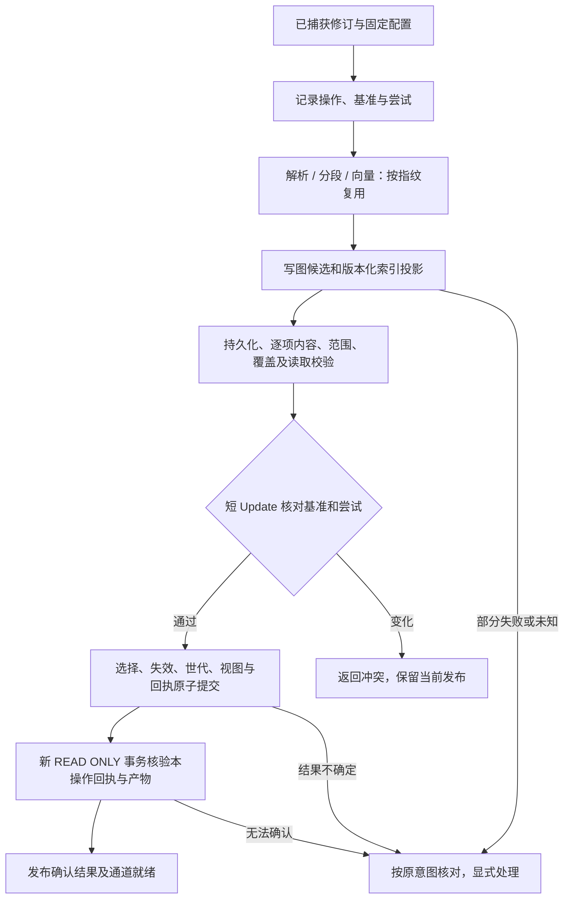

> 历史 Python Phase 3 计划，已完成并冻结。Rust 当前范围见 [组件说明](../../rust/crates/zg-knowledge/README.md)。

# Phase 3 实施计划：文档分段、检索投影与发布

日期：2026 年 10 月 21 日。

状态：已按本计划完成 Phase 3 文档写路径，交付范围、实际参数和原生限制见 [实现契约](python-evidence/phase3/CONTRACTS.md)，测试与资源判定见 [验收报告](python-evidence/phase3/PHASE3_REPORT.md)。本文保留实施时约定，细化 [交付计划 §4.3](../knowledge-delivery-plan.md#43-phase-3-分段全文向量投影与发布)；公共检索和后续里程碑仍按原阶段交付。

## 1. 目标与范围

完成以下写入闭环：

**指定不可变 SourceRevision → Markdown 结构解析 → 检索分段 → 全文及可选向量候选 → 持久化与读取校验 → 图内原子发布 → 独立只读事务确认 → 关闭重开后检查。**

捕获与构建分别留存操作和回执。Phase 2 的摄入成功继续表示输入已可靠保存；Phase 3 的构建成功表示声明的必需产物已发布并确认。正式 search、RRF、图扩展及公共证据查询由 Phase 4 交付；本阶段通过内部验证读取和检查接口核验候选及发布。

| 本阶段交付 | 后续阶段交付 |
| --- | --- |
| Markdown/纯文本 Parser、独立分段策略、快照映射 | M1 知识抽取、实体/声明/支持、更正与领域规则 |
| Embedding 契约、预计算入口、测试桩 | M1/M5 真实本地模型及质量、全离线验收 |
| 全文/向量投影、单来源发布、操作核对 | Phase 4 公共检索闭环；Phase 5 系统性中断恢复验收 |
| 单空间约束、单来源覆盖完整切换 | M2 多来源全库空间迁移及追赶 |
| 新表初始化（CREATE 追加）与部分初始化保护 | M4 GC、修复工具；未来若需 schema 演进再引入版本门 |

单来源纵切片覆盖首版及修订更新；同时使用第二个来源验证并发合并和不兼容空间拒绝，不能由单来源通过推定多来源全库迁移已实现。不实现代码套件、来源删除、通用推理、生态适配或 CLI。

## 2. 已测依据与本阶段设计选择

### 2.1 底座约束

沿用 [Spike-1/2 报告](python-evidence/validation/BASE_REPORT.md)、[正式配置](python-evidence/validation/profile.json) 与 [结果](python-evidence/validation/RESULTS.json)：

- graphdb 固定 `9d6e966ef0ae214cff8d5018efe1dafb37bc2a99`，当前原生 wheel 为已记录的 libcxx-csv-fallback 变体；zvec 固定 `a4347e31f1b8e216cffba59285427a3b78551229`。
- graphdb 使用持久 TP。Python 可写连接的 `begin()/transaction()` 默认是 Update，读取显式执行 `BEGIN TRANSACTION READ ONLY`。
- 短 Update 可原子提交最小根选择、关联失效、视图修订和回执；提交后须通过独立读取路径确认。
- 同一可写原生实例的不同 cursor 可读写并存，两个旧 Read 与候选构建/选择更新并存已测；跨进程 writer 与 reader 不同时直连同目录。
- zvec 写入检查逐项状态；版本/空间条件可下推，但候选仍须回图复核。部分写入和跨存储核对由框架负责。
- 1,000 来源档位通过是固定实验负载下的运行点，不是最终业务 Schema 的容量、SDK 吞吐或模型质量承诺。试验中间行预算不自动成为 SDK 默认配置。

### 2.2 本计划采用的选择

| 项目 | 选择与适用边界 |
| --- | --- |
| Capture 与 Build | 保持 Phase 2 捕获接口；新增绑定修订的构建接口，两个效果分别留回执 |
| Schema | 保持 schema_version=1；Phase 3 仅以 CREATE 追加新表（无 ALTER/DROP），不改既有 Phase 2 表。强制假设无历史遗留数据/旧库：开发期旧库直接重建，不做迁移或兼容拒绝门 |
| 物理结构 | typed 主干 + 版本化 payload；一致性校验和访问路径所需字段优先 typed，扩展信息放 payload |
| 领域对象 | 只确定衔接契约，不在本阶段冻结或创建 Entity/Assertion/Support/Evidence 物理表 |
| 文档处理 | Parser 负责结构，Segmenter 负责检索分段；分别持久化可复用产物和指纹 |
| Embedding | 预计算向量为正式入口；确定性桩只用于测试，不默认冒充真实语义能力 |
| 索引布局 | 全文 collection 与向量 collection 分开，该拆分与“单来源跨空间切换”绑定（切换只重建向量 collection、不动全文）；向量世代绑定空间和物理描述，不原地改写已发布空间。此为 Spike 单 collection 之外的新选择，3.0 须用真实 zvec 双 collection 探针验证 |
| 发布选择（非知识有效性） | 沿用实时计算方向；本阶段只实现“文档产物的发布选择”（SourceSelection/PublicationView），不交付 M1 的声明级有效知识判定 |
| 历史与清理 | 保留旧产物和必要引用，不交付历史查询或自动 GC；失败残留计入资源与诊断 |

这些选择限定本阶段的实现方式；精确 DDL、公共类型及数值配置在 3.0 交付并验证，不以一次建表替代后续版本演进。

## 3. 操作、接口与结果契约

### 3.1 捕获与构建分开

继续使用现有 `ingest_documents(source_id, document, ...) -> JobHandle` 保存输入，保留 `IngestResult`、`KGIngest*` 及回执语义；历史捕获回执不因后续构建而被改写，其 `search_ready` 维持捕获阶段的 false。

新增以下目标接口，最终参数类型在 3.0 确定：

```python
build_documents(revision_id, *, config, operation_id=None) -> JobHandle
builds.get(operation_id) -> BuildRecord
builds.reconcile(operation_id) -> Reconciliation
publications.get(publication_id) -> Publication
publications.current(source_id) -> PublishedSelection | None
```

Parser、Segmenter、EmbeddingProvider 由配置显式注入，不引入插件扫描或全局注册中心。提供者不能获得存储写连接。

构建入口只读取已保存快照，不重新读取外部路径。Phase 3 暂不增加组合摄入接口；调用方顺序等待捕获和构建两个 JobHandle，构建失败时仍可使用已捕获的修订重试。

### 3.2 构建身份与幂等

构建固定来源/修订、解析与分段配置、构建目标、空间、预计算输入清单摘要、根发布基准及捕获基准。固定输入与意图在提供者调用或候选写入前持久化；operation_id 不允许更换其中任何绑定项。

同 operation_id 重试沿用意图并增加 attempt 代次；发布时检查当前代次。已成功操作返回原回执并核验保留产物，不回写为新的尝试。新 operation_id 遇到当前完整成功效果相同，可记录未变化回执；失败、取消、未知或不完整产物不能作为成功复用依据。

根发布或捕获基准已改变时，原操作记录冲突；重新以新基准构建使用新的 operation_id，不在原操作下悄悄替换固定意图。仅无关来源引起的全局视图前进按 3.6 节重验合入。

三类身份分别表达：

- 逻辑单元 ID：修订、解析/分段指纹、确定的原文映射及局部标识决定，不使用底座行号。
- 构建/尝试 ID：表达执行归属，允许失败与新尝试隔离。
- 物理投影 ID：包含通道、单元、构建/尝试或已验证的不可变内容版本；同一次尝试的补写保持 ID 不变，旧尝试不能覆盖新产物。

更换解析配置重算结构及下游；仅改分段配置复用兼容解析；仅改 Embedding 复用修订、解析与分段。本阶段修订内容变化可按整份文档重建，不承诺最小片段差异算法。A→B→A 可以复用 A 的不可变产物，但重新选择必须产生新发布回执。

### 3.3 结果与就绪

BuildResult 至少表达：operation/attempt/build/publication ID、来源与修订、构建指纹、处理范围及原因、复用/重建数量、产物清单引用、已发布视图修订、各通道覆盖/就绪及诊断。片段列表通过有界检查接口读取，不将无限列表塞入任务结果。

更新方式与执行结果分开：当前效果相同为 unchanged；只执行部分阶段为 partial_processing；修订或映射不兼容而重做整份处理为 full_rebuild。失败状态携带失败阶段和已完成清单，不把失败称为“部分成功发布”。

| 概念 | 对外含义 |
| --- | --- |
| Parser/Embedding 能力 | 已有实现及实际配置，不表示某份文档已有产物 |
| text_ready/vector_ready | 本回执绑定的发布在声明覆盖内满足通道的持久化、校验和读取确认 |
| BuildResult.search_ready | 本次目标所需的可检索通道至少一个、且所有必需产物均已发布确认；同时返回具体通道及覆盖，不表示 Phase 4 search API 已交付 |
| 当前选择 | 通过 publications.current 在明确读视图下检查；历史成功回执不保证仍为当前 |
| index.created | 物理索引初始化状态，不代表完整发布或全部通道就绪 |

全局 capabilities 报告实现与配置，另行标记 `search_api_available=false`；具体发布 readiness 用有范围的检查接口返回，不用一个全库布尔值掩盖不同来源/通道状态。知识抽取能力继续为未配置。

构建目标要求来源/快照/单元等图元数据；全文为 Phase 3 基本必需通道，向量可明确设为 required、optional 或 disabled。optional 失败允许发布完整全文，但向量覆盖明确为不可用，不静默降级 required 请求。空文档允许发布完整的零片段清单，标记 indexed_empty、无向量调用；这不同于失败后伪造空成功。

## 4. 子阶段与实施顺序

### 3.0 入口契约、兼容策略与最小探针

先交付以下设计输入，再执行正式业务 DDL：

1. 完成第 3 节接口、结果、指纹、捕获/发布基准及尝试代次的类型和状态表。
2. 在临时目录探测固定 graphdb 的主键查找、typed 属性过滤访问路径、关系邻接、重复 DDL/结构核验及事务行为，并确认可写与 read_only 两种连接上 BEGIN TRANSACTION READ ONLY 均合法（read_txn 依赖）。二级索引作为待核查能力，不能以“typed 一定走索引”为前提。
3. 选定成熟 Markdown 解析库，作为 pyproject.toml 的运行时依赖引入（本项目第一个非原生运行时依赖）：须纯 Python（不触发原生重编）、许可宽松、固定版本，并支持行/字符位置到原始 UTF-8 字节的映射；记录版本与许可证。依赖只在 Parser 适配器内部出现；验证未通过前不接入生产链路。
4. 以真实 zvec 小探针验证 text-only、向量维度/metric、过滤、fetch/upsert、flush/重开和句柄释放。两个 collection 的组合是本阶段新选择，不能仅引用 Spike 单 collection 的结果。
5. 交付 Phase 3 新表 DDL（CREATE 追加，schema_version 仍为 1）、索引物理描述、创建协议、只读核对规则和初始资源配置；记录配置依据和未覆盖成本。

探针、DDL 与说明保存在仓库可回归位置；失败时停止依赖对应契约的实现，不绕开失败改报能力。探针不直接对外提供 SDK 功能。

复用现有固定来源的 graphdb/zvec wheel，不自动升级或重建底座。Markdown 解析依赖为纯 Python，经 pyproject 固定版本引入，不触发原生重编；若原生探针需要编译额外测试目标，沿用 14 并发及已记录构建变体，单独报告构建影响。

### 3.1 Schema 与库初始化

保持现有来源表的 typed 主干及版本化 payload。新增 Build、Attempt、StageArtifact、ArtifactManifest、Projection、IndexDescriptor、VectorGeneration、Publication、PublicationReceipt、SourceSelection 与 PublicationView 等逻辑记录，并给出实际表/REL 映射；不要求每个概念独立建表。

- 保持 schema_version=1：Phase 3 只用 CREATE 追加新表（KGProjection/KGPublication 等），不 ALTER 既有 Phase 2 表。强制假设无历史遗留数据/旧库——开发期任何旧库直接重建，不实现迁移或 schema 兼容拒绝门。
- 创建图 Schema 时先记录初始化未完成，逐项建表并核验结构，全部验证后才标记库 ready。无 DROP 的部分初始化不盲目重跑或覆盖，报告显式处置要求。
- 参与选择、归属、过滤、代次和原子校验的字段明确 typed 位置。payload 有契约版本；重复字段在同事务写入并检查一致性，不能两份都称权威。
- SourceSelection 保存当前来源发布；PublicationView 在读事务内固定视图修订及当前世代。更新以当前选择为基准合入受影响来源，不每次覆盖整份来源映射 JSON。
- Publication 及成功回执不可变，保留先前操作的实际效果；可变任务状态和当前选择另存。
- Phase 2 原始完整正文单元与 Phase 3 检索片段使用不同 kind、阶段指纹及身份，保留原有检查语义。

本阶段不创建 Entity/Assertion/Support/Evidence。未来若需新增 typed 字段或表，因无 ALTER/DROP 仍须以新表/重建库处理；payload 不免除语义版本演进。

### 3.2 读事务、适配器与资源基础

`GraphStoreAdapter` 增加内部 `read_txn`：从当前共享底座实例申请独立 cursor，执行显式 READ ONLY，在退出时提交/回滚并释放；可写宿主与只读打开都支持该读取接口。向框架内部提供受控读接口，不向调用方或提供者泄露原生连接。

只在申请句柄、登记引用或短写协调时使用适配层锁，不能让长期 Read 持有全局锁而阻塞 Update。定义关闭、取消、quarantine 时活动读者的处理；只有原生读取安全结束后才释放资源引用。可见性确认使用提交后新建的只读事务。

扩展 StoreConfig，将已验证的 transaction_timeout_ms/max_intermediate_rows 等实际传给 graphdb，保持同实例配置一致；超预算是可识别错误，不能当作无结果。默认值与配置校验在 3.0 记录，不直接复制实验数字作为产品承诺。

SearchIndexAdapter/索引管理层补齐：

- collection 描述、Schema/空间核验及不同物理索引的句柄管理；create 已有实现，重点补生命周期。
- 带投影 ID、错误码及可重试性的逐项写入结果，检查返回数量与输入对应关系。
- 按 ID fetch、受控 upsert、带标量过滤的验证查询；错误和诊断不泄露原文、凭据或完整向量。
- flush、重开、只读检查与缺失产物诊断；遇到响应未知先核对实际 ID/摘要，不直接整批重发。

资源预算覆盖原始快照读取、结构、片段文本、向量批次、原生索引增长和暂存；以有界迭代及批次背压连接各阶段。构建 Job 提交时按 revision 字节数先估准入成本（类比 Phase 2 的倍数预留），解析/分段后再按实际片段数×向量维度复核并背压，估算偏差不静默突破预算。候选、失败残留、旧版及读取引用占用单独计账，不在 JobHandle 结束时假定磁盘已回收。落盘前及执行中检查余量；不能扩充预算时停止后续准备，保留当前发布。

### 3.3 Markdown Parser 与独立 Segmenter

Parser 接收 SourceSnapshot，返回 ParsedDocument 的块、层级和诊断；只描述结构，不按目标向量长度切块。Segmenter 消费结构和快照，返回框架自有的检索单元候选及映射，分段配置拥有独立 descriptor/指纹。

首版策略以章节为主要边界，长章节按预算拆分；在 3.0 定义大小计量单位、重叠和不可再分块的超限行为，预计算路径不强依赖某个模型 tokenizer。Parser 状态及分段覆盖单独校验；必需阶段 partial/truncated 默认不发布。

- 保存原始 BOM、CRLF 与 UTF-8 字节位置，第三方 Token/AST 不进入公共模型或持久化 payload。
- 为标题内容与章节范围分别表达逻辑含义，避免“标题只占一行却作为整个章节父范围”。
- 正文片段优先使用连续原文区间；需要标题上下文时，额外记录上下文来源及映射，不把拼接后的文本伪装成一个连续原文范围。
- 区分原文片段摘要、实际索引正文摘要和 Embedding 输入摘要；文本清洗、上下文拼接必须进入对应处理指纹。
- 解析产物和分段清单可持久化复用；未变化只在产物完整、配置和上下游依赖匹配时成立。
- 覆盖正文前言、ATX/Setext 标题、代码围栏、列表、表格、链接及 HTML 等已声明语法；文档未支持的扩展明确诊断，不悄悄丢内容。解析不自动抓取链接或读取文档引用的外部文件。
- 空文档、只有标题、超长代码块等均有确定策略；重复标题不作为全库身份。

`parse_document` 继续验证框架类型、UTF-8 边界和层级；新增 Segmenter 校验验证覆盖、排序、重叠政策、附加上下文及实际输入映射，不能复用 Parser 校验后就声称分段正确。

### 3.4 Embedding 契约、预计算与空间

定义框架自有 EmbeddingDescriptor、输入项、逐项结果和 Context；预算/取消/期限遵循既有提供者契约，框架负责有限调度。接口可通过显式注入替换，不引入模型 SDK 依赖或后台无约束任务。

空间指纹包含实现与不可变模型/权重版本、量化、维度、metric、归一化、输入预处理及文档/查询编码约定。地址和可变别名不能代替实际版本；凭据不进入 descriptor。

预计算入口以确定的单元 ID、Embedding 输入摘要及空间绑定每个向量。提供纯处理准备辅助函数，允许调用方从固定快照和配置获得分段清单，再提交冻结的向量清单；构建时再次核验二者一致。冻结清单及数据先可靠保存，其摘要进入操作意图，显式重试不能依赖调用方内存仍在。

逐项核验缺失、重复、额外项、输入摘要、维度、数值类型、NaN/Inf 和空间；对有归一化/非零要求的空间验证相应条件。输入校验失败不写当前产物。测试桩使用明显的 synthetic/test 空间并仅在测试/显式示例启用。

提供者派发前记录调用和输入摘要；可靠保存结果后才算完成，可按依赖复用。结果未知时停止相关阶段，显式核对/重试，不把未知记作空向量或自动重放。

### 3.5 索引布局、初始化与投影候选

索引 store 作为受归属校验的目录，由管理层登记物理 collection：全文 collection 保存正文及过滤元数据；每个向量世代绑定自己的 collection 描述，保存向量和过滤元数据。两种 collection 都使用同一套单元/修订/构建归属。

全文 tokenizer、索引配置及 Schema 指纹绑定物理 collection，同样不允许原地修改已发布产物。单来源重建可准备新 collection 后切换；涉及其他来源覆盖的全文索引配置迁移本阶段明确拒绝，不以一次局部重建悄悄改变全库索引语义。

目录及 marker 至少记录库/存储身份、collection ID、相对位置、通道、Schema/空间指纹、创建状态；图侧登记候选归属和产物引用。文件 marker 表达物理生命周期，图侧发布记录表达可见选择，二者不能互相代替。

| 边界 | 处理 |
| --- | --- |
| 创建意图已保存、目录不存在 | 可写显式核对后创建；只读报告未完成 |
| collection 创建成功、marker 未完成 | 根据原意图检查归属和实际结构，确认一致后由可写核对完成登记；不盲目重复 create |
| 目录存在但身份/结构无法确认 | 返回不完整/身份冲突，保留现场，不覆盖或删除 |
| marker 显示完成但目录缺失/损坏 | 返回可识别错误，不视为 not_created，不自动造空 collection |
| 多个 worker 首次需要同一 collection | 经发布协调器锁串行化 create，并先落持久 create-intent 标记；zvec.create_and_open 要求路径不存在，崩溃后按意图核对实际结构再决定续建或报错，不让任意准备线程竞争原生 create |

每条投影包含投影/单元 ID、来源与修订、build/attempt、通道、正文/输入摘要及适用空间。候选物理写入可见不等于对默认知识视图可见；所有验证/后续召回经图选择判定，不能依靠索引中的可变 state 字段保证发布原子性。

逐项失败只补写允许重试且经过核对的 ID；重复 ID 若实际内容相同可复用，不同则报不可变产物冲突。明确失败、未知响应、永久无效输入分别处理，设置次数/期限预算。索引全部必需项可靠持久化并核验后，才能进入图侧发布。

### 3.6 向量覆盖与发布写路径

每个启用向量的发布视图至多选择一个空间/世代；仅全文视图可以没有向量世代。首次启用向量必须覆盖声明范围的全部可检索单元，零片段完整清单按空集合核验。

普通来源更新继续使用当前空间；显式仅全文构建可发布该来源全文并标记其向量不可用，后续向量/hybrid 请求按 Scope 检查覆盖，不能悄悄漏掉该来源。仅允许单来源库执行完整覆盖的跨空间切换。存在其他已声明向量覆盖来源时，Phase 3 拒绝局部新空间切换并给出未支持的全库迁移诊断，不承诺 M2 的追赶能力。



准备不持有图写事务。发布事务内检查当前 attempt、来源最近成功捕获基准、来源发布基准、处理依赖/覆盖版本及当前空间；默认仅允许发布仍为最近成功捕获的修订，较早修订构建返回冲突，不提供隐式回退发布。

不同来源的无关发布在当前视图上合并选择、递增视图修订，不能用旧全局映射覆盖他人效果。只发生无关视图修订前进时允许重验后合入；根单元或本次所依赖的空间/覆盖变化则返回冲突或按预算重验。

事务原子更新本来源选择、新旧单元/投影的有效选择、适用的世代/覆盖、视图修订及 operation_id 发布回执。本阶段影响集合只包含文档产物及其索引依赖；不伪造尚不存在的声明/共享支持失效。全部旧产物保留，查询视图决定有效性。

事务外新 READ ONLY 事务核验本操作回执和产物。若 A 已提交、B 随后发布、A 再确认，应确认 A 的历史成功并识别已被取代；当前选择为 B 不能被当作 A 未提交。检查与返回分别记录本回执版本和观察到的当前选择，避免将后者写成永久保证。

发布前取消不改变当前选择；进入提交边界后以实际回执为准，复用既有内部提交结果标记，迟到取消不能覆盖成功。未知提交/确认结果隔离实例、关闭并可写重开后按操作核对；没有回执不代表可以跳过候选/意图检查而整批重发。

### 3.7 核对、检查与交付

实现 builds.get、产物有界检查、当前发布和 builds.reconcile。reconcile 仅在可写实例显式执行：读取本操作及所有相关存储的实际状态，区分已发布、未发布可继续、候选不完整、输入/产物冲突和仍无法确认；有回执时恢复确认，不重复调用提供者或重发同一操作。

只读打开不改 marker、不补写、不续跑；可报告当前发布及待核对操作。已明确失败且与当前发布无关的候选不阻塞旧发布检查；无法确认是否影响当前发布的情况不能静默报健康。

Phase 3 必须交付最小可执行核对机制及关键故障用例，不能只写协议后全部留 Phase 5；Phase 5 扩展到全部持久化边界、长期运行和组合恢复验收。

## 5. 测试与验收

测试先写确定性夹具和预期，再验证结果；真实底座与适配注入分别记录。既有测试在 Phase 3 新建库中回归（schema_version 仍为 1，仅多了新表）；强制假设无历史数据，不保留旧库兼容/迁移测试。

| 分组 | 必测行为 |
| --- | --- |
| 初始化 | 非空目录保护；图 DDL 中断后部分初始化保护与重建指引；collection 创建/marker 两侧中断；陌生目录及结构不符；只读检查无写入 |
| 解析与分段 | 中文/英文、BOM、CRLF、空文档、仅标题、重复标题、围栏内假标题、长代码/长章节、列表/表格；字符转字节；原文与上下文映射；覆盖及重叠 |
| 替换与指纹 | 两个 Parser/分段策略可替换；仅分段变化复用解析；仅 Embedding 变化复用分段；Descriptor/实际输入变化不误命中缓存；partial/truncated 必需阶段拒绝发布 |
| 向量 | 预计算清单缺项/重复/错摘要/错单元；维度、NaN/Inf、空间不符；仅全文；optional 失败与 required 失败；不同维度世代并存且旧引用可读 |
| 索引 | 真正逐项部分失败、永久失败、响应丢失后 fetch 核对、有限补写、相同 ID 不同内容冲突；过滤、持久化及只读重开 |
| 增量与幂等 | 重复捕获后首次构建；同输入重复构建；原 operation 重试；内容 v1→v2→v1；配置变化；成功捕获后构建失败仍能重试；空文档成功与失败不混淆 |
| 发布竞争 | 同来源不同修订/配置；新捕获使旧构建过期；过期 attempt 迟到；不同来源合并；空间/覆盖竞争；A 成功被 B 取代后 A 正常确认 |
| 可见性与读取 | 新事务确认；旧原生 Read 保留旧选择；当前 Read 排除未发布/旧候选；读事务不持全局写锁；关闭等待与 quarantine 不泄漏句柄 |
| 资源与诊断 | 图中间行预算实际生效；批次背压；向量/索引扩张超限；磁盘不足；失败残留重复累积；读取保留不被提前释放；诊断不含原文或凭据 |

故障矩阵至少覆盖：

| 中断点 | 预期 |
| --- | --- |
| 捕获成功、构建尚未启动 | 捕获回执可查；没有伪造的发布回执 |
| 提供者已派发、结果未可靠保存 | 调用状态未知，按配置/显式核对处理，不自动重放 |
| 图候选或一侧索引部分完成 | 当前发布不变，按固定 ID/清单核对，不将候选算作有效知识 |
| 索引已持久化、图发布未开始 | 仍为候选，重验基准后才可发布 |
| 发布事务体失败 | 根选择、有效性、视图与回执全部不发生业务变化 |
| 提交前/提交中取消 | 按真实提交边界及回执判断，无部分发布和错误 cancelled |
| commit 响应丢失/原生未知提交 | 实例隔离，可写重开核对本操作；不盲目重发 |
| 发布已成功、确认/任务终态丢失 | 恢复本操作真实成功，即使当前已有后续发布 |

在可注入条件下组合原生持久化故障与 SDK 回执；无法组合的内部窗口明确报告未覆盖，不能用 Python 抛异常冒充原生错误。至少实际执行关键提交边界的子进程终止、重开和真实读取；物理断电与任意文件系统持久性仍不在本阶段结论内。

按实际 Schema 跑 10/100 来源递增资源测试（1,000 档完整资源验收并入 M5，Spike 已在代理 schema 跑过 1000 档），覆盖两个旧 Read、当前/候选/旧产物和失败残留。记录图/全文/向量物理规模、每进程及组合峰值、磁盘暂存、构建/确认/重开成本。沿用已确认的 2 GiB、120 秒阈值时须保持原 worker 统计口径；SDK 组合进程和新增处理成本单列 profile，不能拼接各底座结果替代实测，也不将原查询 p95 当作 Phase 4 完整检索已通过。profile 与数值在正式性能验收前冻结，不事后移动阈值。

## 6. 验收映射与退出条件

| 验收 | Phase 3 子集 | 后续边界 |
| --- | --- | --- |
| A01 | 新库、只读检查、关闭重开、部分初始化保护 | Phase 5/6 扩展恢复组合 |
| A02 | 全文/向量投影实际可写、可验证、可重开 | Phase 4 精确/全文/向量/混合及图扩展公共检索 |
| A03 | Markdown 结构、分段与不可变快照定位 | Phase 4 返回引用及证据 API |
| A04 | 同修订和处理配置的幂等、分阶段复用 | M1/M2 扩展领域与跨单元更新 |
| A08 | 最小清单、部分写入、取消、未知提交及显式核对 | Phase 5 全窗口恢复验收 |
| A09 | 候选隔离、发布竞争、旧读者和旧投影选择 | Phase 4 召回补取及完整查询行为 |
| A10 | 配置/预算/坏索引错误与可检查覆盖 | Phase 4 请求级降级和诊断 |
| A16 | 未变化/阶段复用/整份重建、实际范围与原因 | 后续跨来源影响与扩大范围 |
| A20 | 仅向量变化复用文本；单来源完整空间切换 | M2 全库迁移、追赶及并发来源变化 |
| A24 | 有界准备/批次/残留、磁盘余量和读取引用 | M4 GC 及 M5 长期资源验收 |

退出条件：以上必需正确性用例通过，底座集成实际执行，无阻塞项被记为通过；报告注明仍未覆盖的窗口。提供可运行示例：捕获 v1→全文/向量构建→重复构建→捕获 v2→失败保持 v1→重试发布→关闭重开检查；另有旧读者和后续发布取代的并发示例。

交付源码、探针/夹具、Schema 与状态说明、示例、Phase 3 验收报告及实际配置。回归当前全部测试，记录实际数量与跳过项；执行 Ruff、格式检查及 `git diff --check`。既有局部格式差异只在触及文件或明确纳入小改动时处理，不混入无关清理。

实现交付时同步更新 README、总体设计、交付计划及依赖/许可证记录，明确 Phase 3 新增表（schema_version 仍为 1）、Markdown 解析新依赖、新旧 API、仅全文/向量就绪与 search 尚未交付的边界。文档写入前比对最新内容哈希并合并并发修改，写入后回读及检查链接。本计划不授权远端提交、推送或清理已有业务库。

## 7. 执行顺序与交付批次

| 顺序 | 工作 | 本批可验收产出 |
| --- | --- | --- |
| 1 | 3.0 契约、兼容策略和探针 | 类型/状态/DDL/访问路径/解析依赖/物理布局/配置依据；对应失败门明确 |
| 2 | 3.1 + 3.2 初始化、读事务、索引与资源基础 | 新建库（CREATE 追加新表，schema_version=1），创建中断保护，独立 Read 与受控索引操作 |
| 3 | 3.3 Parser/Segmenter | 可替换实现、结构产物、确定分段和快照映射，复用测试 |
| 4 | 3.4 + 3.5 向量与候选持久化 | 预计算/测试桩、分通道物理投影、逐项核对和候选清单 |
| 5 | 3.6 + 3.7 发布、确认与核对 | 最小正式写闭环，竞争/取消/未知结果恢复及有界检查 |
| 6 | 第 5/6 节组合验收与文档 | 实际测试/资源结果、未测边界、可运行示例与交付报告 |

每批完成相关测试后继续下一批；新的底座能力缺口先修订依赖契约并保留失败证据。全量迁移、M1 领域表或 Phase 4 检索不作为修补本阶段设计缺口的隐式扩展。

## 8. 实施结果与收敛的约束

- 保持 schema_version=1，复用 Phase 2 表并追加文档构建/发布控制表；旧开发库显式重建，不在 open 中迁移。M1 的 Entity/Assertion/Support/Evidence 表未提前创建。
- Markdown 采用 markdown-it-py==4.0.0（纯 Python/MIT）及 mdurl==0.1.2，原生 wheel 保持固定来源；Parser、Segmenter、Embedding 均通过框架契约注入。
- 实现独立捕获/构建、分阶段缓存、不可变投影、有界检查、短图发布、新 Read 确认和显式 reconcile。BuildResult 就绪与公共 search_api_available=false 分开。
- 实测 graphdb 主键访问与关系连接后，来源捕获及单元发布都使用分别锚定端点的 MATCH，避免先做组合再过滤的中间成本；未把 typed 标量自动描述成二级索引。
- 固定 zvec 的已有 ID upsert/optimize 组合出现读取缺失；SDK 限制为相同内容复用、不同内容拒绝、仅缺失 ID 原生补写。原生小块达到 16 个后合并，保留全部版本化 ID，不交付应用 GC。
- 原生只读打开在异常退出及正常关闭后均出现向量文件变化；正常只读实例使用有预算的临时字节副本，原库不变，副本随关闭清理；未清洁会话在可写重开核对前仅允许图/任务只读检查。副本成本纳入最终重开/资源测量，没有把上游问题标为已修复。
- 实际 SDK 长 Read 会消耗固定 64 个退役根预算，已增加保守背压与失败/确认预留。资源 profile 的两个旧 Read 跨越一次完整来源更新，耗尽和释放后重试单独验证；未更改 2 GiB、120 秒或 200 ms 的数值门槛。
- 全部文件仍纳入落盘检查；目录条目直接统计减少重复 stat 开销，相同已验证清单不重复核验。分段和向量膨胀预算在元数据/索引写入前检查。100 来源初次正式耗时 130.54 秒未通过；最终同 profile 为 117.64 秒，只读副本成本计入重开及资源结果，通过但余量小，失败记录保留。

本次没有提交或推送远端，没有清理已有业务目录。测试、命令、测量原值与未覆盖故障窗口统一收录在验收报告，不由计划文字替代证据。

## 参考材料

- [项目范围基线](../knowledge-project-boundary.md)
- [总体设计与核心接口](../knowledge-system-design.md)
- [交付计划](../knowledge-delivery-plan.md)
- [Phase 2 验收记录](python-evidence/spike_1/PHASE2_REPORT.md)
- [Spike-1/2 实测结论](python-evidence/validation/BASE_REPORT.md)
- [现有来源存储（归档）](python-baseline.zip)、[捕获流程（归档）](python-baseline.zip)、[处理契约（归档）](python-baseline.zip)
- [图适配器（归档）](python-baseline.zip)、[索引适配器（归档）](python-baseline.zip)、[库生命周期（归档）](python-baseline.zip)
