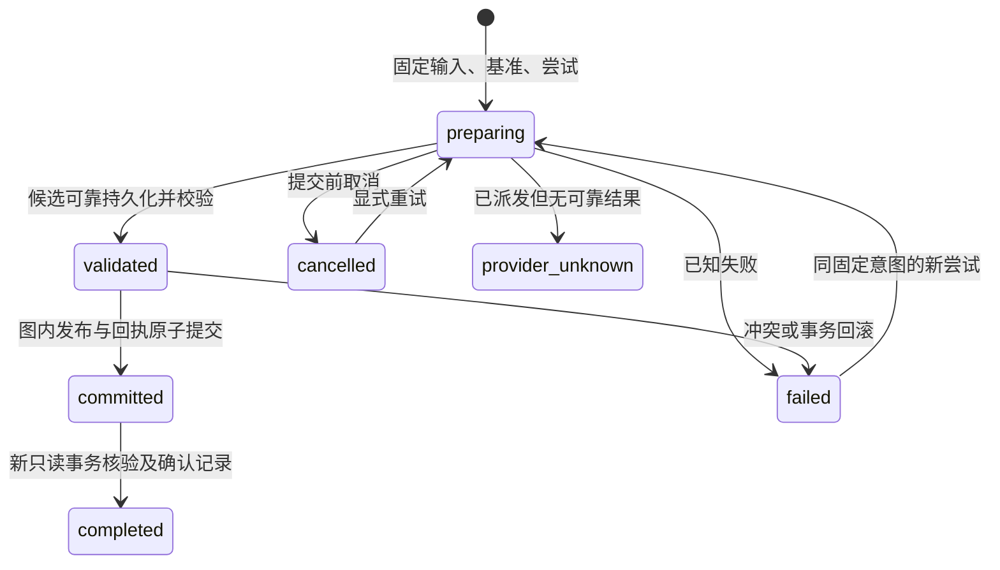

> 历史 Python 验收记录；执行命令需要先恢复基线。原始文档和源码保存在 [Python 基线归档](../../python-baseline.zip)，本可阅读副本仅更新归档引用。

# Phase 3 契约、物理映射与运行约定

日期：2026 年 10 月 21 日。实现入口为 [builds.py（归档）](../../python-baseline.zip)，本文件说明当前交付的文档写路径；范围与退出条件沿用 [实施计划](../../../knowledge-phase3-plan.md)。性能和故障证据另见 [验收报告](PHASE3_REPORT.md)。

## 1. 公共入口与效果

| 入口 | 返回与语义 |
| --- | --- |
| ingest_documents | Phase 2 捕获 JobHandle；保存 UTF-8 修订/正文，捕获回执 search_ready=false，后续构建不改写它 |
| build_documents(revision_id, config=BuildConfig(...), operation_id=...) | 独立构建 JobHandle；绑定已保存修订和处理配置，只读取快照 |
| builds.get | BuildRecord：当前尝试、阶段、状态、错误码及原发布回执 |
| builds.segments(limit, cursor) | 本操作处理配置对应的 Segment 分页，不加载整个向量产物清单来做分页 |
| builds.projection_writes(limit, cursor) | 当前尝试实际写入的投影元数据；复用产物归属原尝试，不混称新写入 |
| builds.precomputed | 读取已可靠保存的预计算输入，用于关闭重开后的显式重试 |
| builds.reconcile | 仅可写；查回执、核对候选和创建意图，区分 committed / not_committed / candidate_incomplete / provider_unknown |
| publications.get / current | 检查不可变发布或来源当前选择；不提供历史时间查询参数 |

BuildConfig 显式注入 Parser、Segmenter、EmbeddingProvider，vector 目标为 required/optional/disabled。全文及图侧文档元数据为必需产物；向量未配置或 optional 失败可交付完整全文，并返回实际向量不可用诊断。required 失败不发布。

BuildResult 包含操作/尝试/构建/发布 ID、清单、来源/修订、指纹、更新方式与原因、单元数、复用阶段、具体通道/空间和发布视图修订。view_version 是本发布产生的修订，不能当作之后每次检查的全库当前版本。search_ready 表达该发布的必需索引产物已确认，公共 search API 仍为 Phase 4；capabilities.search_api_available=false。

## 2. Schema 与物理归属

保持 manifest.schema_version=1，按当前开发期无历史数据的前提新建库。SourceStore 的原表结构不变，追加 publication_store.DDL；不在 open 中追加表、迁移或清理旧目录。缺少 Phase 3 布局或部分初始化返回明确错误与显式重建指引。未来迁移另行设计，不能据 schema_version 相同推断旧开发库可打开。

| 逻辑对象 | 当前映射 |
| --- | --- |
| 捕获来源/修订/原始完整正文 | 既有 KGSource、KGRevision、KGContentUnit 与 KGIngest*，原回执保留 |
| 构建与尝试 | KGBuild、KGBuildAttempt；typed id/owner/revision_id/build_id/state/version + JSON payload |
| 可复用解析、分段、向量及投影阶段结果 | KGStageArtifact 保存内容寻址 JSON 引用；文件位于 artifacts/，摘要验证后使用 |
| 准备好的文档片段 | KGSegment；owner 为修订与分段指纹组合，支持有界结果检查 |
| 物理投影元数据 | KGProjection；不可变物理 ID、归属、通道、摘要与原尝试，保持 candidate 元数据不变 |
| 发布与回执 | KGPublication、KGPublicationReceipt，不可变；已被新发布取代的原回执仍可核对 |
| 当前来源选择 | KGSourceSelection；当前完整产物清单及通道覆盖 |
| 全库视图与当前向量世代 | KGPublicationView；version、space_id、generation 与布局标识；每来源覆盖由 SourceSelection/manifest 表达 |
| collection/世代物理说明 | stores/index.json 登记创建意图、归属、描述和会话状态；VectorGeneration 的物理引用为单空间向量 collection ID，不额外创建 M1 领域表 |

KGProjection 的 candidate 状态不能用于判定对外有效性。当前选择引用的 manifest 才决定投影集合；旧 manifest 和物理 ID 保留供旧读者、回执核对使用。尚未交付应用 GC。

typed 控制列与 payload 由同一短事务更新；当前控制行为使用明确主键和 typed 状态，扩展信息使用版本化 JSON。新建时执行固定 DDL，ready 之前完成布局检查；不使用 ALTER/DROP/MERGE，不尝试修补未知旧表。

图中 Source→Revision、Revision→ContentUnit 关联通过分开的主键锚定 MATCH 写入。组合两个节点后再过滤的写法会在实际规模下产生昂贵的中间组合；来源捕获和片段发布均使用先筛选每个端点的查询，保持关系语义不变。

## 3. 处理与指纹

Markdown 适配器内部使用固定 markdown-it-py 4.0.0，mdurl 0.1.2；均为纯 Python/MIT 依赖，未修改原生 wheel。语法为 CommonMark + table；块位置由原始行偏移映射回 UTF-8 字节，保留 BOM/CRLF。不渲染或执行 HTML，不抓取链接、图片和外部文件；未实现专用 frontmatter/footnote 等插件语义，内容仍作为原文覆盖。

Parser 输出 document、section 和语法块；标题内容与完整章节范围分开。SectionSegmenter 按章节边界和原始字节预算拆分，默认 max_bytes=4096、overlap_bytes=0，超大代码/正文允许 UTF-8 安全拆分。当前正文与 Embedding 输入均为原始连续片段，无合成标题前缀；未来加入上下文须增加映射及指纹版本。

解析指纹包含实现/版本/契约/配置及 media_type；分段指纹包含解析依赖及分段配置；向量缓存包含 EmbeddingDescriptor、输入单元及摘要；索引物理描述单独绑定通道、Schema、空间和 KB 归属。业务 ID 不使用 graphdb 行号或第三方 Token ID。

prepare_document 是不写存储的准备辅助函数，可产生预计算向量对应的单元 ID。准备与 BuildConfig 必须使用相同 Parser、分段配置及媒体类型。预计算输入冻结后先可靠保存清单及数据，摘要绑定构建意图；回读 builds.precomputed 无需调用原提供者。

PrecomputedEmbeddings 校验单元集合、摘要、维度、有限 FP32 值和所声明归一化条件。空间标识包含实际模型/权重版本、量化、维度、metric、预处理、归一化及文档/查询编码约定。SyntheticEmbeddingProvider 是显式测试夹具，不代表真实语义向量或模型质量。

## 4. 状态、幂等与竞争

提交或确认结果不确定时 JobHandle 为 recovery_required，不能从终态推定回滚。图实例隔离后，关闭、可写重开、按原 operation_id 核对。只读检查不续跑或修复。

operation_id 绑定修订、处理配置、目标和预期基准；retry 使用新 attempt，不替换原输入。若根发布/最近捕获基准已变，返回冲突；以新基准构建需新操作。当前完整成功效果相同可返回 unchanged，不增加发布版本；失败和不完整产物不能作为成功依据。

准备阶段不持有写事务。发布事务复核当前 attempt、最近捕获及其修订、来源发布、空间和覆盖；更新来源选择、当前世代/视图及回执。不同来源的无关变化合入当前视图，不以旧全局映射覆盖别人。

发布后以新的显式 READ ONLY 事务读取原回执和不可变产物。A 已发布、B 随后发布、A 再确认时，A 仍为成功；当前为 B 不代表 A 没提交。迟到取消不改写已生效结果，确认元数据使用内部提交结果标记及保留额度。

提供者调用前记录批次输入摘要及 running 状态。结果与缓存引用可靠保存后可复用；即使完成状态响应丢失，reconcile 可按已保存结果恢复。没有可靠结果则返回 provider_unknown，不自动重复调用。该状态需要调用方进一步核实；本阶段不提供通用远程调用强制重放/人工结算工具。

## 5. 索引布局、补写与原生限制

全文与向量使用不同 collection，位于 index/collections/<descriptor_id>。Native Schema 名称包含 KB 归属对应的描述摘要，防止同结构的异库 collection 被误接入。创建意图先持久化，随后 native create、结构核验、ready 登记；目录存在不等于完成，创建后 marker 丢失由显式可写 reconcile 核对。

全文保存正文与过滤元数据；向量保存 FP32 embedding、正文及相同归属。过滤字段为 business_id/source_id/revision_id/build_version/space_id 等；当前字段可下推过滤，不将它们描述成已配置的二级倒排索引。召回验证仍回图侧检查固定清单和有效选择。

仅允许单来源库完整覆盖的跨空间切换；只重建向量 collection，复用文本投影。多来源库拒绝局部切到不同空间，全库追赶留 M2。显式全文构建撤出该来源向量覆盖，不静默伪造全库向量完整。

补写先 fetch：相同 ID/内容复用，不同内容拒绝，只对缺失 ID 使用 native upsert；批次状态只记录稳定错误码，不包含原文或原生错误消息。固定版本的已有 ID 原生 upsert 与 optimize 组合在负向探针中出现读取缺失，SDK 不使用该路径，详见 [负向控制脚本（归档）](../../python-baseline.zip)。

HNSW 的小批次 flush 会产生多个物理块。达到 index_compact_threshold=16 时，在 collection IO 锁内调用原生 optimize(concurrency=1)，保留全部版本化投影 ID，并核验文档数；构建为合并预留暂存预算。基于 .proxima 物理块计数的触发器仅适用于当前固定原生格式。应用层不删除过期知识或投影，该行为是原生物理合并，不是已交付 GC。

原生只读打开在异常退出及正常关闭后的探针中都修改了 HNSW 文件。固定源码的 core Index::Open 未把 read_only 转化为只读 storage 打开约束；仅在 open 时关闭 mmap 无效，因为 collection 从持久版本恢复该配置。原生问题及 SDK 保护见 [负向控制脚本（归档）](../../python-baseline.zip)。

SDK 在可写原生会话前可靠记录 writer_session_dirty，原生句柄关闭并回收后才清除；异常退出后，只读实例只检查图/任务元数据，阻止原生索引读取并报告需可写重开。清洁只读实例为各 collection 建立私有字节副本，将原生句柄指向副本，避免原生写行为修改原库；不能用硬链接代替。副本位于系统临时目录，随句柄关闭清理，既不修复原库也不回写 marker。health 暴露 readonly_index_mode=isolated_copy 与 readonly_copy_bytes。只读指原库不被修改，不表示运行过程完全不使用临时磁盘。

全部副本的累计大小受 candidate_space_bytes 限制，并检查临时盘至少保留 16 MiB 余量；不足即返回 resource_exhausted。副本复制会增加只读打开时间、磁盘及系统缓存成本，当前资源测量包含该步骤。清洁关闭、合并后的库和 100 来源库均做原库文件摘要核对。此隔离方案不等于修复上游原生只读实现，也不证明任意未测格式均安全。

## 6. 资源与读取引用

| 配置/机制 | 当前值与行为 |
| --- | --- |
| graph_transaction_timeout_ms | 1000，实际传给底座；用于事务准入控制，不承诺强制终止任意 Python/native 调用 |
| graph_max_intermediate_rows | 1,000,000，实际传给底座；超限返回 resource_exhausted，不返回截断结果 |
| graph_max_retired_versions | 64；SDK 按最早活动 Read 与写入代次保守限流，为每个 worker 的失败/确认记录预留额度 |
| 准入 | 先按修订字节和向量批次估算，结构/分段后扩充本 worker 的共享额度；额度不足立即背压，不持已有额度等待扩容 |
| 持久空间 | 将快照、图/WAL、索引、产物、旧版与失败残留计入检查；暂存不足停止后续准备，保留当前发布 |
| 只读索引副本 | 累计大小 ≤ candidate_space_bytes，另留临时盘 16 MiB；原库只读，临时副本随关闭清理 |
| 批次与期限 | 默认 batch_size=32、max_units=20000、deadline_seconds=60、write_retries=2；提供者取消/期限为协作式检查 |
| 读取 | 独立 cursor 上显式 READ ONLY，长期读取不持有适配器全局锁；关闭等待活动读取安全结束，不提前释放产物 |

参数为当前实现的可配置起点，不是普遍容量承诺。没有把逻辑额度当作外部提供者/底座 RSS 的硬限制。跨很多构建持续持有原生 Read 会触及退役版本上限，应缩短读取或显式采用经验证的资源配置；本阶段不自动切换为任意历史逻辑视图。

## 7. 验证与后续

可运行示例为 [phase3_build.py（归档）](../../python-baseline.zip)，测试入口为 [文档构建集成测试（归档）](../../python-baseline.zip)、[处理测试（归档）](../../python-baseline.zip) 和 [Embedding 契约测试（归档）](../../python-baseline.zip)。

Phase 4 在当前写路径之上实现公共检索、RRF、预算补取及引用封装。Phase 5 扩展组合恢复窗口；M1 才实现声明级语义和真实抽取；M2 完成全库空间迁移；M4 实现逻辑清理、迁移及通用修复。原生内部任意 WAL/optimize syscall 与物理断电没有被当前 Python 边界故障试验覆盖。
