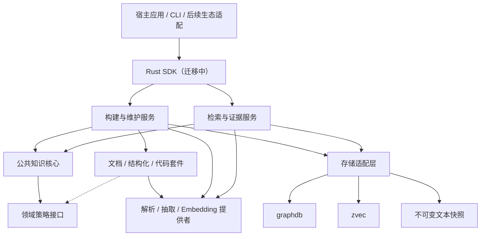
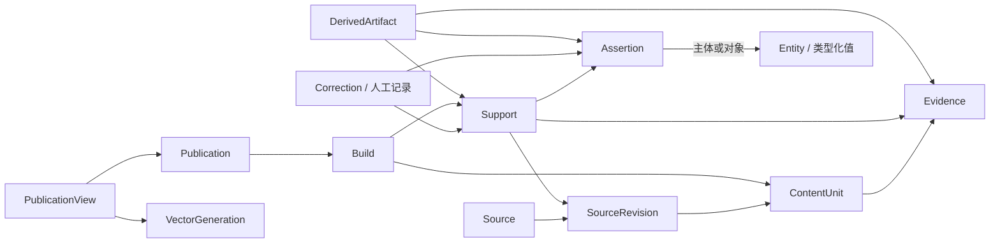
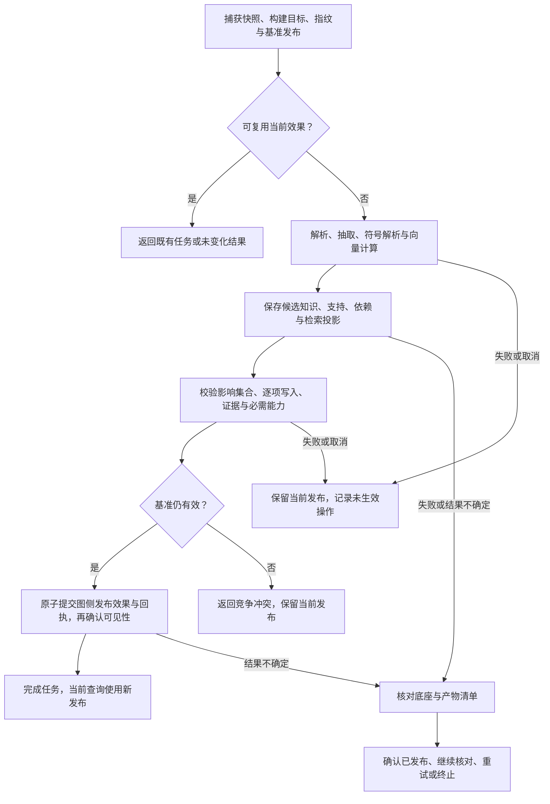
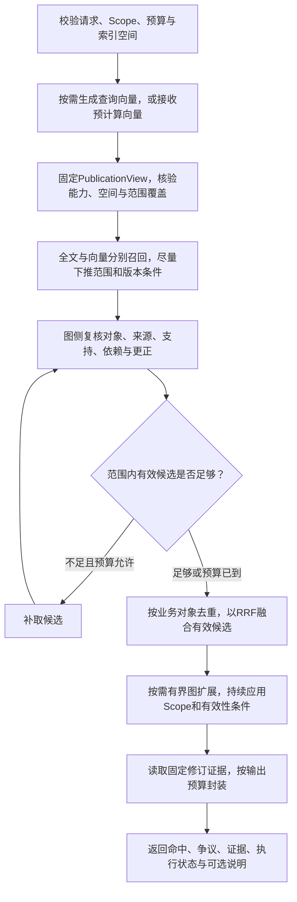

# 通用知识图谱系统总体设计与核心接口

当前执行优先级：以 [zg 查询增强 G0–G4](QUERY_ENHANCEMENT.md) 为主线，代码与文档分别推进，不做跨域关联；独立通用 KnowledgeBase SDK 完整重写后置。下文通用 SDK 与原阶段规划保留作长期设计和历史对照。G1 候选事实不代表持久化、发布、检索已经可用。

状态：总体设计与分期实现约定，开发方向切换为 Rust。原 Python Phase 1–3 已归档为迁移基线；Rust 当前提供不依赖 graphdb binding 的组件，不表示真实摄入、发布或恢复已完成。Rust 范围见 [组件说明](../rust/crates/zg-knowledge/README.md) 与 [验证报告](migration/RUST_CONSOLIDATION_REPORT.md)。原 Python 的实现与验证边界仍见 [Phase 3 契约](archive/python-evidence/phase3/CONTRACTS.md) 和 [验收报告](archive/python-evidence/phase3/PHASE3_REPORT.md)。

日期：2026 年 10 月 22 日。

范围基线：[通用知识图谱项目边界说明](knowledge-project-boundary.md)；验证顺序与验收归属：[交付计划](knowledge-delivery-plan.md)。本文确定模块职责、逻辑知识模型、生命周期、对外接口和验收条件。文中 Phase 2/3 已交付部分指归档 Python 基线，其接口、DDL 和契约用于 Rust 行为对照；后续领域核心物理 Schema、完整公开类型及全部算法参数仍未冻结。

## 1. 设计结论

z-knowledge-graph 面向需要在应用内持续维护知识的开发者。公共核心以来源修订、独立支持、人工更正和有效发布管理知识；文档与代码套件提供各自的解析、身份和依赖规则；检索层返回可核验的知识与证据。项目的差异落实为维护和查询行为，项目对照见[范围基线](knowledge-project-boundary.md#与参考系统的关系与差异)，不将外部系统的性能结果视为本项目收益。

目标交付调整为本地嵌入式 Rust SDK，CLI 后续复用服务；Python SDK 保存在可恢复的历史归档中，活动源码与虚拟环境已移除。graphdb 存储图数据和知识管理记录，zvec 存储可重建的向量与全文检索投影；参与构建的原文保存在本地不可变文本快照中。

Rust 组件 `zg-knowledge` 不反向依赖整个 `zg-engine`。它与 engine 通过 `zg-storage` 共享哈希、文件持久化和 zvec 基础操作，保留各自的 Schema、错误和维护规则。它复用 workspace 的 `zvec-rust`，暂用独立候选 collection，不宣称 zg/KG 的正文或向量已去重。graphdb Rust binding 在上游维护，本仓库只定义内部图存储契约，待 binding 可用后适配，不创建 `zg-graphdb` 或 Python 子进程后端。Rust 使用新格式并要求旧库重建；本文后续的 Python 类型、GIL 约束及 Phase 1–3 物理布局用于说明冻结基线，不是 Rust 接口或格式兼容承诺。

首版覆盖纯文本、Markdown、结构化知识以及 Python/C++ 代码。代码以 Tree-sitter 为默认语法解析器，符号解析作为独立步骤，Clang 为 C++ 可选增强。文档内置可配置的实体关系抽取流程，抽取与 Embedding 的提供者由调用方配置。

基础结构化操作与语法解析不要求模型或联网。全文、向量和混合检索属于首版验收范围；调用向量能力时需要配置兼容的 Embedding 提供者或传入预计算向量，不能以缺少配置为由将其从首版验收中移除。

SDK 按阶段落地，CLI 后续复用相同服务。任意历史全库查询、全库回滚、动态记忆、答案生成策略、Agent Runtime、多租户安全隔离和常驻服务不在首版范围。MCP 与服务接口后续复用 SDK。

## 2. 架构与职责

### 2.1 分层与依赖



SDK 与 CLI 调用同一组应用服务。应用服务组织一次用户操作，公共核心计算知识身份、支持、人工效果、依赖及可见性条件；领域套件向公共接口提交候选产物和策略，不直接修改底座或发布记录。公共核心依赖策略接口，具体策略由套件提供，避免公共模型反向依赖某种语言、提示词或领域本体。图中模块是职责边界，不要求分别建立管理器、独立进程或仓库。

| 模块 | 输入 → 输出 | 主要责任 |
| --- | --- | --- |
| SDK / CLI | 用户参数 → 句柄、任务或查询结果 | 参数与错误映射，复用统一状态语义 |
| 来源服务 | 来源键、位置与输入 → Source、SourceRevision、快照清单 | 分开管理来源身份与实际输入，检测变化 |
| 构建与维护服务 | 操作意图、输入清单、期望基准 → Job、Build、候选产物、Publication | 阶段执行、受影响范围、预算、核对与发布 |
| 公共知识核心 | 候选知识、支持、更正与策略结果 → 有效知识及失效集合 | 身份、幂等、支持归属、更正、依赖与选择规则 |
| 领域套件 | 不可变输入与领域配置 → 对象、声明、证据、依赖、覆盖诊断 | 文档分段；代码语法/符号解析；领域消歧和冲突策略 |
| 检索与证据服务 | Scope、查询、预算与固定视图 → 命中、路径、证据及执行说明 | 候选召回、有效性复核、融合、有界扩展、证据封装 |
| 能力提供者 | 显式批次与上下文 → 带逐项状态的处理结果 | 解析、模型抽取、Embedding、可选重排；声明指纹、发送范围与取消边界 |
| 存储适配 | 业务记录/投影/快照操作 → 底座结果与可识别错误 | 只使用公开 API，封装兼容检查与底座差异 |

### 2.2 数据归属与资源所有权

graphdb 保存 Entity、Assertion、支持、证据关联、人工记录、依赖及任务发布信息，是判断知识有效性的依据。zvec 保存带业务 ID、来源修订、构建和索引空间信息的检索投影；命中只表示得到候选。SnapshotStore 保存参与构建的不可变输入和定位信息。三者分别持久化，通过产物清单、发布选择和查询复核协作，不宣称跨库原子事务。

KnowledgeBase 句柄持有本进程的存储连接、运行任务和读取引用；关闭时停止接收工作，在安全边界收束任务并释放资源。调用方传入的模型、Embedding 等客户端是否由 SDK 关闭，必须在提供者接入时声明，默认由调用方持有。模型权重与推理运行时由调用方准备；本地模型服务可作为独立进程，SDK 关闭客户端不等于停止模型服务，不默认启动、停止或托管该服务。任务属于宿主进程，任务记录可持久化不代表宿主退出后仍在执行。

长耗时解析、模型调用和向量计算在数据库写事务之外完成。对同一发布单元的竞争检查与发布发生在短临界区，实际事务能力遵循 graphdb；不同输入的准备工作可以并行，不对整个构建过程使用全局写锁。首版跨进程打开约束见第 5 章。

快照文件先准备，图中再建立引用。无引用的文件可在核对后清理；本地文件写入不属于图事务。示例：SDK 接收 Markdown 后先捕获快照，再建立任务并构建候选；若 Embedding 失败，任务记录失败阶段，当前发布继续服务，未发布候选不能成为检索结果。

### 2.3 六个参考项目的采用范围

采用 Cognee 的完整维护操作和任务分层、LightRAG 的多通道召回与证据检查、Wikibase 的独立声明与多来源表达、OpenSPG/KAG 的领域策略与执行机制分工、Graphiti 的支持和失效意识、LlamaIndex 的 Store/Retriever 接入分层。以下模型、发布和接口是本项目的设计选择，不声称上游已经提供相同保证，也不将它们的全部产品能力纳入首版。

### 2.4 SDK 执行与并发模型

首版 SDK 以同步阻塞接口为主：查询类接口（entities、relations、graph、search、evidence、assertions 等）在一次调用内固定视图、执行并返回结果。长耗时维护操作（ingest、sync、delete、rebuild、corrections、alignments、迁移、gc）立即返回 JobHandle，实际工作由实例内部的有限 worker 池执行，调用方通过 jobs.get / wait / cancel 观察和控制；wait 只结束等待，不改变任务执行。是否额外提供 asyncio 变体属于详细设计决策，但同一操作不得因执行模型不同而改变第 5.4 节的状态语义。

KnowledgeBase 句柄在其所属进程内可被多线程共享：查询并发执行，维护写路径经第 5.3 节发布协调器的进程内短临界区串行化。该协调是进程内锁，不跨进程；跨进程约束仍由第 5.3 节的单一可写持有者规则保证。第 5.8 节的排队与执行槽位由该 worker 池承载。

Tree-sitter 解析、graphdb 与 zvec 的原生调用可能长时间占用线程；SDK 不假定它们释放 GIL，也不将其直接暴露到调用方事件循环。取消遵循第 5.4 节，只在阶段边界和安全检查点生效，不承诺立即中断原生调用。执行模型的线程/协程承载、池大小与调度参数留到详细设计，不在本文冻结。

## 3. 公共知识模型

以下是逻辑契约，不要求每种概念对应独立表，不要求将所有属性物化为声明节点。来源、知识、人工决策和派生索引分别有身份与版本，引用关系由公共核心维护。

| 概念 | 核心信息 | 约束 |
| --- | --- | --- |
| Source | 业务 ID、来源键、领域、位置、元数据 | ID 不随内容修订变化；位置与身份分开 |
| SourceRevision | 来源 ID、输入版本、内容摘要、快照清单 | 不可变地表达实际输入，不以修改时间代替内容版本 |
| ContentUnit | 来源修订、构建、片段类型、正文范围、章节或符号 | 分段配置变化可以改变片段，定位仍指向确定快照 |
| Entity | 业务 ID、领域、类型、身份键与展示属性 | 不直接以展示名称、底座行号或 Tree-sitter 节点 ID 充当跨修订身份 |
| Assertion | 业务 ID、主体、谓词、对象或类型化值、肯定/否定、限定条件 | 表达一个具体命题；同一属性可有多条声明，否定与未知/无值分别表达 |
| Evidence | 来源修订、片段、定位、可用状态及生成记录引用 | 表达可检查的依据，不单独决定命题是否被采用 |
| Support | 声明、来源或人工记录、证据引用、生成记录与构建归属 | 同一声明可有多个独立支持，各自受发布与撤销规则约束 |
| Correction | 明确目标、替代/抑制/补充意图、内容、理由、操作者与状态 | 保留原始内容，可检查、可撤销，不无声覆盖抽取结果 |
| Alignment | 候选对象、确认映射、依据、操作者与状态 | 不销毁原对象和来源身份，可撤销 |
| DerivedArtifact | 产物种类、输入依赖、处理指纹、构建及新鲜度 | 描述、摘要、推断与检索投影按各自依赖失效；不要求独立公共类型 |
| Build | 输入清单、构建目标、必需/可选产物、处理指纹、影响集合、阶段、产物清单与诊断 | 一次构建可处理同一来源修订，任务进度不等于查询就绪 |
| Publication | 根发布单元、构建 ID、基准版本、影响集合、有效产物与能力就绪 | 发布一个来源或人工操作及其必要关联效果，默认查询排除候选产物 |
| PublicationView | 视图修订、各单元发布选择、有效性变化与当前向量世代 | 在同一图侧事务中形成一致视图，修订号不开放为任意历史查询参数 |
| VectorGeneration | Embedding 空间、版本化投影、来源/人工单元覆盖及就绪清单 | 一次查询只使用一个已发布世代；空间迁移先准备完整覆盖再切换 |



图中箭头表示关联或依赖，不统一表示所有权或删除级联。模型中的 Support 明确“谁以什么依据支持什么”；Evidence 明确“依据在哪里、如何取得”。多个来源的内容即使去重，支持归属也不能合并成一个不可撤销的来源字段。

### 3.1 声明、证据与知识有效性

Assertion 的限定条件参与命题含义，例如产品版本、环境、时间范围或适用对象。它们与证据出处分别保存。命题规范化和等价判断由领域策略确定；同名、同一主体谓词或向量相近，不能直接证明两条命题相同或互斥。

同一声明可由结构化记录、语法提取、规则/语义解析、模型抽取及人工内容分别支持，因此生成方式、模型及置信信息跟随各自 Support 的生成记录，不能用一个生成方式覆盖全部支持。模型推断的产物记录输入声明和证据依赖；推断与原文直接支持分别表达。

| 维度 | 表达内容 | 与其他维度的关系 |
| --- | --- | --- |
| 命题与限定条件 | 声明具体说了什么、何时何地适用 | 条件变化可能形成另一命题 |
| 来源支持 | 哪些有效来源或人工记录提供支持 | 引用数量不直接等于真实性 |
| 生成方式与置信信息 | 如何产生、模型返回什么判断 | 不替代人工判断或领域校验 |
| 人工判断 | 确认、否决、待复核及其理由 | 通过人工记录产生效果，不能改写原文 |
| 默认选择与争议 | 当前采用哪些声明、为何保留其他声明 | 选择规则和争议可检查，不以最近摄入自动覆盖 |
| 生命周期与新鲜度 | 是否已发布、被撤销、依赖失效或需重建 | 失效产物不能因召回分数高而生效 |

默认有效视图按以下顺序计算：固定 PublicationView；选取归属其发布选择的来源支持和可用人工支持；应用目标明确且有效的更正与对齐；按领域规则校验依赖、限定条件及互斥性；产生全库选定声明、未决争议与排除原因；再按 Scope 裁剪可返回的对象、支持、证据和遍历。Scope 不重新裁决全库争议，具体行为见第 6.4 节。底座读事务固定的是本次查询所用状态，首版不开放任意历史视图参数。

领域规则声明互斥时，未裁决的声明作为争议集合保留，知识检查和内容检索可以返回备选及争议标识；默认确定关系扩展和推导不能把其中一条当成已经确认的事实。已有有效的人工选择按其明确目标作用，竞争更正不得静默替换。没有领域规则证明互斥时，保留各条声明并如实显示条件和来源。

缺少值、明确无值、值未知在外部输入中有不同语义，不能全部归为一个空值。首版在类型化导入契约中保留调用方显式声明的区别，不从未抽取到值推导“明确无值”。

Evidence 的文本/代码范围指向确定快照，以左闭右开的字节范围核验，编码随快照记录，行列用于展示。解析前转换编码时保留定位映射；结构化记录使用记录键与字段定位。证据不可用时显示原因，不能读取当前外部文件冒充旧版本。图上有路径、原文存在陈述和陈述被验证为真分别表达。

示例：两份文档均支持“组件 A 支持能力 B，限定版本 2.0”，可合并声明并保留两个支持；“版本 1.0 不支持 B”具有不同条件，应独立保存。若同一版本出现相反结论，按领域策略形成争议，检索显示分歧与出处。

### 3.2 身份与幂等

来源由调用方来源键或已声明的领域规则定位。URI 是位置，文件重命名不自动证明身份保持；调用方显式重定位或领域规则能确定时才沿用来源 ID。

实体在声明的领域命名空间内按稳定外部 ID 或确定性身份键合并。不同来源同名、向量相近或模型判断相似，只产生对齐候选。代码命名空间包含仓库身份，限定名本身不能排除不同仓库、重载及局部同名对象。

声明身份表达规范化命题，支持身份表达独立来源贡献；共同引用一个 Entity 或 Assertion 不表示共享同一个可变产物版本。构建产物带版本和归属，更新支持或属性不能覆盖仍被当前发布与读者引用的数据。具体键编码、物理映射和索引布局留到详细设计。

幂等键包含来源身份、实际输入内容与处理指纹。指纹按解析、抽取与索引阶段记录，包括 parser/grammar、抽取规则、符号解析配置、实际模型与权重/量化版本、提示模板、输出契约、影响结果的推理参数、Embedding 空间与必要预处理。各产物只按自身处理指纹和依赖判断能否复用，不能因一项配置变化无差别重算全部阶段。相同输入与指纹在当前发布效果仍满足本次意图时复用已完成结果或既有任务；删除或撤销后，不能仅凭历史哈希判定操作已经完成。配置变化可在相同 SourceRevision 上产生新 Build。内容去重不能丢失独立来源支持。

服务地址和可变模型别名不能作为实际模型版本的唯一依据。提供者报告可核验的版本，或由调用方提供不可变版本标识；无法确认时记录诊断，不能假定旧产物兼容复用。处理指纹用于识别配置与产物，不承诺模型重新执行一定产生完全相同的结果。

业务 ID 与内容版本分开。符号移动、重命名或签名变化无法确定身份沿用时生成新对象，将原目标更正标记待复核，不把更正自动移到相似对象。

### 3.3 支持、更正与对齐

删除或修订来源时撤销该来源旧发布的支持，保留其他来源和独立人工支持。仅失去全部有效支持且无有效人工内容保留的派生知识退出默认视图；共享实体不能因一个来源删除而整体消失。有效内容引用的实体、证据和快照须保留。

| 更正意图 | 新视图中的效果 | 保留内容 |
| --- | --- | --- |
| 替代 | 为替代声明建立人工支持，在指定目标上施加替代效果 | 原声明、原证据、替代内容和原因 |
| 抑制 | 指定目标退出默认选择，不自动生成相反命题 | 原声明和抑制记录 |
| 补充 | 增加具有人工支持的声明，不隐式否定已有命题 | 新旧声明和各自支持 |
| 撤销 | 停止该更正产生的支持或选择效果，重新计算有效视图 | 更正及撤销追溯 |

更正携带目标身份与期望版本，创建记录与效果发布分别表达。更正之间互斥或基准版本变化时返回冲突，已有发布继续有效，由调用方显式解决。检查接口显示更正的目标、意图、状态和当前效果。

更正以原始业务 ID、目标版本和明确依据绑定目标，不能只绑定当前对齐代表。后续更正若以先前更正产生的内容及其效果为依据，记录这项人工依赖。例如 C1 将 P 替代为 Q，C2 再基于 C1 的 Q 替代为 R；撤销 C1 时，C2 记录保留并进入待复核，不能自动将 R 套到 P。独立导入的人工知识按自己的支持生效。替代环及互斥选择须拒绝并返回相关记录，不以更正时间顺序自行裁决。

来源支持撤销不等于目标身份失效。能够继续确定目标的更正和独立人工支持按原意保留；仅因原文重抽取不能撤销。代码符号身份不能沿用、限定条件改变导致目标无法匹配等情况下，更正进入待复核，不自动迁移其效果。记录仍保留；独立导入的人工知识按自己的来源和依赖规则判断有效性。

Alignment 是对象间可撤销的确认映射。读取当前视图时使用有效映射；原始 ID 与来源绑定仍可检查。撤销映射或目标变化时重算受影响的声明和检索投影，不能物理合并后丢失原对象。示例：确认两个来源中的“组件 A”为同一对象，随后撤销时，应能恢复各自归属，而不是重新抽取全部原文才能找回身份。

首版 Alignment 表达领域允许的身份等价关系，按有效确认边的传递闭包解释，不表达事实属性的一致。A=B、B=C 时三者处于同一等价分量；撤销 A=B 后，仅在不存在其他有效路径时才拆开 A。当前视图可提供按确定性规则选取的 canonical_id，但其可随拆分变化；外部引用、更正和来源支持继续绑定原始 ID。类型/命名空间不兼容的确认须由领域规则拒绝，合并后出现的属性冲突仍按声明争议处理。撤销与闭包重算纳入同一发布影响集合。

### 3.4 派生结果与依赖失效

| 产物 | 依赖 | 变化后的处理 |
| --- | --- | --- |
| 原文片段全文/向量投影 | 快照范围、分段及索引/Embedding 指纹、来源发布 | 重用兼容产物或重建；旧来源候选图侧排除 |
| 实体展示描述与可选摘要 | 有效声明、来源支持、更正及处理指纹 | 从剩余有效输入重建，不能只移除引用后保留旧正文 |
| 推断声明 | 输入声明、支持、规则或提供者版本 | 校验依赖，失效后撤出有效视图，重算结果另行发布 |
| 已解析代码关系 | 文件/仓库输入、符号绑定、解析配置与必要外部依赖 | 依赖变化后重新解析或复核；候选不进入确认关系 |

公共核心记录依赖和失效，领域套件决定如何计算或扩大处理范围。无法证明局部更新安全时扩大重建范围并说明原因。具体摘要、推理和更细粒度依赖能力按首版与扩展范围启用，定义依赖契约不表示首版全部内置。

语义失效的产物不得进入新发布视图。必需产物构建失败时不发布，查询仍使用旧发布且维护任务报告未生效；可选产物可以在新发布中标记不可用并排除，返回对应诊断。检索能力降级只能减少可用通道，不能绕过来源、支持或依赖有效性校验。

失败示例：删除来源后，实体仍由另一来源支持，但旧描述包含被删来源特有内容。必须用剩余支持重建描述，或使该可选描述不可用；不能保留旧正文并将删除任务报告为全部产物已更新。

## 4. 来源、文档与代码套件

### 4.1 输入与快照

来源注册、摄入与构建分开：注册记录身份和位置，摄入只捕获实际输入；Phase 3 通过 build_documents 对指定修订另行构建。文档、代码、结构化记录和外部抽取结果均带来源标识与输入版本。外部结果需要携带可验证的证据定位；只有关系而无来源的输入，也须记录为一次结构化或人工来源，不能生成伪造的原文引用。

默认保存参与构建的文本副本。Git 提交输入使用明确提交；工作区输入保存文件清单及逐文件内容摘要，解析读取该快照，不反复读取仍在变化的外部文件。文件清单声明排除规则，未纳入扫描的文件不计为已覆盖。跨文件快照捕获中检测到变化时重新捕获或报输入变化，不声称得到某个真实瞬间的全工作区状态。

基础格式为纯文本和 Markdown；代码首版为 Python/C++。不支持的格式或语言明确报告，显式选择按文本接入时，只提供文本检索，不报告代码关系能力。

Phase 2 捕获契约：要求调用方显式来源键，位置不参与身份；同一键的领域或位置不一致返回冲突，不隐式重定位。`ingest_documents` 每次处理一个本地路径或显式字节输入，严格接受 UTF-8（可含 BOM），保留原始字节与换行；路径敏感排除发生在读取和落盘前。字节输入是调用方主动提交，不宣称自动识别其中的敏感信息。

当前来源 Schema 为 1，Source、SourceRevision、ContentUnit、操作、尝试与回执持久化在 graphdb，来源—修订—单元另建关联。节点以稳定业务 ID 为主键，owner/state 列支持有界结果检查，版本化 JSON payload 保存相应类型字段；未建立 owner/state 二级索引，不作规模性能承诺。TP DDL 在新库空闲连接上执行，初始化完成后才标记 ready；不支持旧 Schema 自动迁移或非空覆盖。

Phase 2 每次摄入生成或复用一个完整正文 ContentUnit；同一修订可有不同处理指纹的单元，不表示已完成章节解析。来源保存的是最近成功摄入记录，独立于后续 PublicationView。摄入完成返回 `captured` 或 `unchanged`，并始终标记 `search_ready=false`；相同输入的旧失败任务不能复用成成功。A→B→A 可以复用不可变修订，但新记选择变化，不返回未变化。不同来源可共享内容寻址快照，来源归属仍独立。

### 4.2 文档套件

流程为读取快照、保留章节结构、划分片段、可选实体关系抽取、校验与入库。片段保留到原文的映射，分段不能丢失来源范围。

内置抽取流程，抽取提供者由调用方配置；也接受外部 ExtractedKnowledge。本地与远程模型均返回候选产物，对象身份、关系类型、位置和引用经契约校验后，才进入公共核心的支持与发布流程。模型不能直接写入有效知识或覆盖人工记录。不自动把一次抽取的所有同名实体合并，不把无证据支持的模型输出标为有原文支持。

结构化输出通过仅表示符合输出契约。来源定位还须对照快照核验；否定、版本、范围及适用条件的语义质量通过固定标注语料评测，不声称 Schema 校验能够判定内容真实或完整。无法核验的原文支持不得发布，模型建议的实体对齐和冲突结论仍按领域规则或人工确认处理。

无模型配置时仍可构建文档结构与全文索引，并接收外部知识；需要模型抽取或生成向量的任务明确报告缺少能力。抽取与 Embedding 可以分别使用本地实现或显式配置的远程服务，模型接入与全本地约定见第 7.3 节。提供者配置声明发送内容的范围，预算包括调用次数、输入输出量及调用方可提供的费用上限。

#### 4.2.1 可替换处理契约（Phase 2 定义，Phase 3 接入文档构建）

结构解析与知识抽取分别使用 `DocumentParser`、`KnowledgeExtractor` 两个 Python Protocol，通过调用方显式注入实现；不扫描插件、不动态安装，也不将底座连接交给提供者。第三方库仅在适配器内部使用，其 Token/AST/模型 SDK 类型不进入公共结果。

```python
DocumentParser.describe() -> ParserDescriptor
DocumentParser.parse(snapshot: SourceSnapshot, context: ParseContext) -> ParsedDocument
KnowledgeExtractor.describe() -> ExtractorDescriptor
KnowledgeExtractor.extract(units: Sequence[DocumentUnit], context: ExtractionContext) -> ExtractionResult
```

SourceSnapshot 绑定来源修订、内容摘要、编码与不可变字节，提供严格的范围读取；不携带变化中的外部路径。ParsedDocument 保存文档块、父子结构、快照范围和诊断，DocumentUnit 表达后续分段的输入内容及原文映射，文档结构和检索分段分别表达。ExtractionResult 返回局部实体 ID、声明、带类型限定条件、肯定/否定及证据候选，不分配全库身份或直接发布知识。

Descriptor 声明实现、实际版本、能力、输出契约和影响产物的配置；接入方不得将凭据放入配置或诊断，框架拒绝常见凭据字段。捕获、解析、分段、抽取分别记录 StageFingerprint 与上游依赖；更换抽取实现不使原始快照失效，更换解析实现须重新核验结构和依赖它的分段/抽取产物。调用方声明的不可变版本必须真实，不将可变端点或模型别名当作版本。

`parse_document` / `extract_knowledge` 是同步契约辅助函数，调用方显式传入实现。它们校验框架类型、结构、范围、实体引用、领域允许类型/谓词、限定值及引文匹配；partial/truncated 必须附诊断，不能伪装完整结果。Context 传递取消、单调时钟期限和输入/输出额度，前后检查属于协作式约束，不能强制终止任意 Python/native 调用或限制插件 RSS；宿主仍负责调度与信任边界。格式和证据校验不证明语义真实或完整。

Phase 2 使用测试 Parser/Extractor 验证替换与错误契约。Phase 3 接入 MarkdownParser（markdown-it-py 4.0.0，CommonMark + table）和 PlainTextParser，并新增独立 SectionSegmenter；第三方 Token 只在适配器内部使用。结构解析与分段分别缓存、分别记录指纹，media_type 参与解析依赖。分段按原始字节预算、章节边界和 UTF-8 边界执行，保存连续快照范围；BOM/CRLF 不被归一化后伪装为原文位置。详细策略和超限行为见 [处理契约](archive/python-evidence/phase3/CONTRACTS.md#3-处理与指纹)。

prepare_document 是不写存储的预计算准备辅助函数；PrecomputedEmbeddings 以单元 ID、输入摘要和完整空间绑定向量清单，构建时再次核验。SyntheticEmbeddingProvider 只作为显式测试夹具。捕获接口仍不调用解析器；build_documents 才执行解析、分段和候选发布。capabilities 声明结构解析支持和 search_api_available=false，具体发布就绪由 BuildResult/current 检查；M1 才接真实 KnowledgeExtractor，未配置抽取不等于成功抽取出零条知识。

### 4.3 代码套件

Tree-sitter 负责 Python/C++ 默认语法解析。每种语言维护对应 grammar 和抽取查询规则。语法树用于结构提取、定位和切分，不默认整树入图。代码套件分离以下接口：

```text
CodeParser.parse(source: SourceSnapshot) -> ParsedUnit
SymbolResolver.resolve(parsed_units, context: ResolutionContext) -> ResolutionResult
```

| 输出 | 包含信息 |
| --- | --- |
| ParsedUnit | 来源修订、语言、作用域、定义/声明、导入/包含、引用与调用位置、源码范围、解析诊断 |
| ResolutionResult | 已解析关系、候选目标、未解析项、解析依据、受影响对象及诊断 |

语法解析识别函数、类、参数、声明、作用域和表达式。符号解析结合语言规则、限定名、作用域和导入关系建立可确认的绑定。不能仅按名称相同生成跨文件关系。

调用表达式先形成带位置的调用记录，目标能确定后才生成已解析的 CALLS 关系。候选和未解析项保留以便诊断，默认确认关系查询不将其混入。分析完整性另行报告，不能以查询执行成功表示调用图完整。

C++ 基线不要求编译数据库；宏展开、模板实例化、重载、虚调用和条件编译的不确定性如实表达。include 指令与已解析文件依赖分开。Clang 通过独立 SymbolResolver 增强，使用时记录编译参数或 compile_commands.json 的版本，不假定所有工程都能成功构建。Python 动态导入、运行时绑定和反射同样不承诺完整解析。

Tree-sitter 的 ERROR、MISSING 节点转为诊断，记录受影响范围和是否允许部分产物。存在影响结构正确性的诊断时，任务不能无条件报告代码解析完整；是否发布部分产物须由调用方显式选择，结果携带覆盖限制。

首版按文件内容摘要复用未变解析结果，重新解析变化文件，并重新检查受影响的符号引用。文件删除、导入变化、符号签名和对齐变化也触发依赖失效。无法安全确定影响范围时扩大到仓库重解析，不静默保留失效关系。文件内增量语法解析为后续优化，不将 changed_ranges 直接当成完整知识失效范围。

### 4.4 跨内容关联

文档到代码通过显式链接、可解析限定名、结构化记录或领域规则建立有关联依据的关系。名称歧义和语义相似保留为候选；向量分数不直接生成“描述”“实现”等事实关系。不同套件共用证据契约，不共用一套未经区分的消歧规则。

### 4.5 领域套件与扩展契约

领域套件声明输入种类、知识类型与关系、确定性身份规则、解析/抽取步骤、冲突条件、依赖与覆盖诊断。公共框架负责调用步骤、预算、任务记录、候选校验与发布；套件返回候选知识和策略结果，不持有任意写入底座的连接。各接口以明确输入输出协议接入，首版不建设通用插件市场或独立 Agent Runtime。

结构化导入可直接提交实体、声明、支持和证据；文档套件形成章节/片段与抽取结果；代码套件分别提交 ParsedUnit 和 ResolutionResult。领域身份、同名消歧与互斥规则可不同，公共 ID、证据和维护契约一致。示例：文档中的产品简称可提出对齐候选，代码中的重载函数则依赖语言签名与作用域规则，不能共用“名称相同即合并”的策略。

首版可导入带前提引用的外部推断结果，验证前提存在、版本和依赖可用，并保留生成方式；不能核验前提的结果不得发布，任务返回可检查的失败阶段和诊断。完整领域规则引擎是后续扩展：领域套件定义规则和语义，执行组件计算结果，公共核心维护规则版本、前提依赖与失效。LLM 问题规划、工具选择和答案生成继续归宿主应用。

### 4.6 首版文档与结构化知识的最小语义

文档套件提供版本化的最小领域契约，至少说明实体/谓词命名空间、对象与值类型、身份规则、限定条件和互斥条件；结构化导入按同一契约校验。跨来源确定性实体 ID 需要外部标识或明确身份键。没有这些依据的抽取出现项保留来源局部身份，同名只产生对齐候选；修订后不能证明身份沿用时生成新对象并复核人工目标。

声明逻辑内容由主体、谓词、对象或类型化值、肯定/否定及限定条件共同确定。以下是语义样例，不冻结字段编码或物理表：

| 原始内容 | 逻辑表示 | 选择与冲突 |
| --- | --- | --- |
| X 在版本 2.0 支持增量更新 | X、supports、incremental_update、肯定、version=2.0 | 与相同条件、相同对象的否定声明互斥 |
| X 在版本 2.0 不支持跨进程并发写入 | X、supports、cross_process_concurrent_write、否定、version=2.0 | 不与上一行互斥，两者对象不同 |
| X 在版本 2.0 默认开启/关闭日志 | X、default_logging、有类型布尔值 true/false、肯定、version=2.0 | 该谓词声明为单值，相同条件下相反取值互斥 |
| 属性未知、明确无值、未提供 | 显式未知值、显式无值、没有这条输入声明 | 三者不等价，也不等同布尔 false 或关系否定 |

限定条件保留类型与原始值。版本号不当作浮点数；量值保留数值和单位，仅在领域声明换算规则时规范化。条件的等价、包含或重叠必须由领域规则确定，不能删掉条件后合并；未声明单值或互斥规则的多值属性可以共存。谓词别名、单位与条件规范化规则参与处理指纹，变化时重新校验身份与依赖。

模型抽取的两个同名 X 不因此获得同一个全库身份。贯穿用例预先给 X 指定相同外部身份，使测试能分别验证命题去重与独立支持，而不把自动实体消歧当作已解决能力。

### 4.7 输入数据处理与安全边界

摄入内容一律视为不可信输入。代码仓库与技术文档可能包含凭据、密钥和个人信息，快照会完整保留参与构建的原文，因此安全边界在摄入侧、外发侧和存储侧分别声明。

摄入侧：第 4.1 节的文件清单排除规则同时承担安全职责。首版提供默认敏感内容排除（例如 `.env`、私钥、证书、凭据文件）与调用方配置的追加排除；被排除内容不写入快照、不计入覆盖，并在覆盖诊断中说明。排除发生在快照捕获之前，避免敏感原文先落盘再删除。

外发侧：第 7.3 节要求提供者声明发送内容范围；该范围不仅是配置声明，还须在发送前按范围过滤并保留可审计的发送记录，密钥与凭据不进入发送内容、指纹、诊断或日志。未声明为可外发的本地内容不得发往远程提供者；切换到远程须显式配置目标、范围与预算。

存储侧：快照、graphdb 与 zvec 数据的静态加密首版不内置，由调用方在文件系统或卷层负责，并列入范围基线的非目标；SDK 不宣称对本地静态数据加密。逻辑导出不包含密钥和模型服务，遵循第 5.6 节。

投毒与注入：模型抽取产物一律作为候选，经类型、证据、支持与发布校验后才可能生效，模型不能直接写入有效知识或覆盖人工记录（见第 4.2 节），这构成对知识投毒的主要缓解。针对不可信原文中嵌入的指令（prompt injection），首版通过隔离提示模板与内容、要求来源定位可核验来降低影响，但不承诺完全防御；抽取质量与注入抵抗按固定标注语料评测，不作为已解决能力声称。

## 5. 构建、发布与恢复

### 5.1 构建与发布单元



图中“当前发布”在首次构建时可能不存在。复用既有任务不表示任务已经完成；发布边界内发生取消时先确认结果，不能仅按取消标志返回终态。所有状态仍按本章的任务与恢复规则判断。

文档以单来源修订为根发布单元，代码以一次仓库构建为根发布单元，结构化知识以一次声明的导入单元发布。更正与对齐以一次明确人工操作为根，将其效果与必要关联变化一起确认，无需重发所有来源。根单元决定操作归属；其发布影响集合可以覆盖其他来源的派生产物。跨来源批量任务汇总各根操作结果，不承诺整批原子提交，也不承诺所有来源都更新到同一批次；一次查询仍读取一个内部一致的 PublicationView。

构建开始声明输入范围、所需 graph/text/vector 能力，以及必需和可选产物。必需项由调用意图和领域契约共同确定，不能在构建失败后临时改为可选来报告成功。无模型文档结构/全文构建与要求知识抽取或向量的构建分别声明目标，capabilities 同时表达配置、就绪及实际覆盖，不能把仅有元数据的 graph 存储当作实体关系构建已完成。

发布影响集合包括根单元的新旧支持、受影响声明和身份映射、依赖反向闭包、待撤出的派生内容及替代投影。依赖记录同时说明依赖的是具体支持/证据还是已选定命题，并携带对应版本；不同依据不能用一个“依赖实体”字段替代。依赖无法安全界定时扩大范围或拒绝本次发布，并记录原因。

例：B 的派生结果 Q 依赖 A 的支持。删除 A 时，Q 的旧版本及其投影必须随删除效果一起退出新视图，不能等待 B 下次发布。Q 若为本次承诺的必需产物，重建失败则本次删除不发布；若为可选产物，则原子标记不可用并排除，B 的其他有效知识保留。旧视图在删除确认前继续服务，并明确任务未生效。

流程如下：

1. 捕获输入快照、构建目标与基准发布版本，持久化操作、尝试及产物清单。
2. 解析、抽取、符号解析、Embedding，形成带证据的候选知识。
3. 写入候选图产物与 zvec 投影，检查批量写入逐项结果，满足所选底座的持久化要求。
4. 校验证据位置、依赖、对象身份、图读取可见性及所需检索能力。
5. 在短图事务中核验根基准与依赖读集，更新发布选择、支持效果、失效/可用状态和视图修订，并写入同一操作的发布回执；事务外确认实际读取可见性，再报告查询就绪。

依赖读集包含所用来源、更正、对齐及共享对象/冲突键的支持集合版本，避免准备后新增来源贡献而漏算争议。读集变化时重新计算影响集合或返回冲突。无关单元发布后，可以在当前视图上合入本次已验证的变化，不以旧的全库发布映射覆盖新状态。视图可按修订与增量表示，不要求每次复制全部来源；Spike-1 最小控制模型已验证这些图内更新的原子边界、读集和新增支持竞争；完整业务影响闭包仍在后续里程碑验证。三存储的准备与持久化仍分别完成，不构成跨库事务。

候选产物使用带构建/版本标识的身份，不覆盖当前发布仍引用的内容。graphdb 中的发布记录选择有效版本，待发布产物不进入默认查询。准备或校验失败继续使用上一版；首次构建失败时没有可用版，不能伪造空的成功结果。

GraphStoreAdapter 首版优先采用持久 TP 以避免 AP 文件事务的全图重写成本；这仍是内存工作集加持久 WAL，容量需实测。发布校验必须通过实际读取路径核验，不以 commit 返回或 checkpoint 代替可见性确认。等待超出预算时记录当前阶段和待确认状态，不误报可查询。

### 5.2 操作、增量范围与结果

| 操作 | 处理与复用 | 对外结果 |
| --- | --- | --- |
| 首次摄入 | 新 SourceRevision 与 Build，准备完整首版产物 | 任务完成并确认发布后可查询；失败时无可用版 |
| 重复提交 | 来源身份、输入内容、处理指纹和预期效果匹配，复用当前结果或既有任务 | 未变化或返回既有任务；不能把已有失败当作成功 |
| 来源修订 | 捕获新输入，复用兼容的未变计算，替换旧支持并复核依赖 | 报实际处理范围、保留身份、变化产物与发布结果 |
| 更正或对齐 | 重算有效声明、绑定与受影响投影 | 记录接收与效果生效分开；冲突、待复核可检查 |
| 重新索引 | 原有知识和输入仍适用，按新索引或 Embedding 指纹重建投影 | 说明索引空间、影响能力与发布确认，不隐式重新抽取 |
| 完整重建 | 从保留输入重新计算声明范围，重新应用有效人工记录 | 报完整重建及原因，保留当前发布直至候选就绪 |
| 来源删除 | 撤销该来源支持，处理共享知识和依赖，发布删除效果 | 区分请求已接收、删除已生效与物理清理 |

文档首版以来源修订为更新和发布边界，可以复用经指纹与定位验证的产物；不承诺任意编辑均做最小片段差异更新。代码首版按文件复用解析结果、按仓库构建发布，并复核受影响引用。重新分段、模型/规则变化、依赖不全或身份不能沿用时，扩大到来源或仓库重建，不将局部优化作为正确性前提。

维护结果分开表达执行状态、更新方式和发布效果：更新方式区分未变化、局部处理、完整重建；执行状态区分进行中、完成、失败和取消；发布效果指出当前版本与本次是否生效。结果同时提供计划范围、实际范围、扩大范围原因、复用与重建产物统计、失败阶段、可重试性和潜在重复外部调用。这是语义要求，完整类型与序列化留到详细设计。

示例：仅更换 Embedding 模型时复用原文、解析和有效知识，建立新空间投影并校验发布；若同时修改分段规则，则片段与定位依赖也需重建，结果不能只写“重新生成向量”。

更换抽取模型、权重/量化版本、提示模板或输出契约时，重处理使用该配置的来源范围，并按依赖重建受影响的声明、描述及检索投影；输入和解析配置未变时可复用快照与解析结果。重处理仍保留独立来源支持和有效人工记录。仅修改服务地址不自动证明模型变化或兼容，须核对实际版本与处理指纹；影响范围无法安全界定时扩大重建并说明原因。

### 5.3 查询视图与并发

每次查询在 graphdb 只读事务中固定 PublicationView、其中的发布选择及当前向量世代，并持有相应产物的读取引用。zvec 查询不具备与图相同的跨库快照，候选必须回到已固定的图视图校验。旧投影在读者释放前不物理删除，避免正在进行的查询丢失引用。全库视图修订用于本次一致读取与诊断，不承诺批量任务的所有来源同时更新，也不开放历史查询。

固定版本的 Python `begin()` / `transaction()` 在可写实例上默认是 Update，读者必须显式执行 `BEGIN TRANSACTION READ ONLY`。Spike-1 已验证真实 Read 保留旧状态时独立 Update 可以提交；两个旧 Read 与 1,000 来源档位的候选构建及选择切换并存也已实测。读取期限、并发数和版本引用受预算约束，保留到原生调用安全结束；不能从本次两读者试验推定无限制保留可行。若以后以不可变逻辑版本及引用代替长原生读事务，须保证所有读取都经固定版本解析，不在查询中混读当前可变选择。

Phase 3 的 read_txn 使用独立 cursor，持有 Read 时不占适配器全局写锁。实际 SDK 每次构建包含多次短写，长 Read 横跨多个来源批次会消耗默认 64 个退役根额度；适配器按活动读者与写入代次保守限流，预留 worker 的失败/确认额度，返回资源不足且不撤销当前发布。实际 SDK 的 10/100 来源档使用两个旧 Read 跨越一次来源的完整更新，另测耗尽与释放后重试；不能与 Spike 的代理模型保留成本混用。

有效视图在当前本地开发档位先采用查询时实时计算。相同语义预期下，两种实验实现均满足 p95 ≤ 200 ms；实时版本更新成本和空间更低，物化版本读取更快。实验使用统一原始记录及 owner 条件扫描，最终 M1 物理模型、索引和影响闭包尚未确定，不将差值解释为两种策略的普遍性能结论；遇到真实负载瓶颈再验证物化。证据与数值见 [底座实测报告](archive/python-evidence/validation/BASE_REPORT.md)。

版本过滤优先下推 zvec 支持的筛选条件，仍需图侧复核。旧版本或无效候选占据召回名额时，按预算补取并返回有效命中数与候选不足原因。向量近似召回不承诺完整集合，也不能将后过滤后的不足包装为满足 top_k。

解析和提供者调用可以并发。对同一来源或仓库，发布协调器在短临界区检查并更新基准版本，防止旧构建覆盖较新版本。发布检查同时核对构建所用的更正、对齐、共享支持集合及跨来源依赖版本，按第 5.1 节更新影响集合；发生变化需重新校验或返回冲突，不能由旧构建覆盖较新的人工效果。冲突返回明确状态，由调用方重建或取消。依赖其他来源的确定性关系记录依赖版本，依赖变化触发复核，查询不得返回失效绑定。

底座事务决定实际写入并发，不把整个构建过程放入全局写锁。首版同一知识库由一个可写进程持有；多个只读进程只在无可写持有者且各底座均支持时打开。CLI 与嵌入式宿主不能绕开该约束并发直连写入。只读打开不执行任务恢复、修复或清理。

固定 zvec 在异常退出及正常关闭后，原生只读打开都可能改写向量文件。Phase 3 正常只读实例对 collection 建立受预算限制的临时字节副本，原生读取只接触副本，原库文件摘要保持不变；副本随关闭清理，增加的打开时间与空间单列测量。SDK 另可靠记录可写索引会话是否清洁关闭，异常后只读实例仅检查图/任务元数据，需可写重开并显式核对。只读指原库不被修改，不表示完全不使用临时磁盘；该隔离不等于修复上游原生实现。

### 5.4 状态与取消

任务状态与能力就绪分开表达：

| 状态 | 含义 |
| --- | --- |
| queued | 已接收，尚未运行 |
| running | 正在执行，phase 表示快照、解析、模型调用、图写入、索引或发布 |
| cancel_requested | 已请求取消，等待安全停止边界 |
| cancelled | 已停止，不发布尚未发布的候选产物 |
| failed | 当前尝试失败，提供错误阶段、可重试性和已完成工作 |
| recovery_required | 中断或提交结果不确定，需核对底座和任务清单 |
| completed | 已达到任务声明的完成条件；构建任务须包含发布确认 |

图提交、索引写入、发布确认及 graph/text/vector 就绪信息独立保存，并区分不适用、未配置和失败。任务执行、能力健康、派生内容新鲜度与解析覆盖分别表达：任务完成不表示 ANN 完全召回，底座健康不表示全部派生内容仍有效。部分能力完成不等于要求全部能力的构建完成；可选产物被排除时在完成结果中说明其不可用，不把过期内容作为成功产物。

取消在阶段边界和底座支持的安全检查点生效。不承诺立即中断原生调用，不把 transaction_timeout_ms 当成任意查询的硬执行时限。已经开始提交或发布时先确认结果；若发布先完成，任务报告完成及取消未生效，不能返回 cancelled 后让新版本生效。

宿主关闭后任务不继续运行。重新打开可写实例时先核对底座、未完成任务和当前发布记录，再允许恢复工作。模型调用尚无可靠完成记录时，不无条件再次调用并产生费用；任务明确列出重试将重复的外部操作。

### 5.5 故障核对与修复

| 故障 | 行为 |
| --- | --- |
| 解析或模型失败 | 保留上一版及已记录进度；报告可重试阶段，不发布失败候选 |
| 模型未配置、服务不可达或能力不匹配 | 报所需能力、实际提供者和失败阶段；已有发布保持有效，不隐式更换模型或转向云端 |
| 推理超时、内存/显存不足或调用预算耗尽 | 记录已完成项、未知结果项及资源诊断，停止受影响的后续调用；重试需核对完成状态、剩余预算与取消边界 |
| 模型输出不合规或证据无法核验 | 不将无效项作为已完成产物；记录逐项原因，修复输出或重试也计入预算，必需产物不完整则不发布 |
| 图已写入、索引部分失败 | 保留候选清单，按稳定投影 ID 幂等补写并逐项检查 |
| 索引存在、图未发布 | 默认查询排除；核对后继续发布或作为孤立产物清理 |
| 发布前进程中断 | 根据任务、产物和基准版本决定继续或冲突，不仅根据“文件存在”推定成功 |
| 发布后任务状态未写完 | 以已确认的发布记录恢复任务结果，不重复构建 |
| graphdb 提交结果不确定 | 停止使用该实例，关闭相关连接、可写重开恢复，再核对发布记录；期间返回需恢复错误 |
| 已发布索引缺失或损坏 | 标记检索能力不健康，默认报错；显式允许时降级到可用能力，并安排重建 |
| 支持或更正变化后的派生产物重建失败 | 必需产物失败则不发布；可选产物在新视图中排除并记录诊断，不保留语义失效正文 |
| 更正或对齐目标无法沿用 | 保留人工记录并标记待复核，不按相似度迁移效果 |

模型失败不能被包装为空知识或零条查询命中。已有发布不需要本次失败模型调用的查询路径仍可使用；需要该能力的请求默认报错，仅在显式允许时使用兼容的其他检索通道。更换提供者须有明确配置及发送范围授权，并重新核验能力与处理指纹；超时不证明服务端已经停止计算，本地调用同样遵循第 5.4 节的取消和未知结果核对约定。

check 默认只读诊断；repair 根据诊断执行可重建投影的核对或修复，不推测性删除无法辨认的数据。不重写 graphdb/zvec 各自的恢复协议，不把外部快照与索引修复包装为跨库回滚。

### 5.6 删除、保留与清理

来源删除也是任务，接收删除请求不等于删除已生效。删除候选撤销该来源支持、重算共享声明与依赖、重建必需产物，并排除不能使用的可选派生内容；确认发布后默认查询排除撤销支持，物理清理滞后进行。失败前仍使用旧发布时，任务和来源检查必须说明删除尚未生效。共享支持和可用人工支持继续保留，更正目标身份失效时标记待复核。

保留当前有效产物、有效证据引用的快照、人工记录和必要构建追溯。首版不提供任意历史查询；旧构建保留不意味着可作为公共查询版本打开。清理前核对当前发布、未完成构建和在途读取引用，先报告可清理范围，再由显式 gc 操作回收。删除来源后的原文留存由有效引用与调用方声明的保留策略决定，不承诺立即安全擦除。

逻辑导出声明是否包含文本快照、向量及所需重建配置；缺少原文的导入结果须标记原文不可用。密钥和模型服务不导出。graphdb dump 只是图底座快照，不能充当图、zvec 与文本的组合备份；首版组合导出须固定发布视图，物理备份在关闭写入后进行。

### 5.7 最小持久化与恢复协议

本节是完整协议约束。Phase 2 实现来源捕获子集：快照准备后持久化输入/指纹/基准与尝试，图内原子提交产物、最近成功摄入选择及操作回执，随后读取确认。Phase 3 已实现文档候选、发布、确认及显式核对；当前影响集合限于文档片段和索引，不声称实现声明/支持失效。Phase 5 扩展全部持久化边界和组合故障验收。记录可映射到既有逻辑对象，不要求另建任务数据库。至少持久化以下信息：

| 记录 | 必要信息与写入时机 | 恢复依据 |
| --- | --- | --- |
| 操作与构建意图 | 稳定 operation_id、输入修订/快照、处理指纹、构建目标、根基准、资源预算；开始处理前记录 | 重试沿用操作意图，attempt_id 区分尝试，不混淆已失败任务与未变化结果 |
| 提供者调用 | 调用标识、输入摘要、实际配置、派发与结果记录；派发前记录意图，返回后保存可复用结果或结果引用 | 已派发但无可靠结果为未知，不从超时或进程退出推断未执行 |
| 候选产物清单 | 确定性版本 ID、存储归属、内容/配置摘要、逐项写入与校验状态、影响集合和读集 | 探测实际底座状态后幂等补写；“文件存在”或清单存在本身不证明产物完整 |
| 图侧发布回执 | operation_id、实际尝试/构建、影响单元、发布选择与视图修订；与发布效果在同一图事务中写入 | 判断操作是否生效的依据，不依赖任务是否写入 completed |
| 任务确认与诊断 | 实际读取可见性确认、结果及尚需核对项；发布后更新 | 回执已存在时只恢复确认，不重新抽取或再次发布同一操作 |

调用结果被可靠记录后可按指纹复用；未知调用不能无条件重放。显式重试列出可能重复的操作与资源/费用，继续受预算限制；提供者支持幂等键时仍须核对其实际语义。回执以 operation_id 检索，即使根单元已有后续发布，也不能把原操作误判为未执行。保留回执直至对应任务、恢复与保留契约允许清理。

同一操作只允许一个当前尝试更新清单和发布，重试增加尝试代次并在发布时核验其仍有效；旧尝试的迟到结果不能发布。候选物理 ID 包含构建/尝试或不可变内容版本，不能只按业务对象和模型名写入，以免旧调用返回后覆盖新尝试或已发布内容。不能立即停止的旧调用继续保留资源引用，结果按其原尝试隔离核对，不因切换当前尝试就当作已经结束。

| 中断边界 | 重开后的动作 |
| --- | --- |
| 快照已准备、操作尚未引用 | 不对外可见，核对后接入原操作或作为无引用文件清理 |
| 调用已派发、结果未可靠记录 | 标记未知并等待显式处理，不盲目调用 |
| 图候选或索引只完成一部分 | 固定输入与产物 ID，逐项核对补写；已有当前发布继续服务 |
| 候选已就绪、尚无发布回执 | 重新校验读集、影响集合和预算，允许继续或返回冲突 |
| 发布已提交、确认或任务终态丢失 | 查回执并确认可见性，恢复真实结果；若取消后到达则报告取消未生效 |
| 图事务结果不确定 | 暂停该实例，按底座要求可写重开，再查回执及产物；不能推定回滚后重发 |

发布前的失败/取消不改变当前发布选择；发布后的确认超时进入待核对状态，不能撤回已提交效果来伪造 cancelled。只读打开不执行以上恢复写入，缺少恢复条件时返回可识别诊断。每个边界都安排故障注入，底座真实恢复、适配层注入和未覆盖情况分别报告。

Phase 2 的 `ingestions.get(operation_id)` 只读返回操作状态与成功回执，`ingestions.snapshot(operation_id)` 可读取已固定的输入，即使外部文件已删除或尚无已提交修订；`ingestions.reconcile(operation_id)` 仅允许可写实例显式执行。已提交操作按原回执核对，不因来源已有新修订而重做；准备记录存在但无回执时，明确核对为 not_committed 并允许原输入新尝试。操作 ID 绑定来源、内容摘要和捕获指纹，不接受更换输入；同一操作只允许一个进程内活动尝试，事务检查当前尝试代次。不同来源更新各自核对基准，同来源竞争目标不一致时返回冲突。

Phase 3 的 builds.get/segments/projection_writes/precomputed 提供任务与有界产物检查；builds.reconcile 仅可写，按原回执和实际候选区分 committed、not_committed、candidate_incomplete、provider_unknown。发布检查来源最近捕获、来源发布、空间及当前尝试；仅无关来源推进时合入当前视图。有回执时核对原不可变发布，即使它已被后续发布取代，也不重复构建。KGStageArtifact 及内容寻址文件保存解析/分段/向量结果；提供者调用结果已保存而终态丢失时可复用，没有可靠结果则停止，不自动重放。

提交前取消不改变最近成功结果；进入提交后的结果按实际回执确认，内部提交结果标记避免 worker 将迟到取消写成 cancelled。提交/确认结果不确定时实例隔离，关闭、可写重开后核对；只读打开不恢复或修复。孤立快照暂留、不自动清理。快照使用唯一临时文件、文件 fsync、原子替换和目录 fsync，读取校验摘要与长度并拒绝越界；这些是本地 POSIX 实现行为，不代表已做断电或网络文件系统持久性验证。

Spike-1 的 Python 子进程在提交前/提交后被实际 SIGKILL，已验证重开后的最小根选择与回执一致；原生 WAL/内存持久化测试在内部边界注入失败及进程退出，覆盖真实 `CommitOutcomeUnknown`、实例隔离和可写重开。Phase 2 适配层响应丢失注入验证按操作 ID 核对，三类证据分别记录于 [报告](archive/python-evidence/validation/BASE_REPORT.md)。这不代表断电、所有文件系统或 Phase 3 跨存储每个中断窗口已经验证。

### 5.8 构建准入、背压与资源归属

KnowledgeBase 管理本实例的排队、并行准备、批次缓冲和候选空间；任务持有自己的时间、输入/输出量、调用次数与暂存额度，Provider 子预算不能突破任务额度。查询继续使用 QueryBudget，并与构建共享实例级资源准入。调用方管理独立推理服务的实际内存/显存，SDK 通过批次、并发与发送量约束请求，不宣称逻辑额度能硬限制外部服务或底座 RSS。

| 资源 | 准入与执行行为 | 耗尽时的结果 |
| --- | --- | --- |
| 任务队列与并行准备 | 有限排队、有限执行槽位，等待有期限；生产与消费之间使用有界批次 | 接收前明确拒绝或等待超时；已接收任务保留可检查状态，不无限积压 |
| 解析、抽取与向量批次 | 按输入量及声明资源拆批，阶段间施加背压，保存已完成产物 | 停止受影响的后续工作，报告阶段和可复用项；不能仅增加并发重试 |
| 本地磁盘与候选空间 | 计入当前版、候选版、在途读取保留、快照及底座所需余量；大批写入前和执行中复核 | 暂停/拒绝新构建或报告资源不足，保留当前发布，不假定 GC 一定能释放空间 |
| 旧视图与读取引用 | 查询、导出和恢复中的必要产物被固定引用；记录阻塞清理的持有者及持续时间 | 先对新构建施加背压，可请求取消超时读取，但实际读取结束前不得释放引用或删除产物 |

新任务额度不允许抢占已有读取仍在使用的版本。关闭或取消遇到不能立即中断的原生调用时，资源引用保留到实际安全结束，诊断区分请求取消与资源已回收。额度数值、估算方式和超时默认值在实现前的资源配置与试验 profile 中确定，不在本文冻结；未覆盖的实际内存或磁盘成本必须通过 Spike 与集成试验暴露。

Phase 3 在提交时估算修订与向量批次，解析/分段后按实际数量扩充共享准备额度，写入元数据前拒绝超限。落盘检查统计全部已有文件，包含旧版与失败残留；原生批次和合并前保留增长/暂存余量。小批次向量 flush 达到 16 个物理块时进行原生 optimize，保留全部投影 ID；这不是应用 GC。补写先 fetch，仅对缺失 ID 使用 native upsert，禁止已有 ID 原地覆盖，避免已复现的 upsert/optimize 组合读取缺失。配置及原生限制见 [Phase 3 契约](archive/python-evidence/phase3/CONTRACTS.md)。这些是额度和检查点约束，不是底座 RSS/磁盘的硬隔离。

### 5.9 日志、指标与任务追踪

SDK 通过标准 logging 输出结构化日志，使用分层命名 logger，不默认安装 handler 或设置全局格式，由宿主应用控制 verbosity 与目的地。日志级别区分诊断、构建/发布关键事件、可恢复警告与失败；第 5.4 节的任务状态与 phase 变化、第 5.5 节的故障与恢复动作均应有对应日志事件。

第 5.7 节的 operation_id 与 attempt_id 作为日志与任务的关联标识，使一次操作的多阶段、多尝试可被串联追踪。任务进度通过 jobs.get 轮询或可选的事件订阅暴露，不要求宿主读取内部日志才能判断状态。

首版提供最小可选指标：构建与查询计数、阶段耗时、候选不足与补取次数、能力降级次数、资源准入拒绝与背压事件。指标为可选导出，不成为基础操作的隐式依赖。

密钥、凭据、连接串及个人敏感信息不进入日志、指标或普通诊断，与第 6.3 节和第 4.7 节一致。日志与指标的具体字段、格式和导出方式留到详细设计。

## 6. 检索与结果契约

### 6.1 检索 workflow



查询向量可在固定读视图前生成，随后必须核验它与该视图选定的向量世代及 Embedding 空间兼容；若期间切换空间，返回可识别的空间变化/不兼容状态，由调用方按预算重试，不能拿旧向量查询新空间。精确定位和关系查询直接进入固定视图及有界图查询路径，不强制生成向量或调用模型。初始文本/混合检索不依赖 LLM 关键词抽取或答案生成。

精确定位与图关系查询使用 graphdb，全文与向量召回使用 zvec。混合检索分别召回，融合有效候选，再按声明范围执行图扩展，最后封装证据。首版采用可解释的基于排名融合（RRF）作为默认策略，权重及参数在详细设计与评测中确定；不直接相加量纲不同的原始分数。

初始检索投影以可定位的文档片段与代码符号/文本片段为主，并映射到相关 Entity、Assertion 和 Evidence。人工导入与更正产生的可检索正文也形成带人工记录引用的投影，不能只更新图侧选择而遗漏其召回入口。实体描述、摘要等额外投影按具体任务扩展，不以摘要替代原文证据。每条投影保存业务 ID、来源修订、构建版本、内容摘要及 Embedding 空间标识。

Embedding 空间由模型/版本、维数、距离度量及预处理共同定义，写入和查询必须兼容；维数相同不表示空间相同。更换空间构建新投影并校验发布，不原地混写。全文分词与索引配置也参与构建指纹，中文和代码标识符效果分别验收。

### 6.2 查询参数与结果

统一查询参数：

| 参数 | 契约 |
| --- | --- |
| Scope | 来源/仓库、领域、实体/关系类型、方向；未指定时为本知识库当前可用来源，按第 6.4 节裁剪，不构成租户授权 |
| QueryBudget | 时间、候选量、访问对象/边数、跳数、输出条数/字节和证据量；未指定采用有限默认值，数值在详细设计冻结 |
| CapabilityPolicy | 默认要求声明能力，只有 allow_degraded 显式启用才允许降级，并记录实际执行能力 |
| SearchRequest | 文本或预计算查询向量、模式、Embedding 空间、top_k、是否扩展图；全文模式需要文本 |
| 执行说明选项 | 显式请求阶段计数、过滤/融合/扩展依据和预算信息；不改变有效性、Scope 或能力策略 |

所有扩展步骤继续应用 Scope，防止只限制种子而跨范围扩展。图查询限制跳数、访问量及输出，不把 LIMIT 视为中间执行资源硬限制。底座预算映射到实际支持的配置；逻辑时间/字节额度不是进程 RSS 或原生调用硬中断保证。

结果统一包含 items、publication_view、execution 与 diagnostics。每个命中保留对象、片段、相关陈述、路径和证据；各召回通道的原始分数、融合名次、种子及扩展依据分别表达。路径只说明关系连接，不自动证明结论或因果关系。

publication_view 标识本次图侧视图修订及向量世代。diagnostics 说明请求 Scope 的索引覆盖、实际执行通道、可选产物缺失和范围裁剪；索引覆盖完整仅表示相应单元的投影已准备，不表示 ANN 完全召回。详细类型与编码后续冻结，但覆盖不足不能仅作为零命中隐藏。

execution 区分完整完成、部分结果、取消和失败，同时独立记录近似召回、能力降级、候选不足、资源用量和截断原因。成功无命中只在执行成功且结果为空时成立。执行完整不表示 ANN 完全召回、代码语义完整或模型陈述已被验证。

底座报错后，不能将其当成无命中。只有已经完成并可验证的结果单元可以作为显式部分结果返回，失败的底座查询不得伪造部分成功。缺少 Embedding、能力未就绪、版本不兼容、来源冲突、预算超限和需恢复均保留可识别的错误码与阶段。

### 6.3 候选、引用与执行说明

各通道保留原始分数与通道名，RRF 使用排名融合。按稳定业务对象合并重复命中时保留不同来源、证据和通道贡献；内容相同不能导致来源归属丢失。zvec 后过滤与补取均计入候选预算，达到预算后如实说明有效命中不足。图扩展得到的新对象同样校验支持、争议及依赖，不把一个语义相似种子扩成无依据的确定结论。

证据在候选复核、图扩展及最终输出裁剪后封装。每条引用包含所引用对象/声明、来源 ID、来源修订、ContentUnit 或结构化记录定位及可用状态。文本证据包含快照位置；人工判断引用人工记录的 ID、修订和理由，不伪造文本范围。存在有效人工更正时分别展示原文所述、当前采用内容和更正依据；人工判断不能伪装为原文引句。推断引用前提及生成记录，可选摘要保留到支撑声明与原文证据的路径。证据无法读取时明确说明，不能退回当前外部文件补造引用。

| 执行说明 | 内容 |
| --- | --- |
| 阶段计数 | 各通道返回数、复核通过/排除数、去重数、融合保留数、扩展数和证据保留数 |
| 过滤原因 | 范围不符、候选版本不符、来源支持撤销、依赖失效、争议不满足确认关系要求等 |
| 融合依据 | 原始通道分数、通道排名、融合贡献和最终名次 |
| 扩展依据 | 种子、方向、关系类型、路径及所依据的声明和证据 |
| 执行限制 | 实际能力、近似召回、补取次数、候选不足、预算用量、截断和可选产物缺失 |

计数按阶段定义，分通道数与去重后的对象数不直接相加；通道未提供截断前总量时标记未知，不伪造覆盖率。基础结果始终保留可识别的执行状态和错误；详细执行说明可选、受输出预算约束，不泄露提供者密钥或把模型私有思维过程当作解释。

示例：全文命中原文“默认启用”，图侧发现人工更正为“默认关闭”，结果返回原文证据与当前更正内容，标注各自身份；向量索引中的旧描述即使相似度很高，也不能越过更正与发布校验。若底座调用失败，则返回失败或已验证的显式部分结果，不报告无命中。

### 6.4 Scope、人工效果与证据裁剪

首版 Scope 是在全库固定有效视图上的结果与依据裁剪，不创建一套“仅依据所选来源重新判真”的知识库。确定性图扩展先遵守全库的更正、争议与依赖状态，再按范围决定哪些关联可以返回；全文内容仍可返回范围内原文及其当前知识状态。

| 场景 | 首版行为 |
| --- | --- |
| A、B 支持同一 P，查询只选 A | 返回 A 的支持和证据，不附带 B 的正文、引用或由 B 单独支持的属性；对象身份可相同 |
| A、B 对同条件命题互斥，查询只选 A | A 原文可返回，仍标注全库有未决争议；不因排除 B 而把 A 升为默认确定事实，不展开 B 的具体内容 |
| A 的 P 被有效人工更正为 Q | 命中 A 的目标时，返回原文所述及当前采用 Q，并附相关人工记录作为必要元数据；人工依据不伪装为 A 原文 |
| 对齐等价分量含 A、B 两个来源 | 可以使用当前等价身份，但支持、展示属性、证据和后续遍历仍受范围约束，不能借对齐引入 B 的独有内容 |
| 描述或摘要依赖范围外支持 | 不能把全库合成正文作为范围内证据；返回可用的范围内依据，并排除无法满足范围的可选展示内容 |

来源范围内的结果须有该范围内的来源关联；针对该关联目标的有效更正及其替代内容随目标解释，属于必要维护元数据，不因此扩展到人工记录关联的其他来源或邻居。独立人工导入内容没有范围内目标关联时，按其自身来源归属筛选。实体/关系类型等条件继续应用于实际返回内容；没有范围内依据的关系不能仅凭共享实体存在而参与扩展。因范围限制不能展示完整争议依据时，保留争议与范围受限标识，不伪造完整解释。

### 6.5 向量覆盖与 Embedding 空间迁移

首版每个启用向量能力的 PublicationView 至多选择一个当前 VectorGeneration；仅全文视图可没有向量世代，向量请求按未配置/未就绪处理。世代声明一个 Embedding 空间，物理索引可追加版本化候选；具体可见投影仍由该视图的来源/人工单元修订与覆盖清单选定。首次启用向量同样先准备覆盖再发布，空库可在首次摄入中建立首个世代。新摄入默认在当前空间准备投影，不能因调用方更换模型配置就混入新空间。

全文/向量构建目标分别声明覆盖。允许显式构建仅全文内容，但 vector/hybrid 请求需要覆盖其 Scope 中声明要检索的全部可检索单元，包括人工正文；覆盖不足默认报能力/覆盖不足。仅在调用方允许且具有必要文本输入时，可显式退到完整可用的全文通道并报告实际执行方式，不能静默排除尚未建向量的来源后宣称查询完整。首版不在一次查询内融合多个 Embedding 空间。

全库空间迁移按以下流程执行：

1. 固定当前知识视图、全部已声明向量覆盖的单元及实际修订，建立候选世代；原文、有效知识与人工记录可复用。
2. 为目标范围完整生成新空间投影，逐项核验空间、证据归属、持久化和实际查询能力。候选世代不接收默认查询。
3. 切换前核对当前覆盖清单及相关单元是否变化；变化则补齐并重新校验，或在预算内返回冲突，不发布缺口。显式仅全文单元保持其原覆盖声明，不被迁移悄悄变成已支持向量。
4. 在短图事务中更新当前向量世代、覆盖信息及视图修订并写回执，再确认读取可见性。知识来源不必重新抽取或改写为新的来源修订。
5. 已固定旧视图的查询继续使用旧世代，按读取引用与恢复需求延后回收；迁移失败时保持旧世代及其覆盖有效。

迁移期间普通来源更新仍需准备当前空间所要求的投影；旧提供者不可用时，可接收兼容预计算向量，否则等待、失败或保持候选，不能提前切换该来源的空间。迁移任务遇到持续来源变化时按预算结束并报告冲突，不无限追赶。默认查询只读取已发布世代；显式请求尚未发布空间时返回未就绪，预计算向量同样核验空间。覆盖、近似召回和执行是否完成分别报告。

## 7. Python SDK、扩展接口与 CLI

本节保留已归档 Python 基线的接口与目标能力，用于 Rust 迁移的行为对照；不表示 Rust 已提供这些方法。Rust 当前可调用接口以 [组件说明](../rust/crates/zg-knowledge/README.md) 和源码为准，完整 KnowledgeBase API 待上游 binding 接入后交付。

以下为目标接口。Phase 1/2 已交付 create/open/close、基础 capabilities/health、JobHandle、来源与摄入检查；Phase 3 新增下表明确标记的构建与发布入口。其余仍为后续设计，不能按整张表宣称已交付。ID 对调用方为不透明业务标识，已实现类型以源码为准。接口的默认同步语义与长任务经 JobHandle 的异步执行见第 2.4 节；同一操作不因执行模型不同而改变状态语义。

| 接口 | 输入与输出 | 关键语义 |
| --- | --- | --- |
| KnowledgeBase.create / open / close | 路径、配置、提供者；返回上下文管理句柄 | 创建不覆盖既有非空内容；只读打开不恢复任务；关闭回收本进程资源 |
| capabilities / health | 返回已配置能力、兼容性、就绪与诊断 | 区分底座支持、已配置与当前健康，不用一个布尔值代替 |
| sources.register / get / list | SourceSpec 或业务 ID；返回来源和最近成功摄入 ID，list 使用 limit/cursor | Phase 2 已交付；注册不隐式构建，摄入选择不等于知识发布 |
| ingest_documents | Phase 2 接收 source_id、DocumentInput、可选 operation_id/CaptureConfig，返回带 operation_id 的 JobHandle | 每次一个 UTF-8 文档；返回 captured/unchanged、原因及 search_ready=false；后续扩展构建目标/必需产物和批量结果 |
| sources.revisions / revision / content_unit / read_content_unit / snapshot | 有界修订列表、修订/正文单元检查、原始字节或 SourceSnapshot | Phase 2 已交付；范围指向确定快照，不读取当前外部文件 |
| ingestions.get / snapshot / reconcile | operation_id；返回 IngestionRecord / SourceSnapshot / Reconciliation | Phase 2 已交付；状态/固定输入检查只读，显式核对必须可写，区别 committed / not_committed |
| build_documents | 已捕获 revision_id、BuildConfig、可选 operation_id；返回 JobHandle | Phase 3 已交付；全文必需，向量 required/optional/disabled；search_ready 只表示本发布的必需索引已确认 |
| builds.get / segments / projection_writes / precomputed / reconcile | 操作与有界检查参数；返回任务、片段/投影、冻结输入或核对结果 | Phase 3 已交付；检查不续跑，reconcile 必须可写；未知提供者调用不自动重放 |
| publications.get / current | 发布 ID 或来源 ID；返回 Publication / PublishedSelection | Phase 3 已交付；原不可变回执与当前选择分开，不提供历史时间查询 |
| ingest_repository | 仓库来源、提交或工作区输入、语言与排除规则；返回 JobHandle | 一次仓库构建统一发布，携带覆盖与未解析项统计 |
| import_knowledge | 带来源与证据的结构化/外部抽取结果；返回 JobHandle | 验证身份、引用、值类型和证据位置 |
| sources.sync / delete、rebuild | 来源或构建范围、构建目标、期望基准版本；返回 JobHandle | 检查读集和竞争修改；结果说明根范围、关联影响、复用/重建及发布效果；全库空间迁移使用显式重建模式 |
| assertions.get / find、supports.list | 声明/对象 ID、过滤条件及检查选项；返回声明、限定条件、支持与选择依据 | 默认当前有效视图；显式检查争议、排除项和保留追溯，不提供任意历史时刻查询 |
| corrections.get / list | 更正 ID 或目标；返回目标、意图、理由、状态与效果发布信息 | 记录存在与效果生效分别表达 |
| corrections.create / revoke | 目标、操作意图、理由、操作者、期望版本；返回记录与 JobHandle | 记录接收与效果发布分开 |
| alignments.confirm / revoke | 候选对象、依据、操作者、期望版本；返回记录与 JobHandle | 不销毁原始身份，重算受影响关系与投影 |
| jobs.get / list / wait / cancel / retry | 任务 ID、等待期限、重试选项；返回任务快照或句柄 | wait 超时只结束等待；cancel 返回请求状态；retry 显示重复外部操作 |
| entities.get / find、relations.find | 业务 ID 或条件、Scope、QueryBudget；返回查询结果 | 默认当前有效对象和已确认关系，候选/失效项通过显式检查选项读取 |
| graph.expand / paths | 起点/终点、类型、方向和预算；返回对象或路径及证据 | 所有步骤受范围和预算约束 |
| search | SearchRequest、Scope、QueryBudget、CapabilityPolicy 和可选执行说明；返回检索结果 | 支持 text/vector/hybrid，精确定位使用 entities 等接口；保留当前采用内容、争议及依据 |
| evidence.get | 证据 ID；返回出处、版本、位置、原文及可用状态 | 原文不可用时返回明确原因，不用当前外部文件冒充旧证据 |
| export_knowledge / import_knowledge | 导出目的地或导入包、包含项与范围；返回任务或清单 | 原始结构化输入和导入包使用显式输入类型，逻辑导出不同于底座 dump |
| check / repair / gc | 检查范围、诊断或清理选项；返回报告或 JobHandle | 检查不隐式修复；修复和回收范围可检查 |

抽取提供者接受内容片段与上下文，返回带来源定位的知识产物；Embedding 提供者接受文本批次，返回声明空间内的向量及逐项状态。提供者暴露配置指纹、可用能力和适用的预算/取消边界，密钥不进入指纹或普通诊断。本地与远程接入使用同一候选校验与发布契约，具体能力和配置要求见第 7.3 节。重排与 Clang 为可选接入，不成为基础离线操作的隐式依赖。

存储适配保持窄接口：GraphStoreAdapter 提供业务记录读写、候选产物与发布核对；SearchIndexAdapter 提供投影写入、删除、全文/向量候选及检查；SnapshotStore 提供不可变输入、证据读取和引用清理。它们封装底座差异，不另外建立一套数据库事务管理层。

SDK 不暴露可任意写入的底座连接，不提供绕过作用域与发布视图的原始 Cypher 入口。维护或离线调试若使用底座工具，必须独占并在重开前检查兼容性，不计为公共业务接口。

CLI 按 kb、sources、ingest、jobs、entities、relations、graph、search、evidence、maintenance 分组，对应上述 SDK 能力。命令提供人类可读输出和 --json，退出结果区分成功、未完成/部分、失败及取消。具体命令拼写和数字退出码在详细设计确定，不创建与 SDK 不同的状态语义。

CLI 发起构建默认持有进程直至终态；不等待完成的模式只能用于持有知识库的长生命周期宿主，首版不提供“返回任务 ID 后进程立即退出但后台继续”的承诺。已有可写宿主持有库时，CLI 直接打开应明确报占用，后续服务模式再解决多客户端接入。

### 7.1 维护与检查入口

摄入、来源同步、删除、更正、对齐、重建、重新索引、修复和清理均通过受控维护入口提交，复用任务与发布机制。检查入口覆盖来源、声明、独立支持、人工记录、证据、任务和健康状态，不能只查看最终实体属性。索引重建通过 rebuild 的显式范围选项表达，不隐式重新抽取或清除人工记录。CLI 的声明、支持、更正与对齐检查归入 maintenance 分组，具体命令和完整参数类型后续冻结。

### 7.2 LlamaIndex 等生态接入

| 接入方式 | 所有权与调用路径 | 必须保留的契约 |
| --- | --- | --- |
| graphdb 的 PropertyGraphStore 适配 | 数据库级独立集成，由使用 LlamaIndex 的应用自行维护构建与删除 | 如实声明结构化/向量查询能力、稳定 ID 映射、支持语法和同步/异步执行边界 |
| z-knowledge-graph 的 Retriever 适配 | QueryBundle 转为 SDK 查询，结果转为 NodeWithScore 等应用对象 | Scope、预算、publication_view、稳定业务 ID、来源修订、证据、更正/争议及执行状态 |

受本项目管理的知识库通过 SDK 维护，外部框架不能同时使用写 Store 绕过发布和支持规则。Retriever 读取当前有效知识；上层 Query Engine 负责上下文与答案组织。适配器将业务 ID 与显示名称分别映射，保存多来源证据，不把实体名称或单个来源字段当作全部知识身份与归属。

失败状态不能转换为空节点列表，近似召回与截断不能因目标接口简化而丢失；必要信息存入返回元数据或配套诊断。示例：一个实体由两个文档支持，适配后仍可取得两个出处及当前更正，不能仅剩一段合成文本。生态适配作为后续独立可选集成，不新增首版强制依赖或绕过维护的公共 Cypher 接口。

### 7.3 模型能力接入与全本地运行

模型按任务分别接入，生成式 LLM、Embedding 和 Reranker 的能力不能相互替代。模型提供者可以是调用方提供的进程内实现，也可以访问本地或远程服务；本地模型服务与知识库 SDK 的进程边界分别管理。

| 使用位置 | 输入与产物 | 首版与职责边界 |
| --- | --- | --- |
| 文档知识抽取 | 片段、上下文及输出契约 → 带限定条件、来源定位和生成记录的候选知识 | 首版内置流程，可使用本地模型；也接受外部抽取结果 |
| 文档/代码/人工正文及查询向量化 | 文本批次 → 指定 Embedding 空间的向量与逐项状态 | 首版能力，可使用本地模型或预计算向量；写入与查询空间兼容 |
| 检索重排 | 查询与候选文本 → 重排分数/顺序 | 后续可选能力，启用时单独评测，不替代证据与有效性校验 |
| 摘要、实体对齐或冲突识别建议 | 相关文本与有效知识 → 派生描述或建议 | 按后续扩展启用；描述保留依赖，建议不自动成为对齐或裁决 |
| 问题规划与答案生成 | 问题、检索结果及证据 → 应用任务或答案 | 由宿主应用组织，也可调用本地模型，不纳入首版知识核心 |

提供者配置分别声明接入方式及端点、实际模型/权重版本、适用输入范围、上下文与单项输入限制、输出契约、批量及逐项状态、超时、并发、调用预算和取消边界。抽取配置包含提示模板与输出契约版本，Embedding 配置包含第 6.1 节定义的空间及预处理。连接凭据独立管理，影响产物的配置进入相应阶段指纹；完整配置类型和默认参数留到详细设计。

接入时检查实际任务能力：抽取模型需满足所需的结构化输出契约，Embedding 需满足空间和批次要求；通用 HTTP 接口兼容不能替代这些检查。不支持的能力明确报错或由适配器声明实现方式，例如拆分批次后仍需保留逐项结果。capabilities / health 分别暴露已配置、兼容、当前可用与失败诊断，不能将“模型服务可连接”当作“抽取和向量均就绪”。

全本地配置在权重、运行依赖、分词及解析资源预先准备完成后执行，SDK 不自动下载模型或调用未声明的远程服务。本地提供者使用本地权重推理，不转发云端；切换到远程服务须显式配置目标、发送范围与预算，失败不能触发隐式云端回退。调用方负责模型服务部署、资源与许可，SDK 不托管模型服务生命周期。首版以至少一套真实本地抽取与 Embedding 组合在阻断外网条件下验收，具体模型、服务软件和资源配置在接入示例与评测中记录，不冻结为架构依赖。

正常路径示例：输入“组件 X 在 2.0 版本支持增量更新，但不支持跨进程并发写入。”，本地抽取提供者返回两个候选声明，保留各自肯定/否定语义及版本条件；框架核验类型、引用和快照位置，为通过校验的候选建立注明模型生成方式的 Support，再按统一流程构建索引并发布。模型输出格式正确但遗漏否定，属于抽取质量错误，不能因 JSON 校验通过就视为已验证事实。服务不可用、输出被截断或证据校验失败时，按第 5.5 节报告并保留当前发布。

### 7.4 统一错误模型

SDK 与 CLI 复用同一套错误分类，CLI 退出码与 --json 错误体映射到该分类，不另建语义。错误对象至少携带可识别的错误码、发生阶段（对应第 5.4 节 phase）与是否可重试；查询类错误还区分“执行失败”与“执行成功但无命中”，遵循第 6.2 节。

建议的异常层次以 KnowledgeGraphError 为基类，按语义分为：能力未配置、能力未就绪或不健康、版本或空间不兼容、来源/基准冲突、预算超限、需恢复（recovery_required）、提供者失败（含超时、不可达、输出不合规）、底座存储错误、证据不可用、对象未找到、格式或身份不兼容（打开/迁移）。每类映射到稳定的机器可读码；同一底层故障在不同接口返回一致分类。

底座报错不得被吞成空结果或无命中；未知提交结果按第 5.5 节进入 recovery_required，不推定成功或回滚。错误模型用于向调用方解释“发生了什么、在哪个阶段、能否重试”，不泄露提供者密钥或模型私有推理过程。完整异常类型、码值与序列化留到详细设计。

## 8. 第三方依赖与底座约束

Rust 当前只直接复用 workspace 的 zvec Rust 绑定，新增固定的 `pulldown-cmark=0.13.5` 解析适配器；不引入第二套 zvec 源码、SIMDe 或 KG Tree-sitter。代码解析后续复用宿主能力。graphdb binding 的构建、链接与版本维护归上游，接入需求见 [binding 契约](GRAPHDB_RUST_BINDING_REQUIREMENTS.md)。以下固定提交与 wheel 描述属于冻结 Python 基线，其活动源码和依赖登记已退役，原始材料在历史归档中保留，不能把旧组合试验作为新 Rust 组合的证据。

graphdb、zvec、Tree-sitter Python 绑定及 Python/C++ grammar 通过 thirdparty/ 下的 Git submodule 固定提交。Tree-sitter runtime 沿上游依赖树引入，锁定与绑定、grammar 的兼容组合，避免重复副本。Clang 为可选工具链依赖，使用时记录版本和编译配置，不默认 vendoring 整套 LLVM。

项目维护来源、提交、许可证、构建选项、支持平台与组合验证记录。冻结 Python 基线的源码准备阶段显式更新 submodule，SDK 运行时不自动下载依赖。Python Phase 3 使用已固定的原生 wheel，新增纯 Python/MIT 的 markdown-it-py==4.0.0、mdurl==0.1.2 作为显式运行时依赖，不重编底座。模型权重与推理服务按调用方配置接入，不作为核心仓库 submodule 或运行时自动获取的资源；接入示例记录所用模型、实际版本、许可、运行环境和能力验证结果。

本设计核对版本：graphdb 9d6e966ef0ae214cff8d5018efe1dafb37bc2a99；zvec a4347e31f1b8e216cffba59285427a3b78551229。已按 Spike-0 记录的构建变体组合运行，Phase 3 继续复用，不据此声称上游最新。Tree-sitter/grammar 的固定提交及最小解析证据见 [Spike-0 报告](archive/python-evidence/spike_0/SPIKE0_REPORT.md)；代码套件语义仍留 M3。

Phase 3 的追加 DDL、typed 控制字段/JSON payload、双 collection 描述和世代映射见 [物理契约](archive/python-evidence/phase3/CONTRACTS.md#2-schema-与物理归属)。保持 schema_version=1，以当前开发期无历史业务数据为前提；旧开发库显式重建，不在 open 中补表或自动迁移。Entity/Assertion/Support/Evidence 等 M1 表尚未创建或冻结。

| 已核对约束 | 设计影响 |
| --- | --- |
| graphdb 无向量、全文实现 | zvec 承担这两类检索 |
| graphdb 无 ALTER / DROP / MERGE | 预声明首版 Schema，用明确身份和事务实现幂等；不兼容升级通过新库迁移或重建，不假定在线改表 |
| graphdb 查询全物化，无 spill | 控制访问与中间结果预算；SDK 分页不等于底座流式执行 |
| TP 提交不保证下一次独立 Read 立即看到 | 发布需验证实际读取可见性，不把 commit 当就绪屏障 |
| AP 文件事务全图复制/重写，TP 使用内存工作集与 WAL | 持久 TP 为初始设计选择，内存、恢复及 checkpoint 成本单独实测 |
| CommitOutcomeUnknown 需关闭并可写重开恢复 | 暂停该实例操作，不能盲目重试或当成已回滚 |
| graphdb 同目录跨进程一个 writer 或多个 readers | SDK/CLI 遵循单一可写持有者，不提供在线多进程写读并存承诺 |
| zvec 批量写入返回逐项状态 | 不只检查调用是否抛异常；部分失败进入核对与补写 |
| graphdb 原始提交在 Apple Clang 16/libc++ 构建失败（Spike-0 实测） | `src/io/reader.cc` 浮点 `std::from_chars` 被 libc++ 删除；首版经记录的兼容补丁变体或更换工具链构建，作为已知偏差跟踪，进入实现前定上游修复/工具链/长期维护补丁；graphdb 顶层许可证缺失为发布前阻塞项 |

上表中 graphdb 构建缺口一项来自 Spike-0 实测（详见[交付计划](knowledge-delivery-plan.md)与 [Spike-0 报告](archive/python-evidence/spike_0/SPIKE0_REPORT.md)），其余条目的原始依据为文档和接口检查。后续 [Spike-1/2 实测](archive/python-evidence/validation/BASE_REPORT.md) 已补充固定版本的恢复、进程打开约束、只读并发、目标规模及 zvec 逐项写入/过滤/重开；这些试验仍不代表完整 SDK 端到端验收。Tree-sitter 的语法能力也不构成符号解析正确性的证明。

### 8.1 关键设计决策

下表说明本项目选择及代价。源码参考支持机制分析，不构成组合运行、故障恢复或性能验证。

| 决策 | 依据 | 代价与适用边界 | 待验证事项 |
| --- | --- | --- | --- |
| 本地嵌入式 SDK，CLI 复用同一服务 | 面向应用开发者；借鉴 Cognee 的可组合维护入口 | 宿主持有资源和任务，首版不提供常驻后台或多租户服务 | 关闭、重开、只读与占用行为 |
| 模型按任务通过提供者接入，支持全本地配置 | 已确认的模型可替换与离线使用需求 | 调用方管理权重、推理资源和许可；本地部署及接口兼容不构成质量保证 | 真实断网流程、逐项能力、版本切换、故障和抽取质量 |
| 公共知识核心与领域套件分开 | 文档和代码的身份、冲突与依赖不同；参考 OpenSPG/KAG 的分工 | 策略协议需要统一，首版不建设完整规则引擎 | 两套领域规则可共用同一维护流程 |
| Assertion、Support、Evidence、Correction 分别表达 | 参考 Wikibase 的独立声明、Cognee/Graphiti 的支持归属 | 查询有效视图比直接覆盖属性复杂，需保留人工和来源记录 | 多来源、条件、争议与撤销行为 |
| 当前档位有效视图先实时计算 | Spike-2 相同语义预期下两版均达延迟阈值，实时版写入与空间成本更低 | 物化版读取更快；实验 owner 扫描影响更新成本，按真实瓶颈再优化 | 最终 M1 Schema、索引、影响闭包及更大负载重测 |
| graphdb 判定有效性，zvec 保存可重建投影 | 底座能力互补；参考 LightRAG 的多类存储协作 | 承担跨存储核对、版本过滤、补取与修复成本 | 固定版本下的逐项写入、查询过滤和重开 |
| 候选准备后发布，旧产物按读者引用回收 | 更新失败期间仍需可用结果 | 增加峰值空间与清理工作；不提供跨库事务和全库回滚 | 竞争发布、取消与崩溃窗口 |
| 影响集合与回执随图侧发布原子生效 | 跨来源依赖和未知提交需要一致的判断依据 | 准备阶段计算依赖闭包，短事务核验读集；必需关联产物失败会阻塞本次发布 | 跨来源失效、新支持竞争和各持久化边界恢复 |
| 每个视图只选一个向量空间，迁移完整覆盖后切换 | 来源分批更新不能让跨空间查询误报完整 | 保留新旧投影增加空间与追赶成本，首版不做跨空间融合 | 来源持续变化、覆盖不足、旧读者和失败迁移 |
| Scope 裁剪全库有效视图及其依据 | 限定来源不应静默改写争议和人工判断 | 必须分别处理来源证据、人工元数据与复合描述 | 单来源争议、更正和对齐后的证据范围 |
| 输入使用不可变文本快照 | 原文可变，引用需要可复核 | 增加本地存储与保留管理；按引用和策略清理 | 编码、中文范围、工作区变化与导出重建 |
| 首版使用通道排名融合与有界图扩展 | 需要可解释检索；参考 LightRAG/LlamaIndex 的召回组合 | 参数需任务评测，近似召回不保证完整性 | 中英文、代码标识符、候选不足和资源成本 |
| Tree-sitter 与 SymbolResolver 分开 | 语法结构和符号绑定是不同能力 | 宏、动态调用等保留不确定性，Clang 可选增强 | 已确认关系准确性、未解析项与依赖变化 |
| 保留修订追溯，历史时间查询后续定义 | Graphiti 提示业务时间与获知时间需区分 | 保留记录不等于任意历史图可重放 | 动态记忆套件另行定义时间与撤销因果 |
| 数据库 Store 与知识 Retriever 分别接入生态 | 参考 LlamaIndex 的接口分层 | 需要身份和证据转换，适配包不进入首版必需依赖 | 接入后保留支持、更正、错误和发布语义 |

### 8.2 知识库清单、格式兼容与迁移

知识库保存可独立核对的逻辑清单，至少包括稳定库身份、存储世代、格式与 Schema 版本、领域/规则版本、底座兼容信息，以及 graphdb、zvec 和快照的归属。三个存储的归属标识必须与清单匹配；业务 ID 不以物理目录或底座行号替代。清单的物理位置和编码留到详细设计，打开前的核对与拒绝行为属于首版契约。

| 操作 | 行为与失败边界 |
| --- | --- |
| create | 先记录库身份与初始化意图，再建立各存储并确认就绪；不覆盖任意非空目录。初始化中断后由显式恢复处理已有归属，不能以重新 create 清除残留 |
| open | 在业务读写前核对库身份、存储世代与版本兼容性，混用另一库或另一世代的存储须拒绝。缺失/损坏与未完成初始化分别诊断 |
| 只读 open | 同样检查身份与格式，不自动迁移、恢复或修复；新格式无法确认可安全读取时拒绝打开，不尝试忽略未知内容 |
| 兼容升级 | 按明确兼容表允许读取/写入；需要转换时先显式迁移，不把可写打开当作自动改 Schema 的入口 |
| 不兼容迁移 | 首版采用离线导出到新目录、导入与验证，再由调用方切换；不在原库在线改表，不宣称任意历史回滚 |

离线迁移关闭旧库写入后固定输入，导出当前有效知识及必要追溯、稳定业务 ID、命名空间、来源修订、独立支持、证据快照、人工记录和依赖。目标目录承接逻辑库身份并使用新的存储世代，按目标格式构建索引；向量可按兼容性复用或重建。缺少必需领域规则、证据或提供者时报告未完成，不能静默丢弃更正、前提或来源。普通导入到已有库遇到身份/命名空间冲突默认拒绝，由调用方显式选择兼容映射，不能套用离线迁移的身份接管。

切换前核对对象与支持归属、人工效果、证据可读性、发布视图、检索覆盖和固定查询；中断时保留旧库且目标不报告就绪，可以按迁移清单重试。切换完成并在新库接受写入后，不承诺切回旧目录能保留新增数据。迁移后的旧目录只作为保留副本，不作为同一逻辑库的另一可写分支。具体迁移包编码、文件名和命令留到详细设计。

## 9. 验收与后续详细设计

固定一套带预期结果的中文/英文文档、Python/C++ 代码和结构化输入。评测分别记录检索质量、维护正确性、资源成本和接入成本，不将外部数据库基准当成本项目收益。

| 编号 | 验收场景 | 判定依据 |
| --- | --- | --- |
| A01 | 创建、导入、关闭重开与只读打开 | 有效知识、来源、证据和发布状态保持；只读不改写恢复状态 |
| A02 | 精确、全文、向量、混合与图扩展 | 对照预期对象、路径与原文；通道分数和融合依据可检查 |
| A03 | 文档章节、中文范围与外部原文变动 | 证据仍定位构建时快照，字节/行列和内容一致 |
| A04 | 重复导入与处理配置变化 | 无非预期重复；grammar、规则、模型或向量空间变化触发可解释重建 |
| A05 | 代码结构、导入、作用域、重载、宏和动态调用 | 已确认关系准确，候选与未解析项可识别，解析错误不冒充完整语义 |
| A06 | 文件变更、删除、签名变化和跨文件引用 | 失效关系被重查或撤销，不保留错误绑定；仓库统一发布 |
| A07 | 同名对象、多来源支持、更正与对齐 | 不误合并，支持归属可分别撤销，人工内容保留或目标待复核，撤销对齐可恢复原归属 |
| A08 | 部分写入、取消、进程中断与提交结果不确定 | 不发布中间产物；覆盖发布前后取消竞争；按底座与清单核对，不盲目重复模型调用 |
| A09 | 并发查询、同来源竞争发布和旧索引候选 | 查询使用固定发布视图，旧构建不覆盖新版本，补取及不足状态明确 |
| A10 | 预算、依赖缺失、坏索引和显式降级 | 错误与无命中可区分；实际能力、部分结果和截断可识别 |
| A11 | 清理、逻辑导出与重建 | 不删除当前或在途引用；导出包含项明确，可重建对应检索投影 |
| A12 | submodule 与组合兼容 | 提交可复现，许可证和构建说明齐备，真实 graphdb/zvec/Tree-sitter 组合通过上述流程 |
| A13 | 限定条件与互斥声明 | 不同版本/条件声明共存；同条件互斥声明保留争议，默认确定关系不静默选一 |
| A14 | 更正创建、撤销和重新抽取 | 原文与人工依据分开；重建保留效果，撤销后按剩余支持恢复选择；无法沿用目标时待复核 |
| A15 | 支持撤销与派生产物失败 | 共享声明保留；旧描述/摘要/推断不能进入新视图，可选缺失与必需失败可区分 |
| A16 | 更新结果与扩大重建范围 | 区分未变化、局部处理、完整重建、失败与是否发布；说明实际范围及原因 |
| A17 | 执行说明、人工正文与引用 | 可检查通道、过滤、融合、扩展和裁剪；人工更正有召回入口，最终引用绑定实际返回证据 |
| A18 | 真实本地模型与全离线流程 | 预备资源后阻断外网，完成文档抽取、Embedding、构建、增量维护、全文/向量/混合检索及关闭重开，记录模型、配置与资源 |
| A19 | 本地模型故障与能力不匹配 | 覆盖未配置、不可达、超时、内存/显存不足、预算耗尽和输出不合规；不发布失败候选，不隐式调用云端，重试与显式降级遵守原约定 |
| A20 | 抽取与向量配置分别变化 | 模型、权重/量化、提示模板及输出契约变化有可解释重处理；仅 Embedding 变化复用适用的解析与知识，保留人工内容；同一别名下版本变化不能误复用 |
| A21 | 模型抽取语义与证据质量 | 固定标注语料包含否定、版本、条件与同名对象，分别报告声明准确率/召回率、限定条件保留、证据定位和格式通过情况；保留错误样例，不以格式合规代替语义质量 |
| A22 | 跨发布单元失效与共享支持竞争 | A 更新/删除使 B 派生结果失效时同一新视图排除旧产物；覆盖必需失败、可选排除、新支持改变读集以及旧构建不能覆盖新发布 |
| A23 | Scope、争议、更正与对齐的组合 | 范围裁剪不重新判定全库争议；仅返回范围内来源依据及相关人工元数据，不泄漏其他来源独有的描述、支持和遍历 |
| A24 | 构建背压、空间不足与长期读取 | 有限队列/并行/批次；额度耗尽停止或拒绝后续工作，当前发布可检查；读取未结束前不清理引用产物，报告阻塞清理原因 |
| A25 | 初始化、格式兼容与离线迁移 | 中断初始化和混用库/世代被识别，未知格式明确拒绝；新库迁移保留 ID、支持、人工记录与证据，切换前故障不损坏旧库 |
| A26 | 更正链与传递对齐撤销 | P→Q→R 的依赖失效进入待复核，不把 R 移到 P；等价闭包按剩余路径重算，保留原始身份、支持与冲突，拒绝替代环 |
| A27 | 敏感内容排除与外发范围审计 | 默认与配置排除的敏感文件不入快照、不计覆盖并有诊断；远程发送按声明范围过滤并留审计记录，密钥不进入发送内容、指纹、日志或诊断 |

故障用例覆盖关键写入、校验、发布前后及状态记录之间的中断点。测试既包含适配层故障注入，也包含真实底座的重开与查询，不能用纯 mock 通过代替组合验收。代码关系准确性、文档抽取质量和各检索通道召回分别报告；数据规模、延迟与内存上限通过实测后声明。

固定用例中的身份、支持、证据、失效及范围不变量必须全部符合预期；模型质量与性能阈值在对应正式试验前写入 profile，未填写或未测量不能判为通过。A20 同时覆盖同库新旧空间迁移、迁移期来源变化、预计算查询向量跨切换和旧世代读取。完整阶段归属见交付计划，Phase 6 只完成骨架子集，不代替首版全项验收。

### 9.1 贯穿示例：多来源、更正、修订与删除

固定两份文档 A、B，均声明 P：“组件 X 在版本 2.0 默认开启日志”。预先将 X 绑定相同外部身份，领域规则声明同一组件、版本和配置下“默认开启/关闭”互斥。人工确认 Q：“组件 X 在版本 2.0 默认关闭日志”。以下每一步查询均指该操作已确认发布后的视图；处理中仍使用旧发布并可检查任务。

| 步骤 | 输入和维护操作 | 预期知识、证据与查询 |
| --- | --- | --- |
| 1 | 摄入 A、B | 一个等价声明 P、两个独立来源支持；证据分别定位 A、B 的快照 |
| 2 | 对 P 创建替代更正 Q，说明操作者与理由 | 当前采用 Q，P 可检查且显示被替代；Q 标注人工依据，不伪造原文支持；人工正文可检索 |
| 3 | A 新修订移动原文位置，P 的命题和限定条件未变 | 旧 A 支持退出，建立新修订支持，B 支持保留；能够沿用目标的更正继续生效，引用指向新快照位置 |
| 4 | 删除 A 并发布 | P 仍有 B 支持，Q 的人工效果保留；撤销 A 贡献，重算受影响的派生内容，A 不再成为当前有效来源 |
| 5 | 从剩余输入重建或更换 Embedding 空间 | 重建重新应用有效更正；新空间覆盖含 B 与人工正文的全部声明范围后统一切换，查询仍分别展示 Q、人工理由与 B 原文 |
| 6 | 撤销替代更正并发布 | 该更正支持的 Q 及替代效果停止，B 仍支持的 P 恢复默认选择；记录保留可检查 |
| 7 | 删除 B 并发布 | P 失去全部有效支持，退出默认视图；不能恢复已撤销的 Q，实体按其他有效引用决定保留 |

对上述各阶段分别注入索引失败、发布前后中断和取消：未发布时保留上一版并报告本次未生效；已发布则按确认记录恢复任务，人工记录重试须幂等；外部调用结果不确定时不能自动重放，重试须列出可能重复的调用与费用。若某个可选描述无法重建，新视图排除该描述；若必需产物失败则不发布，不能把删除请求已接收当作删除已完成。

另设代码用例：更正指向旧符号，修订后无法证明新符号沿用其身份。旧目标记录可检查、更正待复核，不能自动套到同名或向量相近的新符号。未来生态适配启用时再验证：转为 NodeWithScore 后仍保留稳定 ID、多来源、人工状态、publication_view 及失败/截断信息，不将该后续集成作为首版已完成能力。

再加三组组合用例：B 的可选描述依赖 A 独有支持，删除 A 的同一视图排除该描述；查询仅选 B 时不返回 A 的引用，已有全库争议和关联人工效果仍可识别；空间迁移准备期间 B 再次修订，切换前必须补齐或报冲突。各组同时覆盖失败及原视图仍被读取的情况。

### 9.2 详细设计入口

详细设计按交付门分别落实：Phase 1 前确定库清单、初始化及兼容检查；Phase 2 落地来源最小 Schema、捕获回执及解析/抽取契约；Phase 3 前确定构建目标、最小产物清单、读集/影响集合、图内发布原子边界及第 5.7 节持久化顺序；M1 前确定最小领域和 Scope/人工效果用例；M2 前确定反向依赖计算与全库空间迁移执行方案；M4 前确定迁移包、修复及清理流程。Spike 的实验性模型不能自动替代这些交付设计。

公共类型与序列化、物理 Schema（含公共核心节点/边类型与身份键编码，因底座无 ALTER/DROP 须在首次正式写入前定稿）、实际查询计划、提供者协议、语言规则、索引配置、额度数值、保留期限、SDK 错误模型与异常层次、执行与并发模型承载、日志与指标字段、敏感内容排除与外发审计机制以及 CLI 退出码继续在对应阶段冻结。资源与质量 profile 须在正式测量前明确判定阈值；这些细节必须满足本文行为契约，不能以实现便利改变首版范围。

## 参考材料

### 参考项目与证据

核查日期为 2026 年 10 月 20 日。以下提交固定了本次研究的源码范围；主分支更新后需重新核查，不据此声称上游最新、已经部署或某系统缺少表外功能。本文采用机制的方式和责任边界属于设计选择，第 9 章为后续实现验收要求。

| 项目与固定版本 | 已核查的行为与源码入口 | 对本文的影响 |
| --- | --- | --- |
| Cognee `37f788b`，v1.6.5 | [Pipeline 与任务分层][C1]；[更新方式与回退][C2]；[保留原始输入的派生数据清除][C3]；[图/向量一致性检查][C4] | 维护操作完整、任务状态可检查、重建与原始输入保留分开；更新扩大范围需解释 |
| LightRAG `aaebfe1` | [文档接收和处理][L1]；[结构化检索数据、来源清理与删除][L2]；[召回、上下文与引用][L3] | 多通道检索、证据独立返回、剩余支持下的描述重建；不将 global 模式解释为全库推理 |
| Wikibase `f48fd7a` | [声明、限定条件与引用][W1]；[实体修订存储][W2]；[竞争编辑处理][W3] | 声明与实体分别维护，来源、人工判断、默认选择与历史修订分别表达 |
| OpenSPG `ceeb3ef` / KAG `fdab15b` | [OpenSPG 分层][O1]；[KAG 结构化/非结构化构建链][K1]；[任务规划与执行编排][K2]；[规则执行计划][O2] | 公共机制、领域 Schema/规则、构建算子及应用规划各有责任 |
| Graphiti `3cc723c` | [Episode 摄入与删除][G1]；[时间字段][G2]；[失效处理][G3]；[时间过滤][G4] | 来源支持与派生摘要都需维护；业务时间与获知时间不同。删除路径允许摘要重建失败后保留旧摘要，本文选择显式排除失效产物；时间字段本身不构成任意历史全图重放保证 |
| LlamaIndex `619d746` | [PropertyGraphStore 协议与实体 ID][I1]；[索引及来源字段写入][I2]；[来源文本返回][I3] | Store 与 Retriever 分别适配，名称和单个来源字段不足以承担本项目的稳定身份与多来源契约 |

Graphiti 等项目中的时间和失效机制仅作为后续动态记忆设计参考，不为首版增加任意时间查询。Wikibase 的等级用于选择，不能直接当作真实性或模型置信度；本文不要求复制其全部数据模型、等级枚举和 Wiki 服务。Cognee 自定义模型的身份、LightRAG 的来源合并和 LlamaIndex 的数据转换均需按本项目契约适配，不能把接入接口视为维护语义已自动满足。

### 本项目与底座材料

- [底座实测结论、故障证据与限制](archive/python-evidence/validation/BASE_REPORT.md)
- [正式试验配置](archive/python-evidence/validation/profile.json) 与 [结构化结果](archive/python-evidence/validation/RESULTS.json)
- [项目范围基线](knowledge-project-boundary.md)
- [graphdb API（核对版本）](https://github.com/zvec-ai/graphdb/blob/9d6e966ef0ae214cff8d5018efe1dafb37bc2a99/docs/api.md)
- [graphdb 架构（核对版本）](https://github.com/zvec-ai/graphdb/blob/9d6e966ef0ae214cff8d5018efe1dafb37bc2a99/docs/architecture.md)
- [zvec 写入、全文与向量检索接口（核对版本）](https://github.com/alibaba/zvec/blob/a4347e31f1b8e216cffba59285427a3b78551229/python/zvec/model/collection.py)
- [Tree-sitter 官方介绍](https://tree-sitter.github.io/tree-sitter/)
- [Tree-sitter Python 绑定](https://github.com/tree-sitter/py-tree-sitter)
- [Tree-sitter Query 与 ERROR / MISSING 节点](https://tree-sitter.github.io/tree-sitter/using-parsers/queries/1-syntax.html)

[C1]: https://github.com/topoteretes/cognee/blob/37f788bd287750e10d7610173e5332b3843f6ebd/cognee/modules/pipelines/__init__.py
[C2]: https://github.com/topoteretes/cognee/blob/37f788bd287750e10d7610173e5332b3843f6ebd/cognee/api/v1/update/update.py
[C3]: https://github.com/topoteretes/cognee/blob/37f788bd287750e10d7610173e5332b3843f6ebd/cognee/api/v1/forget/forget.py
[C4]: https://github.com/topoteretes/cognee/blob/37f788bd287750e10d7610173e5332b3843f6ebd/cognee/api/v1/validate/validate.py
[L1]: https://github.com/HKUDS/LightRAG/blob/aaebfe1bb8d55deb6a4304d357a3bf4c92fcd40a/lightrag/pipeline.py
[L2]: https://github.com/HKUDS/LightRAG/blob/aaebfe1bb8d55deb6a4304d357a3bf4c92fcd40a/lightrag/lightrag.py
[L3]: https://github.com/HKUDS/LightRAG/blob/aaebfe1bb8d55deb6a4304d357a3bf4c92fcd40a/lightrag/operate.py
[W1]: https://github.com/wikimedia/mediawiki-extensions-Wikibase/blob/f48fd7adfb5ed286df7fc71a65708152bee2a8d7/docs/topics/json.md
[W2]: https://github.com/wikimedia/mediawiki-extensions-Wikibase/blob/f48fd7adfb5ed286df7fc71a65708152bee2a8d7/docs/storage/entities.md
[W3]: https://github.com/wikimedia/mediawiki-extensions-Wikibase/blob/f48fd7adfb5ed286df7fc71a65708152bee2a8d7/repo/includes/EditEntity/MediaWikiEditEntity.php
[O1]: https://github.com/OpenSPG/openspg/blob/ceeb3ef549df79ca4c4878e7ff452c73584991f3/README.md
[O2]: https://github.com/OpenSPG/openspg/blob/ceeb3ef549df79ca4c4878e7ff452c73584991f3/reasoner/runner/runner-common/src/main/scala/com/antgroup/openspg/reasoner/session/KGReasonerSession.scala
[K1]: https://github.com/OpenSPG/KAG/blob/fdab15b3929d2ee40dfcdd388f90233096a6afc9/kag/builder/default_chain.py
[K2]: https://github.com/OpenSPG/KAG/blob/fdab15b3929d2ee40dfcdd388f90233096a6afc9/kag/solver/pipeline/kag_static_pipeline.py
[G1]: https://github.com/getzep/graphiti/blob/3cc723cd292eb5c2ac5ea2c5539270b8e1b6389f/graphiti_core/graphiti.py
[G2]: https://github.com/getzep/graphiti/blob/3cc723cd292eb5c2ac5ea2c5539270b8e1b6389f/graphiti_core/edges.py
[G3]: https://github.com/getzep/graphiti/blob/3cc723cd292eb5c2ac5ea2c5539270b8e1b6389f/graphiti_core/utils/maintenance/edge_operations.py
[G4]: https://github.com/getzep/graphiti/blob/3cc723cd292eb5c2ac5ea2c5539270b8e1b6389f/graphiti_core/search/search_filters.py
[I1]: https://github.com/run-llama/llama_index/blob/619d74664e8404612038bc15a1a40c686037277c/llama-index-core/llama_index/core/graph_stores/types.py
[I2]: https://github.com/run-llama/llama_index/blob/619d74664e8404612038bc15a1a40c686037277c/llama-index-core/llama_index/core/indices/property_graph/base.py
[I3]: https://github.com/run-llama/llama_index/blob/619d74664e8404612038bc15a1a40c686037277c/llama-index-core/llama_index/core/indices/property_graph/sub_retrievers/base.py
