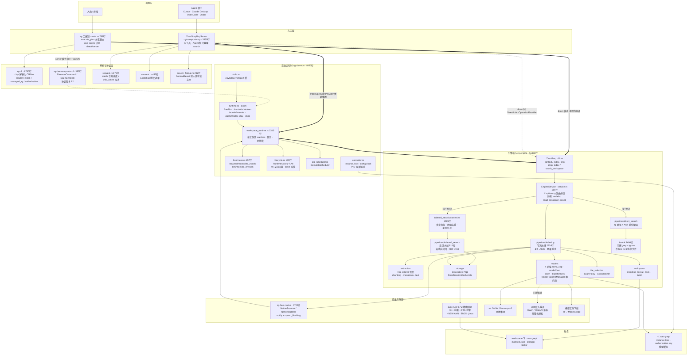
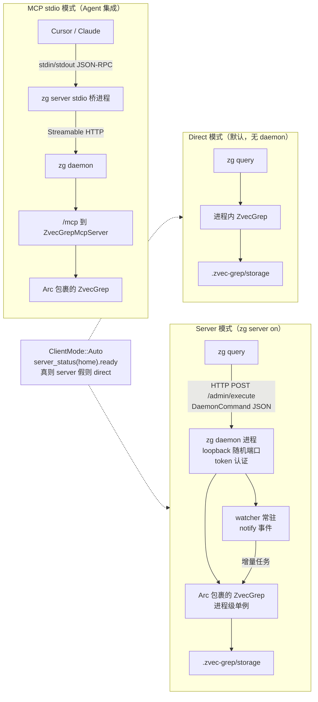
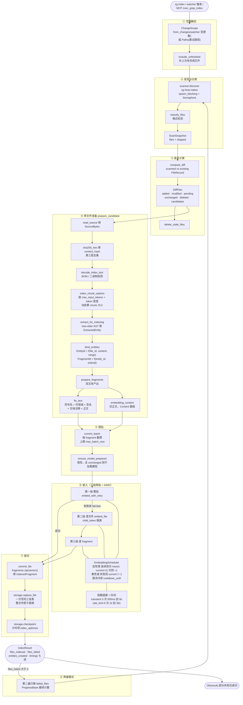
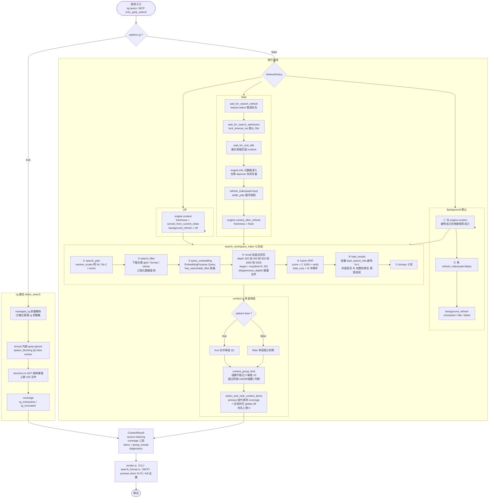
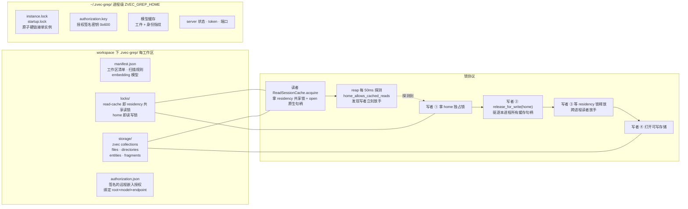

# zg 架构与数据流图集

本文用 Mermaid 图 + 表格描述 zvec-grep（zg）的整体架构、进程拓扑、读写两条数据流、磁盘布局与锁协议，并标注各环节的数据流量特征。

与 [ARCHITECTURE.md](./ARCHITECTURE.md) 的分工：那份文档记录**设计红线**（公开边界、禁止引入的抽象层、依赖规则），本文记录**可视化结构与数据流**。所有图中的行数、常量、文件路径均来自源码实测，核对基线为 `rust/crates/` 当前状态。

阅读顺序建议：图 1 建立整体印象 → 图 2 理解部署形态 → 图 3/图 4 分别走通写路径与读路径 → 图 5 理解并发正确性 → 附录查具体数值与源码位置。

---

## 目录

- [1. 主架构：分层与组件](#1-主架构分层与组件)
- [2. 进程拓扑与运行模式](#2-进程拓扑与运行模式)
- [3. 写路径：索引构建数据流](#3-写路径索引构建数据流)
- [4. 读路径：搜索数据流](#4-读路径搜索数据流)
- [5. 磁盘布局与锁拓扑](#5-磁盘布局与锁拓扑)
- [6. 数据形态演变](#6-数据形态演变)
- [7. 流量特征对比](#7-流量特征对比)
- [附录 A：crate 清单与规模](#附录-acrate-清单与规模)
- [附录 B：关键常量](#附录-b关键常量)
- [附录 C：源码位置索引](#附录-c源码位置索引)

---

## 1. 主架构：分层与组件



粗箭头（`==>`）表示进程内零拷贝调用，虚线（`-.->`）表示跨进程 JSON 传输或可选路径。

### 依赖倒置的关键点

`IndexOperationProvider` trait 定义在**下游**的 `zg-transport-mcp`，实现在**上游**的 `zg-daemon`：

```rust
// zg-transport-mcp/src/lib.rs:194  ← trait 定义
pub trait IndexOperationProvider: Send + Sync { ... }

// zg-daemon/src/workspace_runtime.rs:41  ← daemon 依赖 transport-mcp
use zg_transport_mcp::{IndexOperationProvider, ...};

// zg-daemon/src/workspace_runtime.rs:870  ← 实现在上游
impl IndexOperationProvider for WorkspaceRuntimeManager { ... }
```

依赖方向是 `zg-daemon → zg-transport-mcp`，但控制流方向相反。因此 transport-mcp 完全不知道 daemon 存在，它能自带 `DirectIndexOperationProvider` 独立工作。这是「同一套 MCP 工具在 direct 与 server 两种模式下行为一致」的机制基础。

---

## 2. 进程拓扑与运行模式



模式判定只有三行（`zg/src/main.rs:583`）：

```rust
ClientMode::Direct => Ok(false),
ClientMode::Server => Ok(true),
ClientMode::Auto   => Ok(zg_daemon::server_status(&home).await?.ready),
```

三种模式共享同一份 `.zvec-grep/` 索引格式和同一个引擎实现，差异只在「谁持有 `ZvecGrep` 实例」和「有没有 watcher 常驻」。

daemon 的 HTTP 路由（`zg-daemon/src/runtime.rs:106-110`）：

| 路由 | 方法 | 用途 |
| --- | --- | --- |
| `/healthz` | GET | 存活探测 |
| `/control/shutdown` | POST | 优雅关闭（需 token） |
| `/admin/execute` | POST | DaemonCommand 转发 |
| `/admin/index` | POST | SSE 流式索引进度 |
| `/mcp` | nest_service | rmcp StreamableHttpService |

---

## 3. 写路径：索引构建数据流



### 三层去重

写路径的核心目标是「尽可能少干活」，为此有三层过滤：

| 层 | 位置 | 判据 | 专治 |
| --- | --- | --- | --- |
| 一 | `ChangeScope` | watcher 变更集 / 重试路径收窄扫描范围 | 增量场景不扫全树 |
| 二 | `compute_diff` | mtime + size 对比已存 FileRecord | 未变文件 |
| 三 | `prepare_candidate` | 读入内容后比 sha256 content_hash | git checkout / touch / 格式化回改 |

第三层命中后返回 `PreparedCandidate::Unchanged`，调用方执行 `diff.resolve_modified_as_unchanged()` 修正统计，避免把跳过的工作谎报为 modified。

### 双文本产出

同一个 fragment 产出两份不同文本，这是构建路径最重要的设计：

```rust
struct PreparedFragment {
    model: String,
    entity_id: EntityId,
    fragment_id: FragmentId,
    embedding_content: Vec<Content>,   // 喂给向量模型：仅正文
    fts_text: String,                  // 喂给 BM25：元数据前置 + 正文
}
```

`lexical_text()` 构造 `fts_text` 时前置 AST 元数据：代码实体依次拼 `symbol_name`、`scope`、`signature`、`documentation`；Markdown 拼 `heading`、`scope`；然后才追加正文。图片降级为 `[image:png]` 占位符，表格递归展开单元格。

结果是符号名被放在 FTS 文本最前面，jieba 分词后成为高权重 token，这解释了为什么搜符号名时 BM25 一路特别准；同时语义向量不被冗长签名干扰。

### 惰性模型准备

`ensure_model_prepared(model_prepared: &mut bool)` 的所有调用点都在 `push_embedding` 之前，因此：

- 全部文件 unchanged 时从不 prepare，不下载不加载模型
- `model_prepared` 跨两遍 pass 传递，第二遍不重复 prepare

### 三级降级与 fail-fast

```
第一级 整批 embed_with_retry
   │ 失败且非 fail-fast
   ▼
第二级 逐文件 embed_file（child_token 隔离，一个文件失败不影响兄弟）
   │ 文件内批失败且非 fail-fast
   ▼
第三级 逐 fragment（定位并只牺牲坏的那一条）
   │ 仍失败
   ▼
EmbeddedFileOutcome::Failed 记录 reason，不中断整体
```

三级里每一级都检查 `error.should_fail_fast()`。为真时立刻向上抛不再降级，因为认证失败、模型不存在、维度不匹配这类错误缩小粒度重试毫无意义。

### 写路径数据流量

| 阶段 | 输入量 | 输出量 | 收敛特征 |
| --- | --- | --- | --- |
| 扫描 | 全工作区文件树 | DiscoveredFile 数组（路径 + size + mtime） | 首次 N，增量只有变更数 |
| 差异 | N 个 scanned + M 个 existing | 五分类，仅前三类进 candidates | 稳态下趋近 0 |
| 抽取 | 文件字节流 | Entity 数组（函数 / 类 / 章节级） | 1 文件产出数十实体 |
| 分块 | 实体内容 | PreparedFragment 数组 | 1 实体产出 1 到 k 片段 |
| 嵌入 | fragment 文本 | f32 向量数组 | 每片段 384 到 4096 个 float |
| 落盘 | 实体 + 片段 + 向量 | zvec collection | 向量占体积主导 |

流量瓶颈在嵌入阶段：这是唯一可能出网的环节，也是唯一需要 AIMD 拥塞控制与三级降级的地方。本地推理时为 GPU/CPU 密集，远程时为网络与配额密集。

---

## 4. 读路径：搜索数据流



### 路由分叉

分叉点在 `EngineService::context_with_refresh`（`service.rs:69`），由布尔开关 `options.rg` 显式决定：

```rust
if options.rg {
    self.direct_search.context(options).await
} else {
    indexed_search::service::context(&self.indexing, &self.models, &options, cache.as_ref(), refresh_completed).await
}
```

**不存在查询自动分类器，也没有任何 fallback 分支**。索引路径缺索引时直接报错提示 `zg --index or zg --rg`，不会自动降级到 rg。TypeScript 主实现与 Rust 侧行为一致（已双侧核对）。

### 三种刷新策略

| 策略 | 行为 | freshness | background_refresh |
| --- | --- | --- | --- |
| `Off` | 直接查现有索引 | `served_from_current_index` | `off` |
| `Background`（默认） | **先查后刷**，刷新排入调度器 | `served_from_current_index` | `scheduled` / `idle` / `failed` |
| `Wait` | 先完成增量刷新再查 | `fresh` | `idle` |

Background 之所以「先查后刷」，源码注释给了两个理由：如果先提交刷新，刷新会拿写锁，自己的查询就被锁在外面；而且查询成功本身证明这个操作没有在创建索引。

Wait 策略调的是 `context_after_refresh` 而非 `context`，语义是「调用方已完成刷新，不要再做磁盘新鲜度扫描」。正因为跳过了扫描才敢报 `fresh`。其保证边界是诚实的：只覆盖**已投递给 watcher 的事件**，操作系统层面还在飞的通知属于下一次刷新。

### 自适应召回

```rust
let target = (limit * RECALL_TARGET_FACTOR).max(RECALL_MIN_TARGET_CANDIDATES);
let mut previous_depth = 0;
let mut depth = RECALL_INITIAL_DEPTH;              // 200
loop {
    let mut saturated = false;
    for route in &recall_routes {
        let hits = /* search_fts 或 search_vector，topk = depth */;
        saturated |= hits.len() >= depth;
        add_recall_hits(candidates, &hits, &route.route, previous_depth)?;   // skip 增量合并
    }
    if candidates.len() >= target || !saturated || depth >= RECALL_MAX_DEPTH { return Ok(()); }
    previous_depth = depth;
    depth = (depth * RECALL_GROWTH_FACTOR).min(RECALL_MAX_DEPTH);
}
```

三个要点：

- `skip(previous_depth)` 只处理新区间，但 `rank = index + 1` 用**绝对位置**，保证 RRF 的 rank 语义正确
- `saturated` 是**跨路由 OR**，只要有任何一条路由打满就继续加深；全部未打满说明已穷尽
- 三个终止条件：候选达标 / 无路由打满 / 到达 2000 上限

### RRF 融合

```rust
candidate.score = candidate.recall.iter()
    .filter_map(|trace| trace.rank)
    .map(|rank| 1.0 / (RRF_K + rank_as_f64(rank)))
    .sum();

fused.sort_by(|left, right| {
    right.score.total_cmp(&left.score)
        .then_with(|| left.id.as_str().cmp(right.id.as_str()))
});
```

即 score(d) = Σ 1/(k + rank_r(d))，k = 60。

三个设计要点：

- **只用 rank，完全丢弃原始 score** —— BM25 分数与余弦相似度量纲不同，RRF 把它们压成「第几名」天然可比。这也是将来加第三路召回（如图检索）无需重新调权重的原因
- **`total_cmp` 而非 `partial_cmp`** —— f64 的 partial_cmp 遇 NaN 返回 None，而 sort_by 要求全序；total_cmp 提供 IEEE 754 total order
- **同分按 entity id 字典序** —— 保证完全确定性，对应 TS 侧的 localeCompare

候选去重粒度是**实体而非片段**：`candidates` 以 EntityId 为 key，`evidence` 保留全部命中片段，但 `recall` trace 按 `(path, route_id)` 只留最好的 rank。所以一个实体的 5 个片段命中同一路由时只贡献一个 RRF 项，而 5 个片段都会出现在最终 evidence 里。

### 读路径数据漏斗

```
zvec collection（可能数十万 fragment）
    │
    │ ④ 自适应召回：每路由 depth 200 起步，×2 加深至 2000
    ▼
候选池 target = max(limit × 5, 50) 约 50 个实体        收敛 1000 到 4000 倍
    │
    │ ⑤ RRF 融合
    ▼
全序候选列表
    │
    │ take(limit)，DEFAULT_LIMIT = 7
    ▼
7 个实体
    │
    │ ⑥ 批量 load_search_hits（一次调用，避免 N+1）
    ▼
ContextItem × 7（content + 三个 range + metadata + evidence）
    │
    │ 多查询组：context_group_limit 分摊 → 跨组去重 → 优先上限 6
    ▼
最终 items + group_results
    │
    │ 渲染：preview=short 每项不超过 10 行源码 + 7 行 outline
    ▼
输出文本（CLI 终端 / MCP ContentBlock::text）
```

召回阶段是唯一的大数据量环节，但它只传 ID + rank + score，不传内容。内容加载被推迟到 `take(limit)` 之后的第 ⑥ 阶段，只加载 7 个实体的正文。这是典型的**晚物化（late materialization）**优化。

---

## 5. 磁盘布局与锁拓扑



工作区 home 的解析见 `workspace/layout.rs`：常量 `ZVEC_GREP_DIRECTORY = ".zvec-grep"`，索引子目录 `WORKSPACE_INDEX_DIRECTORY = "storage"`，`find_nearest_workspace` 向上查找最近的 manifest。

### ReadSessionCache 的四道防线

`IndexStore::open()` 是昂贵的原生调用，daemon 会复用句柄（60 秒空闲超时）。复用就可能读到旧数据，为此有四道防线：

| 防线 | 机制 | 覆盖场景 |
| --- | --- | --- |
| 主动驱逐 | `release_for_write(home)` 遍历全局 `CACHES` 注册表 | 本进程要写 |
| 被动探测 | `reap` 里 `home_allows_cached_reads` | 别的进程要写 |
| 空闲超时 | `last_used` + 60 秒 | 长期不用的工作区 |
| 租约保护 | `Arc::strong_count(&session) > 1` 则跳过 | 正在查询的绝不回收 |

前两道保证正确性（绝不服务旧数据），后两道保证资源不泄漏。

### 两级锁分离

```rust
struct CacheInner { state: Mutex<CacheState>, ... }        // 第一级：只保护 HashMap 结构，纳秒级
struct SessionSlot { entry: Mutex<Option<CachedSession>> } // 第二级：保护单工作区的原生 open/close，可达百毫秒
```

因此工作区 A 的冷启动不会阻塞工作区 B 的缓存命中。`reap` 巡检时用 `try_lock` 而非 `lock`，正在冷启动的工作区直接跳过，下一轮（50ms 后）再看。

同样的锁纪律出现在 `retire_idle`：准入检查（`retired = true`）与历史清除（`forget_root`）共享 map 锁保证原子，而异步的 `close_watcher` 放在释放 map 锁之后执行。

### 后台回收线程为何必须是 OS 线程

```rust
// A native thread can release idle handles even when a synchronous writer
// is waiting for another process's cache on a single-threaded executor.
std::thread::Builder::new().name("index-read-cache".into()).spawn(...)
```

单线程 tokio executor 上，若某任务同步等待另一个进程释放缓存，executor 无法调度任何其他任务，包括本该回收句柄的 tokio 任务，于是死锁。独立 OS 线程不受 executor 状态影响，`REAP_INTERVAL = 50ms` 稳定巡检。

线程持 `Weak<CacheInner>`，`while let Some(inner) = weak.upgrade()` 在所有 Arc 释放后自然退出；`drop(inner)` 必须在 sleep 之前，否则 upgrade 永远成功导致线程与缓存都无法析构。

### 新鲜度证明的双计数器

`freshness.rs` 用两个正交维度判定新鲜：

| 维度 | 计数器 | 追踪 |
| --- | --- | --- |
| 增量 | `dirty_revision` / `indexed_revision` | watcher 投递的变更是否都索引了 |
| 全量 | `required_epoch` / `reconciled_epoch` | 是否做过一次完整磁盘核对 |

`is_reconciled()` 需四个条件全满足，任一不满足即报 `possibly_stale`：

```rust
self.watcher_active.load(Acquire)                                 // ① watcher 在跑
    && state.jobs.is_empty()                                       // ② 无在途任务
    && state.reconciled_epoch == state.required_epoch              // ③ 核对代次追上
    && self.indexed_revision.load(Acquire)
        == self.dirty_revision.load(Acquire)                       // ④ 变更全部索引
```

`require_reconciliation()` 只需 `required_epoch += 1` 就能让新鲜度失效。触发点：watcher 收到 Rescan、watcher 退出、任务提交被队列拒绝、任务失败、有文件失败、证明丢失。

`Proof` 保留任务**提交时**的 revision 与 epoch，完成时用 `fetch_max` 合并，因此一个提交时 revision=5、完成时 dirty_revision 已是 8 的任务只能把 indexed_revision 推到 5，不会错误清除新变更。

`complete_job` 要求 `files_failed == 0` 才承认新鲜 —— 写路径「部分失败仍返回 Ok」的语义在这里有了后果：任何文件失败都不缓存为新鲜。

只有 `reason == JobReason::Watch && full` 的任务才能满足 epoch，用户显式跑的 `zg index` 不算，因为它可能只索引了部分路径，无法证明整个工作区被核对过。

---

## 6. 数据形态演变

| # | 形态 | 所在层 | 关键字段 |
| --- | --- | --- | --- |
| 1 | `DiscoveredFile` | zg-host-native | relative_path · size_bytes · modified_epoch_ms |
| 2 | `ScannedFile` | indexing | + formats · detection_error |
| 3 | `IndexCandidate` | indexing | + kind(Added/Modified/Pending) · existing |
| 4 | `SourceBytes` 到 `Cow<str>` | indexing | 原始字节到解码文本，Full 范围零拷贝借用 |
| 5 | `ExtractedEntity` | extraction | content · source_range · fragments · metadata |
| 6 | `Entity` | domain | + EntityId = f(file_id, content, range) 内容寻址 |
| 7 | `PreparedFragment` | indexing | fts_text（元数据前置）· embedding_content（正文） |
| 8 | `Vec<f32>` | models | 384 到 4096 维向量 |
| 9 | `IndexedFragment` | storage | model · entity_id · fragment_id · fts_text · vector |
| 10 | zvec collection | zvec-rust | HNSW ANN 索引 + BM25 倒排（jieba 分词） |
| — | **读写分界** | — | — |
| 11 | `StorageSearchHit` | storage | document_id · entity_id · file_id · score · rank |
| 12 | `Candidate` | indexed_search | sources · recall(去重 trace) · evidence(全部) · score · rank |
| 13 | `SearchHit` | indexed_search | entity · file · evidence · matched_by · trace |
| 14 | `ContextItem` | api/context | 20 字段：content · range/excerpt_range/content_range · outline · container · query_groups · selection_reason |
| 15 | `ContextResult` | api/context | source · coverage 三态 · freshness · items · group_results · diagnostics |
| 16 | 文本 / JSON | render / search_format | CLI 终端输出 或 MCP ContentBlock::text |

### 三个 range 的区别

`ContextItem` 里有三个坐标字段，最容易混淆：

| 字段 | 指什么 |
| --- | --- |
| `range` | **实体**在源文件中的范围（比如整个函数） |
| `content_range` | **content 字段本身**的精确源坐标 |
| `excerpt_range` | 匹配片段在 content 内的范围（比如命中的那一行） |

`content_range` 是 daemon 协议 v12 新增的**必需**字段，旧 daemon 的回复缺少它会在反序列化时被拒，因此升级 CLI 时必须重启常驻 daemon。之所以不能靠数 content 行数推断：content 可能是实体的一部分（fragment 用字节偏移选取），也可能跨越非连续区域。

`ContentRange` 是 serde tagged enum（`tag = "kind"`），三个变体 `File` / `Text{6 字段}` / `Byte{2 字段}`。`last_line()` 靠 `end_byte_column == 0 && start_byte_offset < end_byte_offset` 判断结束行是否为排他的下一行行首并减 1，全程 `saturating_sub` 防下溢。

### ID 的内容寻址

`EntityId::new(file_id, &content, source_range)` 与 `FragmentId::new(&entity_id, ordinal)` 都是内容派生的，因此同一文件重复索引不产生新 ID —— 这是增量索引幂等性的基础。

---

## 7. 流量特征对比

| 维度 | 写路径（索引） | 读路径（搜索） |
| --- | --- | --- |
| 触发频率 | 首次全量，之后 watcher 增量 | 每次查询 |
| 数据量级 | O(文件数 × 片段数 × 向量维度) | O(召回深度 × 路由数)，但只传 ID + rank |
| 收敛比 | 无收敛，全量落盘 | 1000 到 4000 倍漏斗（数万 fragment 到 7 个 item） |
| 网络流量 | 远程嵌入时全部片段文本上行 + 向量下行；本地推理时零出网 | 远程嵌入时查询文本上行（几十字节）+ 向量下行；本地时零出网 |
| 磁盘 I/O | 重（读源文件 + 写 collection + checkpoint） | 轻（读会话缓存复用句柄，晚物化只读 7 个实体） |
| CPU / GPU | 重（tree-sitter 解析 + 嵌入推理） | 中（BM25 在 zvec 内、HNSW ANN、RRF 是纯算术） |
| 时延 | 秒到分钟 | 毫秒到秒 |
| 并发控制 | AIMD 自适应 + 攒批 + 两遍重试 | 读会话缓存 + writer-intent 锁 + 30s 超时 |
| 失败语义 | 部分失败仍返回 Ok | 全有或全无 |
| 隐私边界 | allow_remote / authorized_remote 签名授权；watcher 任务强制清洗 | 同左；MCP 侧 fts_only 可禁用向量检索 |

**隐私默认值**：文件、索引、模型全部留在本机。只有显式授权远程嵌入时才有数据出网，且授权绑定 `(workspace_root, model, endpoint)` 三元组并签名存储，改任何一个都需重新授权。签名密钥在 `~/.zvec-grep/authorization.key`（0o600）。

`watch_loop` 在提交后台任务前强制清洗一次性授权：

```rust
// One-operation consent must never authorize later watcher jobs.
options.allow_remote = false;
options.authorized_remote.clear();
```

否则用户的一次性授权会被 watcher 后台任务永久继承，构成隐私泄露。

---

## 附录 A：crate 清单与规模

| crate | 文件数 | 行数 | 职责 |
| --- | --- | --- | --- |
| `zg-storage` | 5 | 444 | 共享原语：SHA-256、原子文件替换、zvec collection 打开/创建 |
| `zg-engine` | 143 | 51498 | 核心：领域模型、文件选择、提取、嵌入、持久化、索引/搜索流水线 |
| `zg-host-native` | 9 | 3722 | 原生扫描器与会话式 watcher，通过 PathPolicy 解耦 |
| `zg-daemon-protocol` | 1 | 395 | 线协议 DTO，单文件 |
| `zg-daemon` | 13 | 8490 | 常驻进程：axum HTTP + MCP stdio 桥 + 单实例锁 + 工作区运行时 |
| `zg-transport-mcp` | 5 | 3812 | MCP Server，6 个 zvec_grep_* 工具 |
| `zg-cli` | 7 | 6780 | clap 解析为 CliPlan、渲染、Agent 安装、授权交互 |
| `zg` | 9 | 3968 | 生产二进制，src/main.rs 788 行 + 7 个集成测试 |
| `zg-testkit` | 4 | 190 | 兼容性夹具读取器 |
| `zg-knowledge` | 17 | 3939 | 知识库重写第一阶段，**不是生产二进制的依赖** |
| `zg-engine/macros` | — | — | proc-macro crate，`file_formats!` 编译期生成格式枚举 |

合计约 8.3 万行。workspace 配置：resolver 3、edition 2024、rust-version 1.98、`publish = false`、`unsafe_code = "forbid"`、clippy `all + pedantic` 且 `unwrap_used` / `todo` / `unimplemented` / `dbg_macro` 全部 deny。

实测代码卫生指标：

| 指标 | 数量 | 说明 |
| --- | --- | --- |
| `unsafe` 代码块 | 0 | 全仓仅 2 处 `unsafe` 字样，都在 extraction/code.rs 的测试字符串字面量里 |
| `.unwrap()` | 0 | 被 `clippy::unwrap_used = "deny"` 强制 |
| `.expect()` | 3168 | 生产代码里几乎为 0，集中在 `#[cfg(test)]` 模块（`expect_used` 是独立 lint，未被 deny） |
| `#[test]` | 517 | — |
| `#[tokio::test]` | 211 | — |
| `#[non_exhaustive]` 属性 | 0 | 搜到的 8 处 `finish_non_exhaustive()` 是 Debug builder 方法，用于日志脱敏 |

---

## 附录 B：关键常量

### 读路径（indexed_search/pipeline.rs）

| 常量 | 值 | 含义 |
| --- | --- | --- |
| `DEFAULT_LIMIT` | 7 | 未指定 limit 时返回的实体数 |
| `RRF_K` | 60.0 | RRF 融合的 k 参数 |
| `RECALL_INITIAL_DEPTH` | 200 | 召回起始 topk |
| `RECALL_MAX_DEPTH` | 2000 | 召回深度上限 |
| `RECALL_GROWTH_FACTOR` | 2 | 每轮加深倍数 |
| `RECALL_TARGET_FACTOR` | 5 | 目标候选数 = limit × 5 |
| `RECALL_MIN_TARGET_CANDIDATES` | 50 | 目标候选数下限 |

### 多查询组（indexed_search/context.rs）

| 常量 | 值 |
| --- | --- |
| `DEFAULT_CONTEXT_TOTAL_LIMIT` | 30 |
| `DEFAULT_CONTEXT_PRIORITY_LIMIT` | 6 |
| `CONTEXT_GROUP_RRF_K` | 60.0 |

### 写路径（indexing/pipeline.rs）

| 常量 | 值 |
| --- | --- |
| `MAX_SKIPPED_FILE_SAMPLES` | 20 |
| `MIN_DEFAULT_FILE_SIZE_BYTES` | 1 MiB |
| `EMBEDDING_TRANSIENT_MAX_RETRIES` | 3 |
| `EMBEDDING_RATE_LIMIT_MAX_RETRIES` | 6 |
| `EMBEDDING_TRANSIENT_RETRY_BASE_DELAY` / `MAX` | 500ms / 8s |
| `EMBEDDING_RATE_LIMIT_RETRY_BASE_DELAY` / `MAX` | 2s / 30s |
| `EMBEDDING_RETRY_JITTER_MILLIS` | 500 |
| `EMBEDDING_SUCCESS_STREAK_MIN` | 4 |

### 运行时与缓存

| 常量 | 值 | 位置 |
| --- | --- | --- |
| `REAP_INTERVAL` | 50ms | storage/read_session.rs |
| 读会话空闲超时 | 60s | service.rs `enable_read_session_cache` |
| 模型空闲过期 | 15 分钟 | models/runtime/manager |
| 模型缓存软容量 | 1（LRU 淘汰空闲） | models/runtime/manager |
| `DEFAULT_IDLE_TTL` | 4 小时 | workspace_runtime/lifecycle.rs |
| `MAINTENANCE_INTERVAL` | 1 分钟 | workspace_runtime/lifecycle.rs |
| `lock_timeout_ms` 默认 | 30 秒 | api/context.rs |
| 写者锁竞争重试窗口 | 1s / 50ms 间隔 | workspace_runtime.rs `ZvecGrepIndexExecutor` |
| rg 结构增强文件上限 | 100 | direct_search/structure.rs |

以上读路径常量与 TypeScript 主实现 `src/engine/pipeline/search/index.ts` 逐一对齐，测试名 `fuses_fts_and_vector_routes_with_main_compatible_rrf` 即锁死此对齐。

---

## 附录 C：源码位置索引

### 引擎入口与编排

| 内容 | 位置 |
| --- | --- |
| `ZvecGrep` 公开 API | `zg-engine/src/lib.rs:41-149`（struct 41、impl 46、Default 151） |
| `EngineService` 与 rg 路由分叉 | `zg-engine/src/service.rs:21-27`、`:69` |
| ContextOptions 35 字段 | `zg-engine/src/api/context.rs:50-109` |
| 两套过滤选项互斥校验 | `zg-engine/src/api/context.rs:112-137` |
| ContentRange 与半开区间处理 | `zg-engine/src/api/context.rs:541-597` |

### 读路径

| 内容 | 位置 |
| --- | --- |
| 七阶段主流程 | `indexed_search/pipeline.rs:167-242` |
| 自适应召回 | `indexed_search/pipeline.rs:338-381` |
| prefer_symbol 子路由 | `indexed_search/pipeline.rs:383-427` |
| 符号名启发式抽取 | `indexed_search/pipeline.rs:634-687` |
| RRF 融合 | `indexed_search/pipeline.rs:493-516` |
| 物化与两类校验 | `indexed_search/pipeline.rs:518-614` |
| 过滤器下推决策 | `indexed_search/pipeline.rs:689-748` |
| 多查询组与 fuse | `indexed_search/context.rs:141-158` |

### 写路径

| 内容 | 位置 |
| --- | --- |
| 总指挥与两遍重试 | `indexing/pipeline.rs:126-215` |
| 单遍流水线 | `indexing/pipeline.rs:362-471` |
| 攒批与生产者消费者循环 | `indexing/pipeline.rs:630-781` |
| 惰性模型准备 | `indexing/pipeline.rs:783-812` |
| 单文件转换 | `indexing/pipeline.rs:932-999` |
| 双文本产出 | `indexing/pipeline.rs:1025-1111` |
| 三级降级 | `indexing/pipeline.rs:1187-1418` |
| AIMD 调度器 | `indexing/pipeline.rs:1585-1726` |
| 重试分类与退避 | `indexing/pipeline.rs:1465-1547` |
| 原子提交 | `indexing/pipeline.rs:900-930` |

### 存储与并发

| 内容 | 位置 |
| --- | --- |
| 读会话缓存全貌 | `zg-engine/src/storage/read_session.rs`（284 行） |
| 后台回收线程 | `storage/read_session.rs:63-87` |
| 保守回收 reap | `storage/read_session.rs:176-216` |
| 写者主动驱逐 | `storage/read_session.rs:261-275` |
| 工作区目录布局 | `zg-engine/src/workspace/layout.rs:10-49` |
| 写者调用驱逐的两处 | `workspace/lock.rs:39`、`workspace/lock/wait.rs:84` |

### 常驻运行时

| 内容 | 位置 |
| --- | --- |
| Manager 与 Runtime 结构 | `zg-daemon/src/workspace_runtime.rs:50-77` |
| 三个适配器 | `zg-daemon/src/workspace_runtime.rs:181-240` |
| watch_loop | `zg-daemon/src/workspace_runtime.rs:1091-1170` |
| 三种刷新策略 | `zg-daemon/src/workspace_runtime.rs:900-1001` |
| 两层 wait 包装 | `zg-daemon/src/workspace_runtime.rs:1044-1072` |
| 新鲜度证明 | `zg-daemon/src/workspace_runtime/freshness.rs`（157 行） |
| RAII 守卫与空闲回收 | `zg-daemon/src/workspace_runtime/lifecycle.rs`（139 行） |
| axum 路由 | `zg-daemon/src/runtime.rs:106-110` |

### 协议边界

| 内容 | 位置 |
| --- | --- |
| IndexOperationProvider trait | `zg-transport-mcp/src/lib.rs:194-222` |
| Direct 实现 | `zg-transport-mcp/src/lib.rs:224-250` |
| 工具集构建与描述改写 | `zg-transport-mcp/src/lib.rs:303-336` |
| 六个工具 | `zg-transport-mcp/src/lib.rs:344-545` |
| 进度与取消 | `zg-transport-mcp/src/request.rs:13-60` |
| 输入上限常量 | `zg-transport-mcp/src/lib.rs:117-121` |

### 已知 parity gap

`SearchHitTrace` / `SearchFusionTrace` 的 `forced` 恒为 `false`、`reason` 恒为 `None`，即 TypeScript 侧的 `trackEntityId` / `forceTrackEntity` 强制追踪尚未在 Rust 侧实现。其余常量、RRF 公式、召回深度序列、去重粒度、确定性排序均已双侧核对一致。完整差距清单见 [RUST_MAIN_PARITY.md](./RUST_MAIN_PARITY.md)。

---

## 相关文档

- [ARCHITECTURE.md](./ARCHITECTURE.md) —— 设计红线与依赖规则
- [README.md](./README.md) —— 构建、安装、发布与行为契约
- [CONTRIBUTING.md](./CONTRIBUTING.md) —— 验证命令与引擎改动约定
- [RUST_MAIN_PARITY.md](./RUST_MAIN_PARITY.md) —— 与 TypeScript 主实现的差距清单
- [../docs/05-architecture.md](../docs/05-architecture.md) —— TypeScript 主实现的架构说明
